# NERV

[](pyproject.toml) [](CHANGELOG.md) [](LICENSE)

[English](README.md) · [简体中文](i18n/zh/README.md)

**NERV is a robot platform for Agents, connecting local execution to real devices and simulated worlds.** Bring an Agent that you already use; NERV provides projects, observations, bounded actions, policy execution, operator controls and a record of what happened.

NERV 0.9.1 introduces **Brain Core**, the internal identity and control module used by external Agents. It ships with NERV and contains no AI Agent, model provider, prompt loop or model credential manager. External Agents own reasoning and context; Runtime owns device drivers, ACT and gait policies, high-frequency control and stopping. Despite the version number, this is an architecture and compatibility change.

[Connect an Agent](guides/mcp.md) · [Architecture](guides/architecture.md) · [SO-101 setup](guides/so101-setup.md) · [Assets](guides/assets.md) · [Roadmap](ROADMAP.md)

This checkout is a **0.9.1 development checkout**, not a published release. The commands below install the latest public release; they do not fetch unpublished changes. Candidate 08 passed its Linux CPU software and installation checks, but its fixed shared-world two-G1 trial achieved 0/6 independently scored navigation successes, with three false arrival claims and no falls. Navigation qualification and physical SO-101 trials remain incomplete. See the [candidate findings](guides/brain-core-091.md#installed-candidate-findings). Go2 motion is blocked until a complete, verifiable deployment contract is available.

The completion revision now adds persistent World/Robot/Brain resources, bootstrap allocation and transactional G1 membership in source. Long-duration stable holding and three paired living-room rendezvous trials remain unqualified; this is not a new accepted candidate.

<div align="center">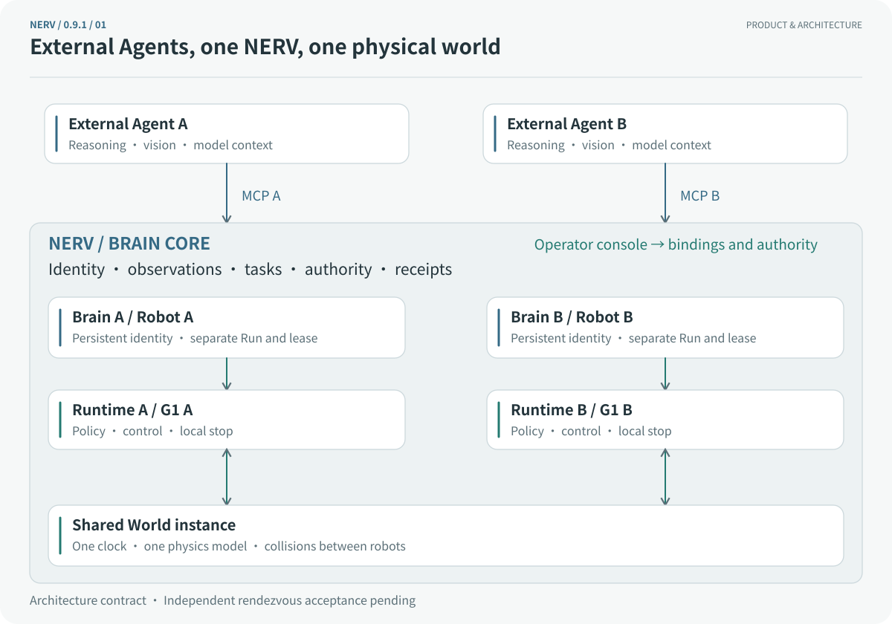</div>

## Install and start

The GitHub installer manages Python, uv and the prebuilt interface. End users do not need Node.js, a source checkout or a separate LeRobot terminal. Robot and simulation components are installed when needed.

Linux / macOS:

```bash
curl -fsSL https://github.com/Yanshi-Robotics/nerv/releases/latest/download/install.sh | sh
```

Windows PowerShell (experimental):

```powershell
irm https://github.com/Yanshi-Robotics/nerv/releases/latest/download/install.ps1 | iex
```

Open a new terminal and run `nerv`. The stable channel normally opens [http://127.0.0.1:8170](http://127.0.0.1:8170). Startup does not connect motors, authorize motion or resume interrupted tasks. Use `nerv serve --no-browser` for a terminal without a desktop; Ctrl+C requests orderly shutdown.

An explicitly installed preview uses `nerv preview` and its own channel data. Candidate installation and repository development are described in [CONTRIBUTING.md](CONTRIBUTING.md). Preview is not a second source checkout, and publishing code does not activate a local installation.

## Create a project and connect your Agent

1. Open the console. Install a simulation engine and World, or register a standard SO-101 from Robots.
2. Create a Sim or Real Project, choose its robot, world and execution structure. A NERV chat key is not required. Projects are stored under the current channel in `.nerv`.
3. Open Settings → Agent connections. Name the client, select the projects it may access and choose observation-only or task/action permissions.
4. Configure your MCP client to launch the bridge with its paired client ID. For a preview candidate:

   ```bash
   nerv mcp --channel preview --client CLIENT_ID
   ```

5. Start the world, inspect the selected control scheme and authorize motion separately. In the world controls, explicitly select the Agent that will receive control.

The bridge connects to an already running Host. It does not start another robot service or prepare hardware. The [MCP guide](guides/mcp.md) explains configuration, observation acknowledgements, request IDs and revocation. Codex, DeepSeek Harness and Claude Code are intended clients; their names are not a claim that every client/version has passed acceptance.

Without an Agent or model key, operators can still install resources, configure devices, view observations and use the permitted fixed-policy/manual controls. There is no internal visual decision service.

## Work in a world

The console groups **Projects, Robots, Worlds, Policies, Assets and Settings**. Robot details keep the SO-101 profile and local 3D preview. Associated projects show real or simulated workspaces; an available robot asset is not treated as a registered physical device.

Inside a project, the main camera or simulated scene fills the workbench. The slim tool rail opens observation, execution, device and manual controls. Monitor frames can become the main view, change size, dock or hide; their layout is saved with the project. Camera display choices do not alter the images delivered to an Agent.

Activity bubbles show attributed Agent statements, task state and execution feedback. They do not import an external conversation or turn an Agent statement into a verified robot result. Full history remains available from Activity. The console opens over the world; opening settings does not end its Run. Stop task and emergency stop remain separate operator controls.

<div align="center">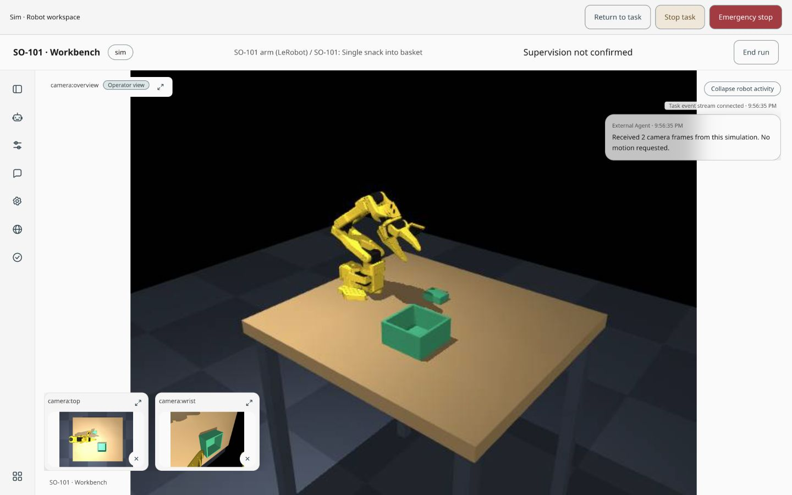</div>

Installed candidate: an unarmed SO-101 simulation Run with an observation-only MCP SDK client. The client received two camera images and published the displayed statement. This screenshot shows the workbench and event path; no model reasoning, robot motion or physical hardware test was involved.

## Projects, runs and task history

A Project is the saved configuration: robot, environment, execution structure, layout and revisions. A Run is one instance of that world or device workspace. A Task is a goal with frozen configuration and authority. An Execution is one policy or bounded action within that task.

<div align="center">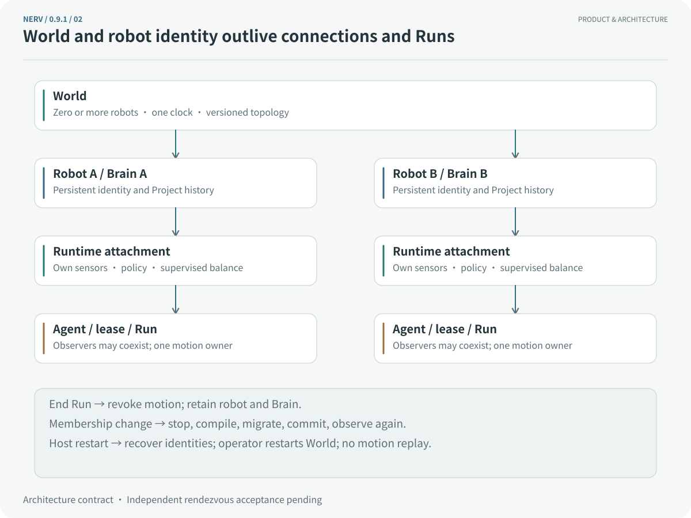</div>

Reopening a project restores configuration and history and can reattach to a valid active instance. Host restart interrupts old work and clears motion authority. It does not replay actions. New project revisions apply to future runs/tasks; current tasks keep their locked references. Official weights and assets are referenced rather than copied into every project.

The 0.9 migration preserves robot sessions as projects and historical runs. Plain chat remains a read-only archive rather than becoming a fictitious robot project. Migration snapshots and idempotent records support recovery; use the candidate's recovery instructions before rolling an older binary back over its data.

## Supervise and execute

External Agents may request bounded visual actions or compatible motion skills. Existing ACT execution and external skill selection remain separate execution routes. Drivers and inference stay in Runtime environments; model output cannot directly write motor registers.

<div align="center">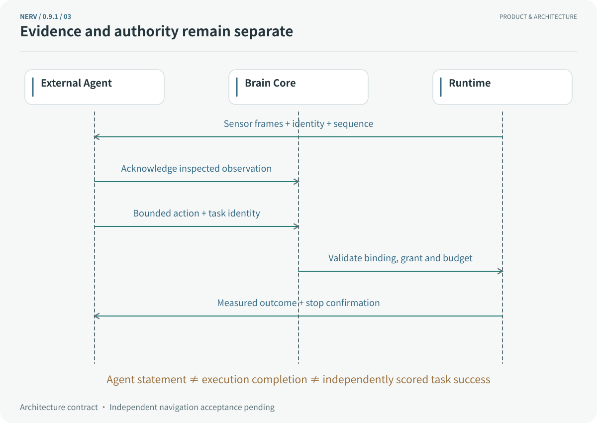</div>

Observation delivery, acknowledgement and task success are different facts. Images carry instance and frame information. The client must acknowledge a delivered observation before requesting motion, then observe again after a bounded action. Polling task state or keeping a transport open does not renew supervision. Local expiry handling requests a stop and reports whether it was confirmed.

Manual takeover revokes external motion control and waits for stopping to be confirmed. Agent observation can continue; resuming Agent control requires another explicit operator action. Stopping incoming requests, stopping a task, emergency stop, disconnect and torque release have distinct meanings. See [architecture and control](guides/architecture.md).

## Robots and current limits

| Route | Candidate scope | Acceptance limit |
|---|---|---|
| SO-101 Real | Guided setup, existing calibration checks, two cameras, ACT and bounded control | Physical connection and motion are operator-run; grasping reliability is not certified |
| SO-101 Sim | Three workbench scenes, camera observations and bounded controllers | Real ACT exports are not assumed compatible with simulation |
| G1 Sim | Managed scene and motion-policy path | Apartment and house movement, turn and supervision-stop checks passed; distance tracking remains imprecise |
| Go2 Sim | Adapter and capability work | Motion blocked by missing complete deployment contract; no public motion claim |
| Sim2Real / Real2Sim combinations | Reserved capability types | Not runnable in this release |
| Codex / DeepSeek Harness / Claude Code | Local stdio MCP bridge intended for these clients | Client/version-specific end-to-end acceptance still pending |

Standard SO-101 setup checks the computer, installs the runtime, identifies a follower, checks existing motor/calibration prerequisites, confirms cameras and saves configuration. Motor setup and new calibration remain external. Missing a calibration file means it was not found, not that the device has never been calibrated. Connecting may energize motors; follow the [SO-101 guide](guides/standard-so101.md).

Linux, Windows, WSL and macOS use separate dependency plans. Windows/WSL hardware passthrough and macOS camera support remain experimental. The current locked macOS Intel Host combination has no compatible package. The [installation guide](guides/github-install.md) and [acceptance guide](guides/release-acceptance.md) distinguish platform package checks, simulation, policy inference and hardware evidence.

## Assets, policies and managed environments

NERV keeps its managed Python environments, tools, cache and installed resources under `NERV_HOME`, normally `~/.nerv`. Host, LeRobot, simulation and build tools are isolated where dependencies differ. Stable and preview keep separate channel data. Neither installation nor updates modify a course environment or system Python; shared USB devices and GPUs still require coordinated ownership. See [environment management](guides/environments.md).

Simulation engines and scene packages update independently. The asset library supports official versions, data-only MJCF imports, personal copies, validation, saved revisions and export. Official updates do not overwrite a personal copy. Apartment, residence and robot assets remain part of NERV's simulation direction; [nerv-assets](https://github.com/Yanshi-Robotics/nerv-assets) holds their source. See [asset workflows](guides/assets.md).

Policies can come from local exports or pinned Hugging Face revisions. ACT retains its native processors and statistics; ONNX motion policies require an explicit deployment contract. A model's presence in an organization does not make it compatible or recommended. Unknown-origin historical weights remain excluded from new official distribution. See [motion policies](guides/motion-policies.md) and [publication rules](guides/policy-publishing.md).

Downloads use verified files, persistent records and bounded retry/resume. Installations stage and check environments before activation. [Recoverable installation](guides/recoverable-installation.md) explains the progress display and limits. To check a published update use `nerv update --check`; stop tasks and exit before `nerv update` or `nerv rollback`. Preview has separate update/rollback commands.

## Deployment direction

The local Agent-to-NERV workflow is the scope of 0.9.1. A future independent local Agent project can own model APIs, context and planning, then connect to NERV Brain Core and Runtime. Brain Core remains part of NERV. A future cloud Agent will need authenticated remote transport and device registration. Those products are not bundled with this candidate.

<div align="center">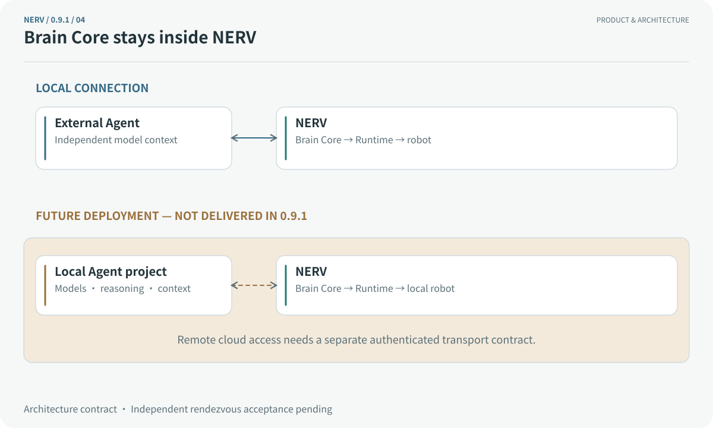</div>

The [roadmap](ROADMAP.md) retains Harness extensions, plugin management, Yanshifu integration and real/simulation transfer research. It states the next checks and completion criteria without promising dates.

## Worlds and earlier demonstrations

These recordings and screenshots are preserved from earlier versions. They show simulation assets and earlier interfaces, not completed 0.9.0 client acceptance. The G1 recording uses a head camera and gait skill to follow “Walk to the living room.” It plays at 2.5× speed; [original-speed MP4](assets/readme/media/walk-to-the-living-room.mp4).

<div align="center">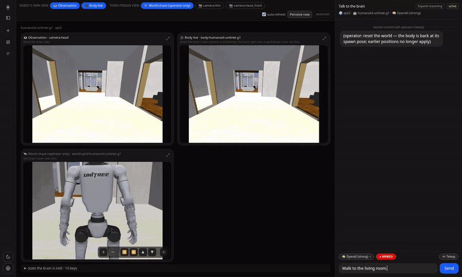</div>
<div align="center">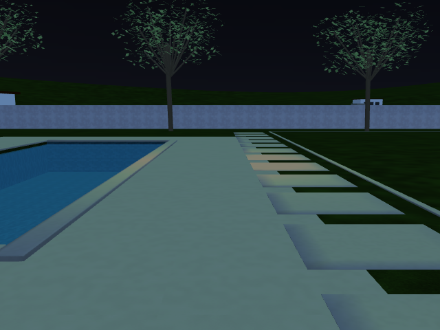</div>

<details>
<summary>Earlier interface and asset views</summary>
<div align="center">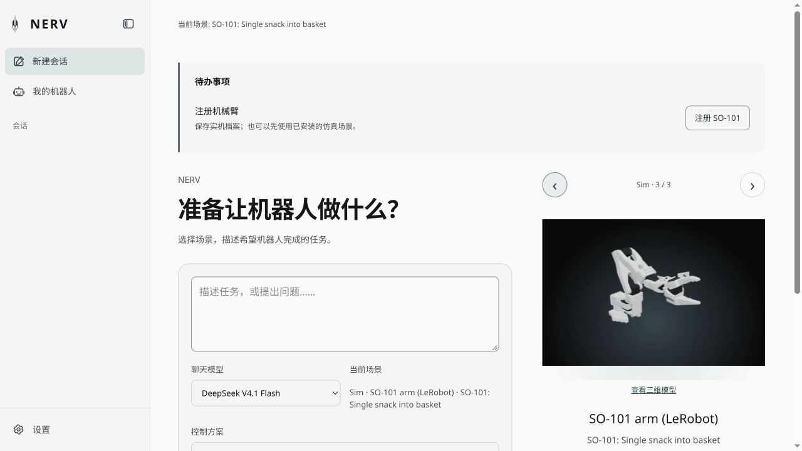</div>
<div align="center">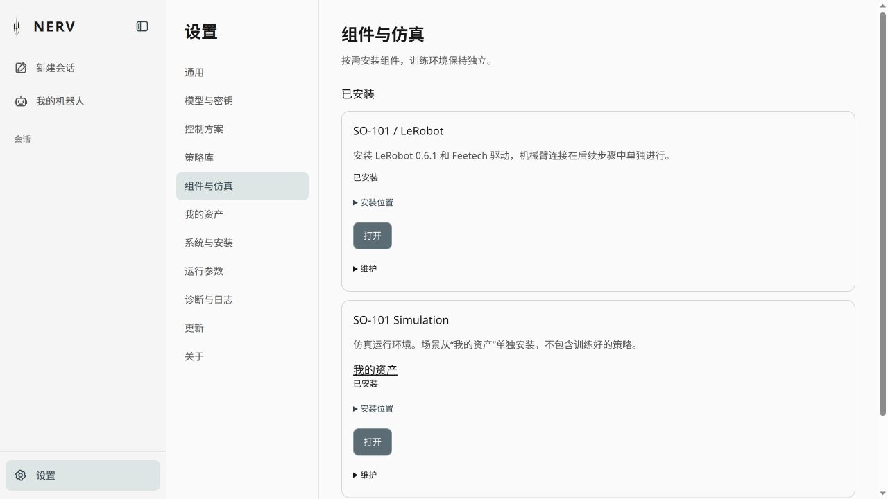</div>
<div align="center">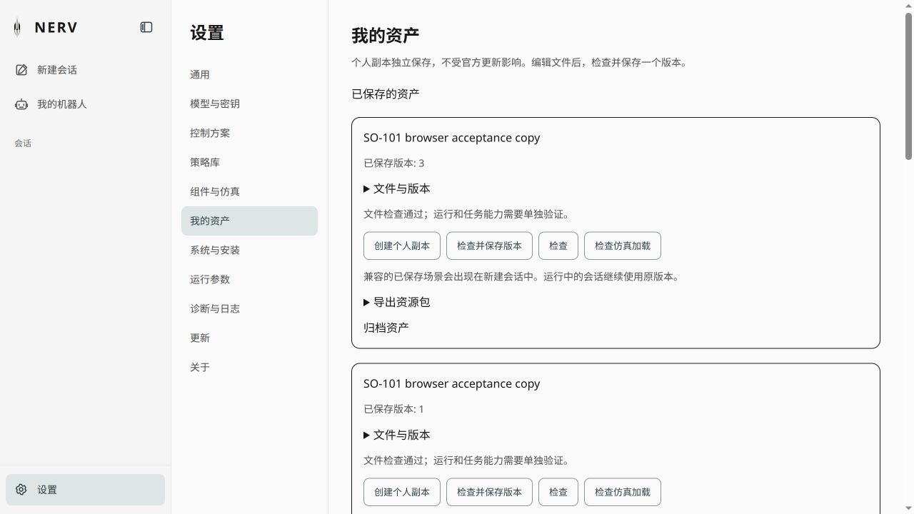</div>
<div align="center">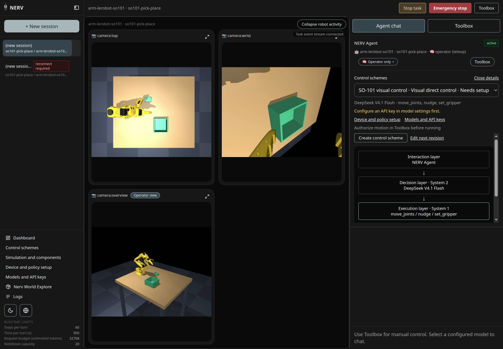</div>
<div align="center">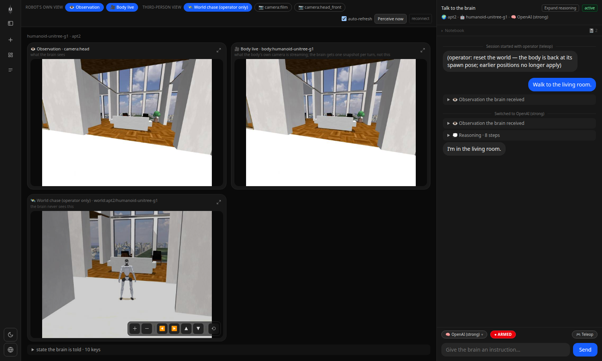</div>
<div align="center">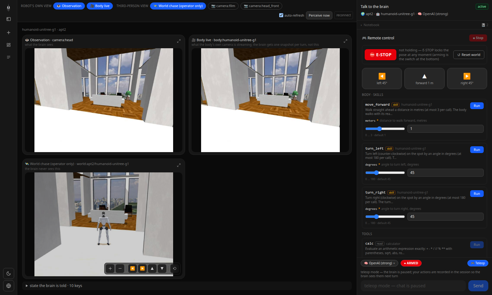</div>
<div align="center">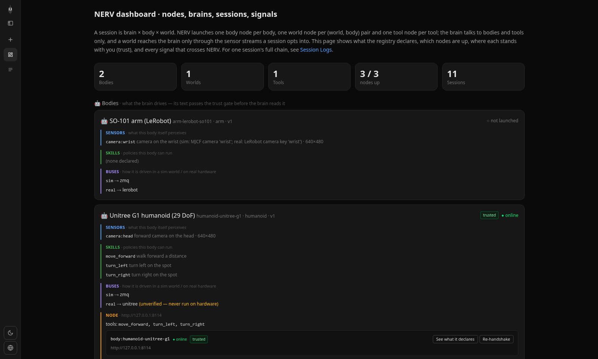</div>
<div align="center">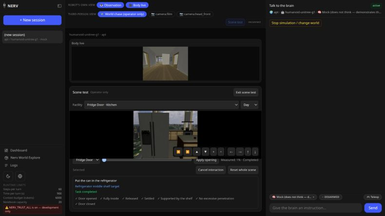</div>
<div align="center">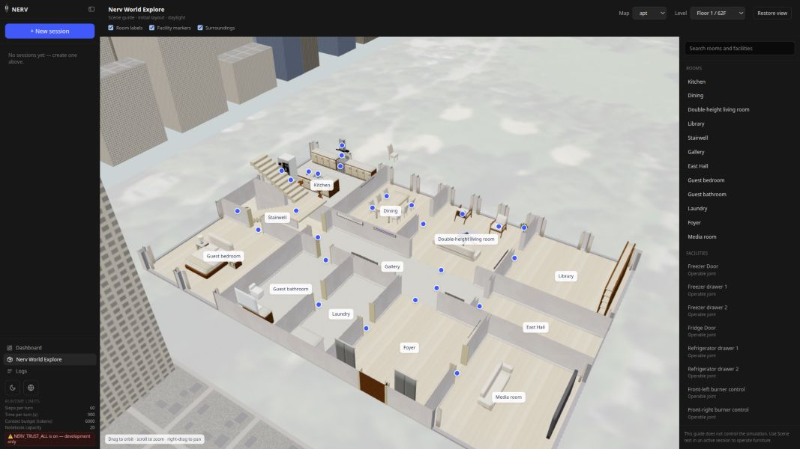</div>
</details>

The [world-library tools](nerv-assets/docs/explore/README.md) describe scene inspection. A flat-ground gait does not supply grasping, autonomous sitting or stair traversal. The candidate console below was captured from the local 0.9.0 build. It shows a saved project before a Run starts; it is not evidence of robot motion.

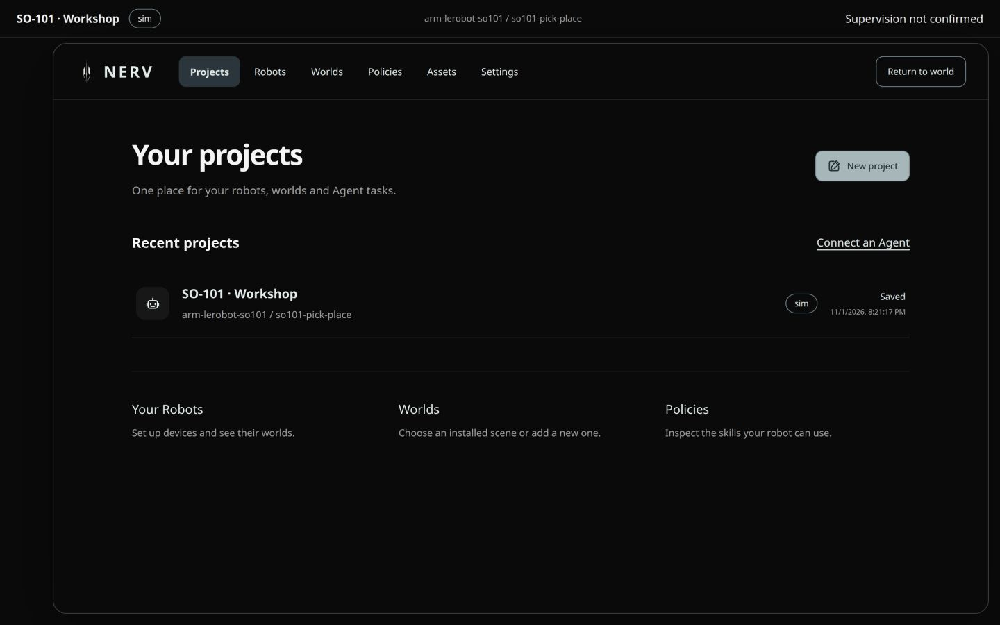

## Contribute

NERV is maintained by Yanshi Robotics. **DeepSeek Harness** and **Codex** contribute AI-assisted development; maintainers review changes and decide what to merge and release.

Read [CONTRIBUTING.md](CONTRIBUTING.md), the [Runtime SDK](packages/nerv-runtime-sdk/README.md) and [repository rules](AGENTS.md). Use [GitHub Issues](https://github.com/Yanshi-Robotics/nerv/issues) for reproducible problems and use cases. Remove credentials, personal data and private recordings from reports.

Application code uses the [MIT license](LICENSE). Robot assets, third-party packages and policy weights retain their own licenses. The [editable diagram sources](assets/readme/diagrams/README.md) accompany the figures above.
