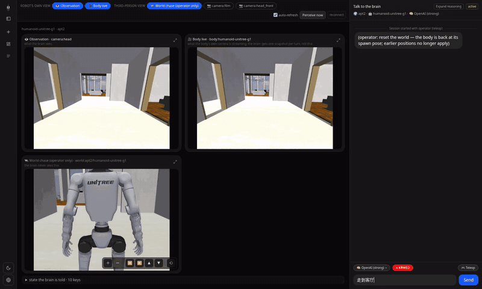
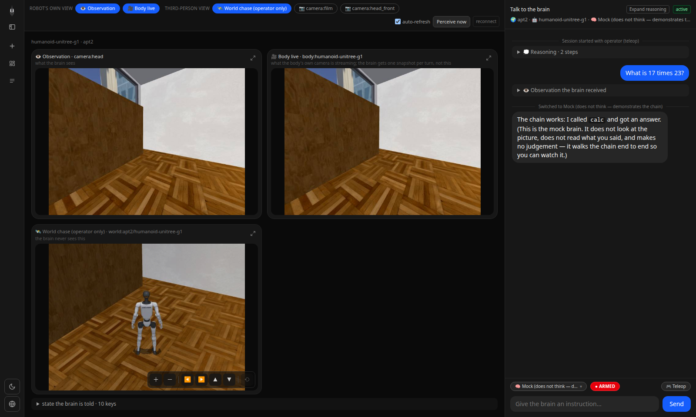
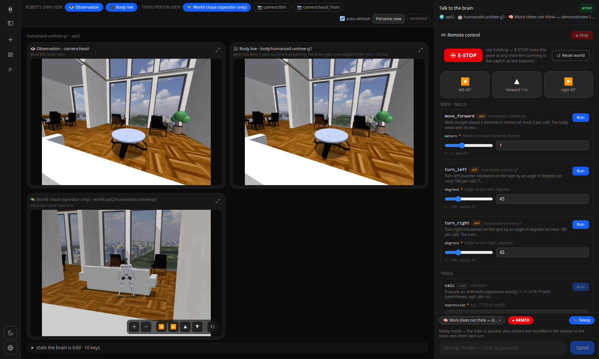
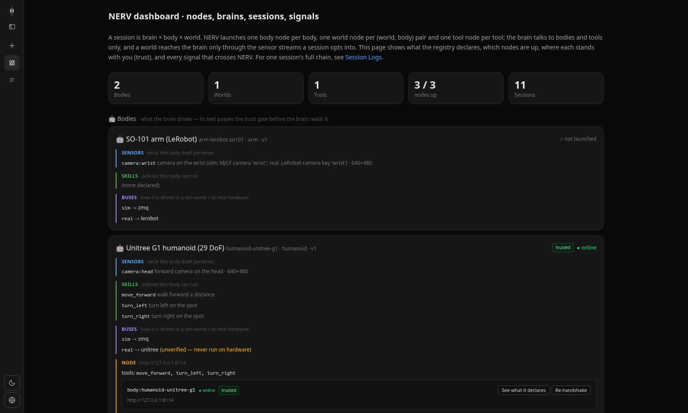
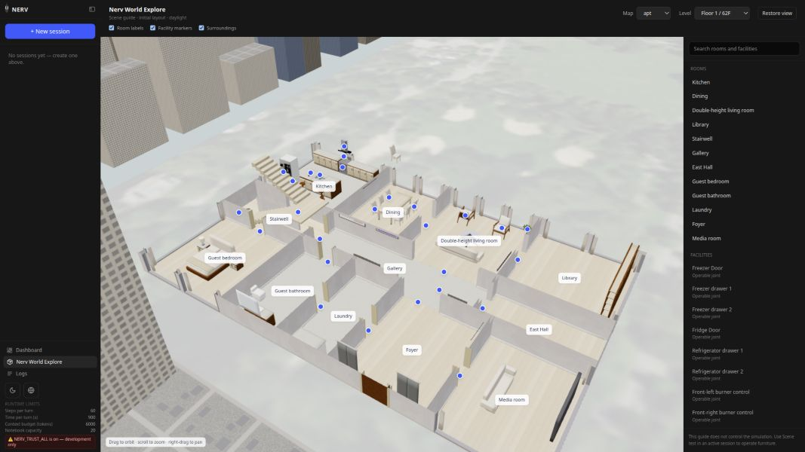
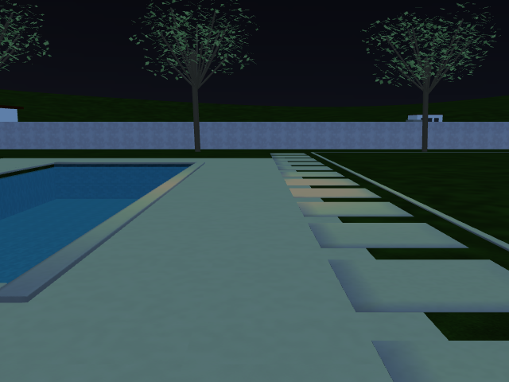

# NERV

[简体中文](docs/i18n/zh/README.md) · [Architecture](docs/architecture.md) · [Runtime SDK](docs/runtime-sdk.md) · [VLM configuration](docs/vlm.md)

NERV connects a visual language model to a robot, its sensors and its skills. The agent chooses tasks and tools; a local runtime owns the device and controls action dispatch.

## Overview

One NERV instance binds one robot and one environment. One active conversation holds control. Simulation and real hardware are separate startup choices, with independent preparation, calibration and verification. Changing environment requires ending the instance; running environment transitions are not implemented.

The agent can start a skill, observe while it runs, receive another instruction and cancel the execution. The operator prepares and enables the device and can apply an emergency stop. Releasing the stop returns to disarmed standby and invalidates the previous task.

## Architecture

The agent harness, robot runtime, world and tool services meet through NERV. The host routes observations and tool calls, checks control permissions and records session events. Robot drivers and policy inference run in a separate worker environment.

<div align="center"></div>

The harness composes session memory, context management and a model provider. A runtime declares its sensors and skills; the frontend reads those capabilities. Simulation and real hardware have separate environment bindings. Operator scene controls and simulator ground truth stay outside the agent's observation. See [the architecture guide](docs/architecture.md) for the module boundaries.

## Current status

The source version is **0.6.0**. The local `v0.5.0` tag preserves the audited baseline. Version 1.0.0 requires the physical acceptance described in [the acceptance guide](docs/acceptance.md).

| Connection | Current scope |
|---|---|
| SO-101 / real | LeRobot 0.6.1 adapter, top and wrist cameras, native ACT loading, managed execution and local watchdog. Physical acceptance pending. |
| G1 / simulation | Existing MuJoCo worlds and gait controller retained; rendered/control regression passed with CPU llvmpipe. |
| SO-101 / simulation; G1 / real | Disabled bindings retained as legacy configuration. No current execution support. |
| Visual models | Editable DeepSeek V4.1 Flash, GPT-6.1 Sol and GPT-6 Astra registrations. API and physical checks start unverified. |

The ACT artifact is the original 100,000-step `snack_into_box` checkpoint. The repository contains its file hashes and input contract, not its weights. Whether the policy itself returns to Rest remains a physical test requirement.

## Quick start

Use Python 3.11 or later and Node.js with npm. From this checkout:

```bash
python3 -m venv .venv
.venv/bin/python -m pip install -e ./packages/nerv-runtime-sdk -e '.[platform,dev]'
npm --prefix frontend ci
npm --prefix frontend run build:static
.venv/bin/nerv serve --port 8000
```

Open `http://localhost:8000`. The static frontend uses the same origin as the backend. For frontend development, use `npm --prefix frontend run dev` on the allocated port 8100.

Open **Visual models**, configure a provider key, and explicitly run API validation. Validation makes billable model requests; saving a key does not. Create a session after selecting its robot and environment. A conversation can also be created without a robot. No device is prepared automatically for a real binding.

Configuration values can be placed in `.env` using [.env.example](.env.example). Private model settings and keys live under `NERV_HOME` (default `~/.nerv`), outside the repository.

## Robot connections

For G1 simulation, initialize the existing worlds and policies submodules and install simulation dependencies:

```bash
git submodule update --init --recursive
.venv/bin/python -m pip install -e '.[sim]'
```

Select G1, Simulation and a compatible world. The existing world lifecycle, scene tools and operator views remain available. Operator scene state and third-person cameras do not enter the agent's observation.

For SO-101, create a separate adapter environment. Install only the SDK and LeRobot adapter there:

```bash
python3 -m venv .venv-lerobot
.venv-lerobot/bin/python -m pip install -e ./packages/nerv-runtime-sdk -e ./packages/nerv-runtime-lerobot
.venv-lerobot/bin/nerv-runtime discover
.venv-lerobot/bin/nerv-runtime check --provider lerobot0.6.1
```

Set `NERV_LEROBOT_PYTHON` to that interpreter, `SO101_PORT`, the calibrated `SO101_ID`, `SO101_CAMERA_CONFIG` to the native camera JSON and `SO101_ACT_CHECKPOINT` to the frozen checkpoint directory. Match the checkpoint's cameras, calibration, scene and starting pose. The profile's real binding remains `verified: false`; `NERV_ALLOW_UNVERIFIED=1` permits a supervised acceptance session and does not certify the device.

A person then selects Real hardware, creates the session, presses **Prepare device**, reviews the worker tool manifest, loads the policy and enables control. Manifest review is an initial setup step; individual agent tool calls need no approval. Preparation connects the device and may enable motor torque. Model loading sends no motion. Skill completion retains the device session. The emergency stop is a software pose hold, not a power cut or a substitute for a hardware stop.

## Demo and interface

The following recording and screenshots come from earlier G1 simulation versions. They show the existing navigation and operator views; the model controls and device preparation flow have changed in 0.6.

<div align="center"></div>

The instruction is “Walk to the living room.” The recording shows one unedited turn at 2.5× speed; an [original-speed MP4](docs/media/walk-to-the-living-room.mp4) is also available. The agent uses head-camera observations and calls the gait skill. The chase camera is an operator view.

<div align="center"></div>

The session view places sensors beside the conversation. Robot observations and operator-only views are separate. Runtime sensor names determine which camera streams appear.

<details>
<summary>More interface and simulation views</summary>

Teleoperation exposes the declared robot tools and emergency stop. The dashboard shows registry entries, node state and sessions.

<div align="center"></div>

<div align="center"></div>

World Explore displays apartment and house assets. Scene testing is an operator function: its task state and results do not enter agent observations or certify an autonomous robot skill. The G1's released flat-ground gait does not provide furniture manipulation, grasping, autonomous sitting or stair traversal.

<div align="center"></div>

<div align="center"></div>

<div align="center"></div>

The [world validation guide](docs/validation/world-explore/README.md) covers scene tests, G1 routes and browser views.

</details>

## Visual models

The registration panel exposes model ID, endpoint, protocol, image capability evidence, tool support, request limits and reasoning effort. Chat reads the same registry. Pure text models and Mock do not appear in the running catalogue or act as fallbacks.

Sol and Astra use Responses API for tools. DeepSeek has a separate Responses adapter. Effort options are model specific; an unspecified effort leaves the parameter out so the supplier applies its default. The last model and each model's effort are remembered. Changes are refused during an active turn or execution.

Image input, tool calls and continuation are tested independently with a non-robot probe. A changed endpoint, model configuration, effort or credential invalidates the matching readiness check. Registration and API readiness do not imply physical acceptance. See [VLM configuration](docs/vlm.md).

## Agent harness

<div align="center"></div>

The diagram follows a managed skill such as ACT. Starting it returns an execution ID; the agent continues observing and checking execution state while the worker runs its local policy. Direct read tools and existing G1 skills can return their result within the tool call. Local stop and supervision checks remain active while a model request is pending.

The default `AgentHarness` receives its host Link, model provider, context manager and compactor through replaceable boundaries. It never owns a robot object or loads ACT.

Each session has a durable append-only event journal, image assets, task and notes. Existing JSON sessions migrate once and retain a `.legacy` source snapshot. JSON snapshots can be rebuilt from the journal. History search and paginated reading are restricted to the current session.

The context budget covers instructions, notes, summary, complete tool groups, tools, current images, provider continuation and reserved output. Token and image budgets are estimates; actual usage is recorded when the supplier returns it. Compaction uses a separate request without tools, images or the main reasoning continuation. Failed compaction retains original events and pauses if the request cannot fit.

Restart marks unfinished runs as interrupted with unknown results. It restores history without replaying actions. A new instruction invalidates old model decisions while an already running skill remains locally supervised.

## Runtime plugins

`nerv-runtime-sdk` is an independently installable package with no NERV core, vendor SDK, PyTorch or MuJoCo dependency. A Python worker discovers `RuntimeProvider` entry points in its own environment. Non-Python services can implement the same HTTP/MCP protocol and register a URL.

`describe()` and imports must have no device or GPU side effects. Preparation, policy loading, enabling, execution, cancellation, emergency stop, release and disconnect are separate operations. Profiles, environment bindings and policy artifacts are separate contracts. The host does not inject its source tree or model credentials into workers.

Follow [the adapter guide](docs/runtime-sdk.md) for a registration example, protocol endpoints and read-only conformance checks.

## Validation

The original ACT checkpoint and native processors also passed CPU and queued CUDA tensor forward checks. These check numerical contracts, not manipulation performance.

The software suite uses explicit fixtures for model responses, cameras and actuators; these tests are not physical demonstrations. To install the adapter source for CPU lifecycle tests without installing its native driver in the host environment:

```bash
.venv/bin/python -m pip install --no-deps -e ./packages/nerv-runtime-lerobot
.venv/bin/python -m ruff check src packages tests
.venv/bin/python -m pytest tests --ignore=tests/test_humanoid_family.py --ignore=tests/test_world_bus.py --ignore=tests/test_e2e_apt.py -q
npm --prefix frontend run typecheck
npm --prefix frontend run check:locales
npm --prefix frontend run build:static
```

Full simulation verification adds the three omitted modules on a working MuJoCo rendering setup. Local GPU work follows the machine's queue policy. Real-device tests and paid API checks are explicit operator actions.

## Versioning

Version history is preserved. `src/nerv/_version.py` supplies the core package, CLI and HTTP version. The independently installable SDK and adapter declare matching development versions in their package metadata.

The release sequence is 0.5.0 baseline, 0.6.x development, then 1.0.0 after the frozen 10-trial integration acceptance and fault tests. There is no automatic release based on unit tests or model registration. See [CHANGELOG.md](CHANGELOG.md).

## Development

[AGENTS.md](AGENTS.md) describes repository boundaries. Public protocol references: [Brain](docs/nerv-brain.md), [Body](docs/nerv-body.md), [World](docs/nerv-world.md), [Operator](docs/nerv-operator.md), [Tool](docs/nerv-tool.md). Scenes and policies remain separate submodules.

NERV is distributed under the [MIT license](LICENSE). Vendor SDKs, model weights, training data and external assets retain their own licenses.
