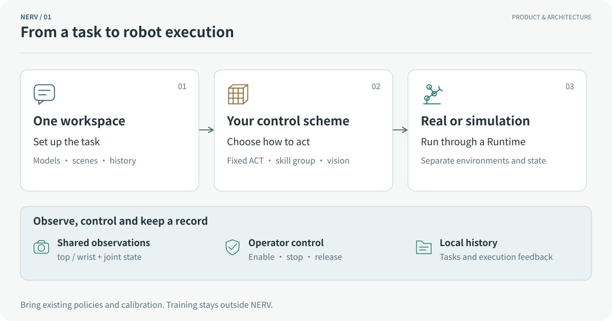
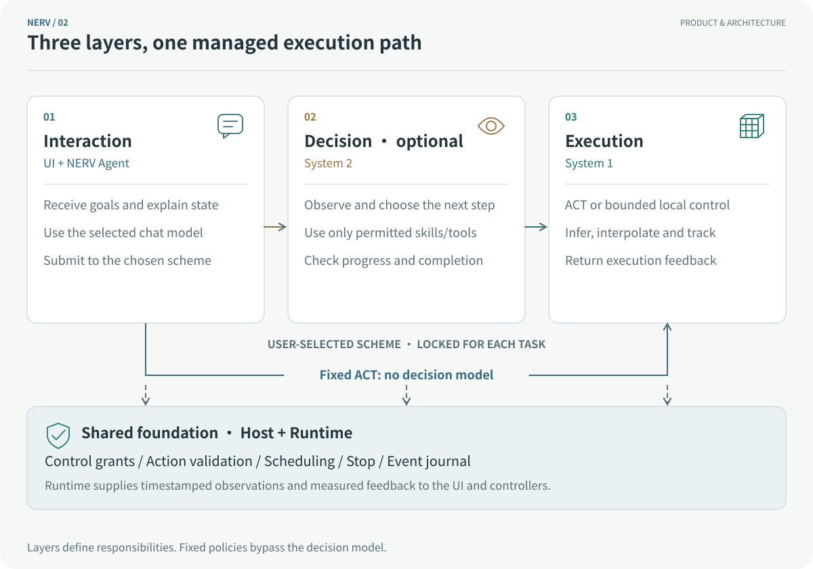
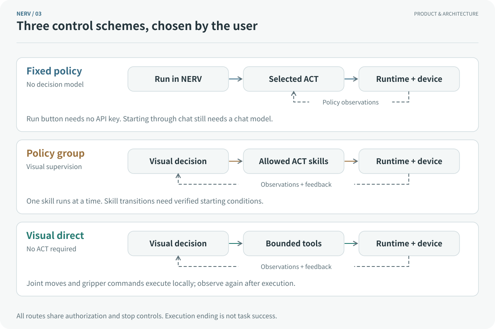

# NERV

[](pyproject.toml) [](guides/release-acceptance.md) [](LICENSE)

[](README.md) [](i18n/zh/README.md)

NERV is a local workspace for running robot tasks with trained policies and visual AI. Connect a robot or simulation, choose a control scheme, and follow its observations and execution history in one interface. Training and calibration stay in your existing tools.

[SO-101 setup](guides/standard-so101.md) · [Architecture](guides/architecture.md) · [Roadmap](ROADMAP.md) · [Changelog](CHANGELOG.md)

Version 0.8.5 is an unreleased local candidate. The installer below uses the published release, currently 0.8.1; it does not install this candidate. Real SO-101 acceptance and student onboarding trials remain pending.

<div align="center"></div>

## Quick install & start

The GitHub installer manages uv, Python 3.12 and the prebuilt interface. No Node.js, Git or frontend build is needed. It installs the host first; robot and simulation components are installed separately from Settings.

Linux/macOS:

```bash
curl -fsSL https://github.com/Yanshi-Robotics/nerv/releases/latest/download/install.sh | sh
```

Open a new terminal, then start:

```bash
nerv
```

Windows PowerShell (experimental):

```powershell
irm https://github.com/Yanshi-Robotics/nerv/releases/latest/download/install.ps1 | iex
```

Open a new PowerShell window, then start:

```powershell
nerv
```

NERV serves its interface and API at [http://127.0.0.1:8170](http://127.0.0.1:8170) and opens a browser after startup. Configuration, sessions, environments and caches live under `~/.nerv`. Startup does not connect motors, enable motion or resume tasks. Press Ctrl+C and wait for shutdown before restarting.

For remote terminals, use:

```bash
nerv serve --no-browser
```

Use `--port` to choose another port; NERV reports occupied ports without stopping other processes. See the [installation guide](guides/github-install.md) for diagnostics, extracted bundles and migration from older npm launchers.

The 0.8.4 candidate adds a six-step **Your Robots → SO-101 setup** flow: computer checks, runtime installation, arm discovery, prerequisite checks, camera confirmation and saving. Motor setup and calibration remain external; NERV only reads their current values after you click **Check device**. See [SO-101 setup](guides/so101-setup.md).

The 0.8.3 installation foundation provides **Settings → System and installation**, CPU/NVIDIA installation plans, complete dependency download totals and persistent pause/resume. See [recoverable installation](guides/recoverable-installation.md) for the candidate workflow and platform limits.

## What you can do

- **Connect a robot or simulation.** Save a standard SO-101's serial device, existing calibration and two cameras through guided setup. Install simulation as an optional module.
- **Bring your own policies.** Import an externally trained ACT, check compatibility, and load and run it inside NERV.
- **Choose the control route.** Use a fixed policy, let a visual model supervise allowed skills, or let it select bounded motion tools.
- **Keep chat and tasks separate.** The chat model handles interaction; the selected scheme controls the task. Stop reply and Stop task are independent actions.
- **Keep a local record.** Sessions, task events, settings and environments stay on your computer. Restart restores history without resuming motion.

## First use

New Session is the default page and the destination of the NERV logo. Your Robots manages the saved SO-101 profile; Sessions holds conversation history; Settings contains models, policies, components and preferences.

1. Choose a scene: register a standard SO-101 in Your Robots, or install the simulation component from Settings → Components and simulation, then choose a scene in My assets.
2. Configure a chat model in Settings → Models and API keys. Saving a new key requires an explicit test with a built-in image, which may incur a provider charge. It does not send a camera frame.
3. Select the robot or scene on New Session, describe the task, and start. A configured model and valid scene are required; missing items have direct setup links.
4. Choose a compatible control scheme and separately authorize motion before running a robot task.

Without an API key, you can still install components, configure the robot, view cameras and run fixed ACT through Your Robots → Device and fixed policy workspace. Policies are imported separately through Settings → Policy library.

<div align="center"></div>

The robot detail page opens a local 3D model; its display pose is an illustration, not measured telemetry. Names, pictures and connection settings persist across restarts; motion permission does not. About displays the running version, while Updates contains the explicit update check. Navigating between pages preserves the active workspace and stop controls. Runtime preference changes apply to new Agent turns, not work already in progress.

## Three-layer architecture

The layers describe responsibilities, not three mandatory models. System 2 labels the optional decision layer; System 1 labels local execution.

<div align="center"></div>

The host manages sessions, tasks and authorization. An independent Runtime owns the robot and cameras. SO-101 uses one native LeRobot instance, with all motion passing through `robot.send_action()`. ACT and bounded tool execution share the scheduler. Models cannot expand a scheme's allowed action set. See the [architecture guide](guides/architecture.md) for lifecycle and protocol details.

## Choose a control scheme

<div align="center"></div>

| Scheme | Decision layer | Execution layer | Requirements |
|---|---|---|---|
| Fixed policy | Disabled | One selected ACT | Compatible imported policy; no API key for the Run button |
| Policy group | Selected visual model | Allowed ACT skills, one at a time | Visual model credentials and compatible skills |
| Visual direct control | Selected visual model | Bounded joint moves, increments and gripper commands | Visual model credentials; no ACT required |

Fixed ACT runs inside NERV without a separate LeRobot terminal. A one-skill group adds visual supervision. Combining skills requires validated transitions; an unverified transition stops for operator intervention.

The chat panel keeps the chat model and control scheme separate, shows the scheme's decision model and skills, and provides View structure and current-task controls. Running tasks retain their scheme revision and model settings. Stop reply, Stop task and Emergency stop have separate purposes. Stop the task before changing schemes or moving between Sim and Real.

## Standard SO-101 and policy import

The real-device contract is one standard SO-101 follower with `lerobot[feetech]==0.6.1`: five arm joints in degrees, a gripper in LeRobot's 0–100 range, and `top`/`wrist` cameras at 640 × 480 and 30 FPS. Supply the serial device, robot ID, existing calibration and camera identities. A leader and custom joint mappings are unnecessary for inference.

Import an externally trained ACT directory in Settings → Policy library. NERV checks weights, native processors, statistics, camera inputs, six-channel shapes and fingerprints. Missing unit/order metadata requires a fixed standard declaration recorded as user-provided. Original exports remain read-only; changed files require rechecking. Use the no-motion policy check before enabling actions. [ONNX motion policy imports](guides/motion-policies.md) use a separate deployment contract and a selected, fixed revision. The [SO-101 guide](guides/standard-so101.md) covers registration, camera confirmation and recovery.

Connecting can enable motor torque. Ordinary disconnect retains torque; explicit release requires supporting the arm. Software stop requests a hold, which cannot be confirmed after communication loss. Requested targets, sent targets and measured positions are separate records. Neither an execution ending nor a model saying “done” proves task success. Operator acceptance of an unverified binding does not certify the hardware integration.

## Modules, updates and support

NERV uses uv-managed Python virtual environments under `~/.nerv`, separate from system Python and training environments. See [environment management and isolation](guides/environments.md) for directory ownership, preview profiles, updates and shared hardware limits.

The 0.8.5 candidate separates the simulation engine from scene packages. Install the engine in Components and simulation, then install pick-and-place, snack-sorting, Tower of Hanoi or the G1 residence from My assets. Scene packages do not include trained policies. Installed modules appear first in Settings; installation supports persistent progress, cancellation, integrity checks and retry. The 0.8.5 candidate adds [data-only MJCF asset import, personal copies and saved revisions](guides/assets.md); it does not execute third-party simulator code. Real and Sim bindings remain separate; matching tensor dimensions do not make a real ACT usable in simulation. See the [module and scheme contract](guides/control-schemes.md).

Stop tasks, disconnect devices and exit NERV before updating or rolling back. Check for a published update:

```bash
nerv update --check
```

Install it, then start NERV again:

```bash
nerv update
```

To return to the previous installation:

```bash
nerv rollback
```

Updates stage the host and installed official modules before activation. Failed updates restore prior pointers and configuration. Rollback preserves newer configuration copies; credentials and session histories stay current. See [update and recovery details](guides/github-install.md#user-data-and-updates).

| Platform or route | Status |
|---|---|
| Linux host and SO-101 simulation | Local software and installation checks; hardware acceptance is separate |
| SO-101 real / Linux | Adapter and guided setup implemented; physical grasping acceptance pending |
| Windows native / WSL2 | Experimental; USB, camera backends and passthrough need hardware testing |
| macOS Apple Silicon / Intel | Experimental; dependencies, camera permissions and CPU/MPS require validation |
| G1 simulation | Managed scene and local ONNX imports in the candidate; a compatible, checked motion policy is required |
| GR00T / SmolVLA | Planned policy backends; not delivered integrations |

The [acceptance guide](guides/release-acceptance.md) separates software, simulation, physical tasks and novice onboarding. The [roadmap](ROADMAP.md) describes future Harness extensions, plugin management and Yanshifu integration; these are outside 0.8.2.

## Demo and interface

The G1 recording below is from an earlier simulation version. It demonstrates head-camera observation and a gait skill; it is not SO-101 hardware evidence. The instruction is “Walk to the living room.” The unedited turn plays at 2.5× speed; an [original-speed MP4](assets/readme/media/walk-to-the-living-room.mp4) is available.

<div align="center"></div>

<details>
<summary>Earlier interface and world views</summary>

Control-scheme workspace from version 0.7:

<div align="center"></div>

These preserved screenshots show earlier navigation, observation and operator views. Model, task and device setup controls have since changed. The chase camera and World Explore views are operator-only.

<div align="center"></div>
<div align="center"></div>
<div align="center"></div>
<div align="center"></div>
<div align="center"></div>
<div align="center"></div>

The [world-library tools](worlds/docs/explore/README.md) cover scene testing and browser views. G1's flat-ground gait does not supply grasping, furniture manipulation, autonomous sitting or stair traversal. Scene checks do not certify autonomous task success.

</details>

## Contributors and development

NERV is maintained by Yanshi Robotics. AI development contributors include:

- **DeepSeek Harness** — AI-assisted development.
- **Codex** — AI-assisted development.

Maintainers review changes and decide what to merge and release.

See [CONTRIBUTING.md](CONTRIBUTING.md) for development setup and review guidance, the [Runtime SDK](packages/nerv-runtime-sdk/README.md) for extension interfaces, and [AGENTS.md](AGENTS.md) for repository conventions. Report problems through [GitHub Issues](https://github.com/Yanshi-Robotics/nerv/issues) with versions and sanitized reproduction steps; exclude credentials and private recordings.

NERV uses the [MIT license](LICENSE). External SDKs, robot models and media retain their own licenses. Official policy releases have separate license and source requirements; see [policy publication](guides/policy-publishing.md).
