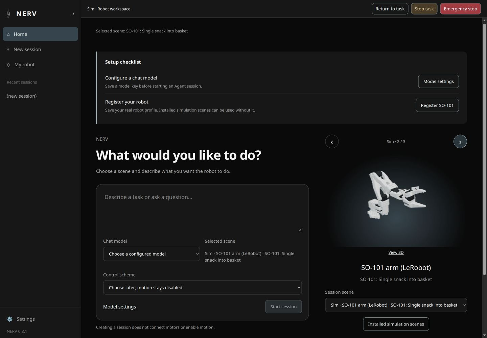
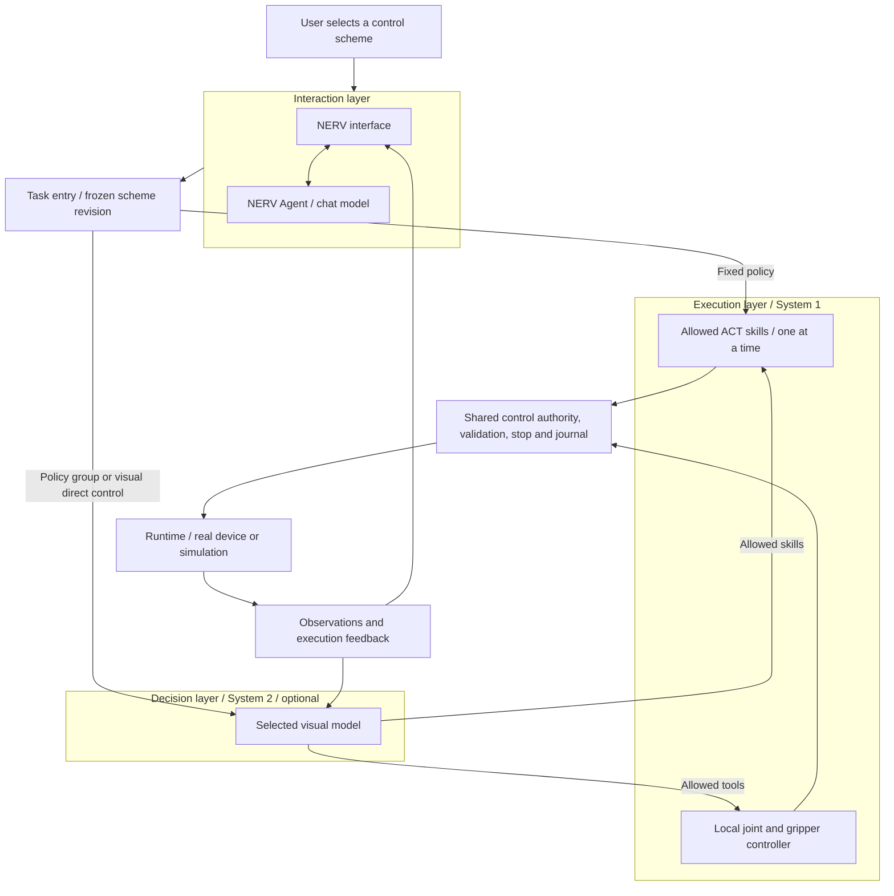

# NERV

[简体中文](i18n/zh/README.md) · [Quick install & start](#quick-install--start) · [SO-101 setup](guides/standard-so101.md) · [Architecture](guides/architecture.md) · [Runtime SDK](packages/nerv-runtime-sdk/README.md)

NERV connects conversation, task decisions and local robot execution. Choose a control scheme, give it a task, and see what the robot actually did. Use a trained ACT policy, let a visual model select and supervise allowed skills, or use visual decisions with bounded joint and gripper tools.

**0.8.1 is a development release for testing.** Install it from GitHub Releases or use `nerv update` from an existing release installation. SO-101 physical acceptance and student onboarding trials are pending. NERV uses externally trained policies and existing calibration; it does not train or calibrate robots.

## Quick install & start

The release installer manages uv, Python 3.12 and the prebuilt interface. Students do not need Node.js, Git or a frontend build. The default installation contains the host only; install SO-101 and simulation components from the interface when needed.

Linux/macOS:

```bash
curl -fsSL https://github.com/Yanshi-Robotics/nerv/releases/latest/download/install.sh | sh
```

Windows PowerShell (experimental; not yet hardware validated):

```powershell
irm https://github.com/Yanshi-Robotics/nerv/releases/latest/download/install.ps1 | iex
```

Open a new terminal, then start:

```bash
nerv
```

The server opens your browser after becoming ready at [http://127.0.0.1:8170](http://127.0.0.1:8170). It serves the interface and API together. Ctrl+C exits. An occupied port produces an error; NERV does not kill another process or silently change ports.

```bash
nerv serve --no-browser
```

```bash
nerv serve --port 8171
```

```bash
nerv doctor
```

Normal use stores configuration, sessions, installation environments and caches in `~/.nerv`. `NERV_HOME` is an optional override for isolated tests. Starting NERV never connects motors, enables motion or resumes an old task.

To update, exit the running server, then run `nerv update --check`, `nerv update` and `nerv`. The [installation guide](guides/github-install.md) covers rollback, extracted bundles and migration from older npm launchers.

## First use

Every new Agent session requires a **configured chat model and a robot scene**. Use the left and right arrows on the home card, or its scene selector, to choose a registered real robot or an installed simulation scene. The card and task input share the same selection; the displayed robot and scene are used when you start the session. Conversation-only creation is no longer available, including through the API and CLI. Existing conversation history remains readable. Opening the home page or Settings makes no model request. Registering a new key requires an explicit image test; the interface explains the request before sending it.

Home appears above New session in the sidebar. If a model or real robot profile is missing, the home checklist links directly to the relevant setup page. An installed simulation can be used without registering real hardware. Choosing a scene never connects motors or grants motion authority.

**My robot** manages one standard SO-101 follower. Give it a name and optional picture, then follow runtime installation, serial device selection, existing calibration and camera confirmation. Save the configuration and connect separately. Changing the display name does not change its LeRobot calibration ID. Existing saved profiles appear without repeating registration. A connection can enable motor torque; motion authorization remains a separate operator action.

Without a key, you can still install components, register the robot, view cameras and run a fixed ACT from **My robot → Device and fixed policy workspace**. Import policies in **Settings → Policy library**; policy import is not part of registration. Fixed ACT runs inside NERV, using the same task records and stop controls as model-driven tasks.

For simulation, open **Settings → Components and simulation**. Installed components appear first, followed by installation progress and available modules. Install **SO-101 Simulation** and open its scene explorer, or choose a simulation scene when creating a chat session. The three presets are pick and place, snack sorting and Tower of Hanoi; they include local controllers, not trained task policies.

<div align="center"></div>

### Settings and saved preferences

Settings groups general preferences, models, control schemes, policies, components, runtime parameters, diagnostics and updates. Device ports, calibration and cameras remain in My robot. Home and Settings share the same state; navigating between them does not cancel a robot task. Return, stop and emergency-stop controls remain visible while a robot workspace is active.

The four runtime parameters apply to **new Agent turns**. Environment configuration takes precedence and locks the affected field. Running turns and robot tasks retain their limits. Robot names, processed pictures and preferences are stored under `~/.nerv/devices`; update snapshots include them. Rollback preserves newer configuration in the recovery directory reported by the command.

The optional SO-101 viewer loads its model and decoder locally. Its display pose is an illustration, not measured telemetry. User images are size-checked, cropped to a square and re-encoded without metadata.

## Three-layer architecture

The layers describe responsibilities, not three mandatory models. System 2 and System 1 are auxiliary terms for the optional decision layer and the execution layer.



The host manages sessions, tasks and authorization. An independent worker owns the device and cameras. For SO-101 it uses one native LeRobot instance; all motion passes through `robot.send_action()`. ACT inference and bounded tool execution share the same scheduler. Neither the Agent nor the decision model can expand the selected action set.

## Choose a control scheme

| Scheme | Decision layer | Execution layer | Requirements |
|---|---|---|---|
| Fixed policy | Disabled | One selected ACT | Compatible imported policy; no API key for the Run button |
| Policy group | Selected visual model | One or more allowed ACT skills, sequentially | Visual model credentials and compatible skills |
| Visual direct control | Selected visual model | Bounded joint moves, increments and gripper commands | Visual model credentials; no ACT required |

Fixed ACT runs entirely inside NERV. You do not launch a LeRobot policy in another terminal. One-skill policy groups provide visual supervision of that skill. Unverified transitions between different skills stop for operator intervention; listing several ACT policies does not establish that they compose reliably.

The right chat panel shows the **chat model**, **control scheme**, its actual decision model and execution skills, **View structure**, and the current task. Fixed schemes expose **Run selected policy**. Chat replies and robot tasks have separate cancellation. Changing the chat model does not replace a running task's model or scheme. Editing a scheme creates a new revision; running tasks keep their original configuration.

On first use, review and allow the runtime's capabilities from the scheme area. This makes its skills available for selection; motion still requires separate authorization. Missing credentials remain visible with a direct link to model settings.

<div align="center"></div>

**Stop reply**, **Stop task** and **Emergency stop** have separate purposes. Robot stop remains available outside the model conversation. Stop and confirm termination before switching schemes or between Sim and Real. Runtime protocol 3 requires an expiring action allowlist and control generation; older workers cannot silently execute unrestricted tasks.

## Standard SO-101 and policy import

The real-device product is one standard SO-101 follower with `lerobot[feetech]==0.6.1`. Five arm joints use degrees, the gripper uses LeRobot's 0–100 range, and cameras are `top` and `wrist` at 640 × 480 and 30 FPS. A leader is unnecessary for inference. Students supply connection details, calibration and their trained policy, without joint mappings.

Import an ACT export through **Device and policy setup**. NERV checks weights, native processors and statistics, camera inputs, six-channel shapes and file fingerprints. A fixed standard declaration records units/order as user-declared when the training export cannot establish them. Load checks do not move hardware. After connecting, use **Check policy without motion** before enabling actions. Original exports remain read-only; changed files require another import/check.

Ordinary disconnect retains torque. Explicit torque release requires supporting the arm. Software stop requests a hold; communication loss cannot confirm that it happened. Requested targets, targets actually sent by LeRobot, and measured positions are recorded separately. An execution ending or a model saying “done” is not independent proof of task success.

See the [SO-101 guide](guides/standard-so101.md) for discovery, saved profiles, calibration, camera handoff and recovery. Unverified real bindings use an explicit operator acceptance checkbox; this does not certify the hardware integration.

## Modules, updates and support

**Models and API keys** uses a short select → key → test-and-save flow. The test sends one built-in image request and may be billed by the provider. It does not upload a live camera image. Keys are excluded from journals and diagnostics. Conversation and decision models are chosen independently.

Module installation has persistent progress, cancellation, checksum verification and retry. Arbitrary simulator imports are not exposed in this release. The [module and scheme contract](guides/control-schemes.md) documents extension boundaries. SO-101 real and simulation bindings remain separate; a real ACT does not become simulation-compatible merely because its tensor dimensions match.

```bash
nerv update --check
```

```bash
nerv update
```

```bash
nerv rollback
```

Stop tasks, disconnect devices and exit NERV before updating or rolling back. The new host and all installed official modules are staged and checked before activation. Failed updates restore the previous configuration and environment pointers. Rollback restores the coordinated set, preserves newer configuration copies, and keeps credentials and event histories current. The [installation guide](guides/github-install.md) explains this boundary and recovery.

| Platform or route | Status |
|---|---|
| Linux host and SO-101 simulation | Software candidate; local installation and regression checks are separate from hardware acceptance |
| SO-101 real / Linux | Adapter and guided setup implemented; physical grasping acceptance pending |
| Windows native / WSL2 | Experimental; USB, camera backends and passthrough require hardware testing |
| macOS Apple Silicon / Intel | Experimental; dependencies, camera permissions and CPU/MPS each require validation |
| G1 simulation | Existing source workflow retained for regression; not a one-click student module |
| GR00T / SmolVLA | Future policy backends; not delivered integrations |

The [release acceptance guide](guides/release-acceptance.md) separates software, simulation, real ACT, visual supervision, direct visual control and novice onboarding. No simulator task result or mock test substitutes for a physical grasp.

## Demo and interface

The G1 recording below is from an earlier simulation version. It demonstrates head-camera observation and a gait skill; it is not SO-101 hardware evidence. The instruction is “Walk to the living room.” The unedited turn plays at 2.5× speed; an [original-speed MP4](assets/readme/media/walk-to-the-living-room.mp4) is available.

<div align="center"></div>

<details>
<summary>Earlier interface and world views</summary>

The model, task and device setup controls have changed in 0.7. These preserved screenshots show earlier navigation, observation and operator views. The chase camera and World Explore views are operator-only.

<div align="center"></div>
<div align="center"></div>
<div align="center"></div>
<div align="center"></div>
<div align="center"></div>
<div align="center"></div>

The [world-library tools](worlds/docs/explore/README.md) cover scene testing and browser views. G1's flat-ground gait does not supply grasping, furniture manipulation, autonomous sitting or stair traversal. Scene checks do not certify autonomous task success.

</details>

## Extend and contribute

The [Runtime SDK](packages/nerv-runtime-sdk/README.md) provides versioned discovery, lifecycle and bounded dispatch. Device SDKs stay in workers; policy backends produce candidate targets without owning hardware. See [CONTRIBUTING.md](CONTRIBUTING.md), [AGENTS.md](AGENTS.md) and [CHANGELOG.md](CHANGELOG.md).

Report versions and sanitized reproduction steps. Do not include keys, unreviewed camera frames or private configuration archives. NERV uses the [MIT license](LICENSE); SDKs, models and external assets retain their own licenses.
