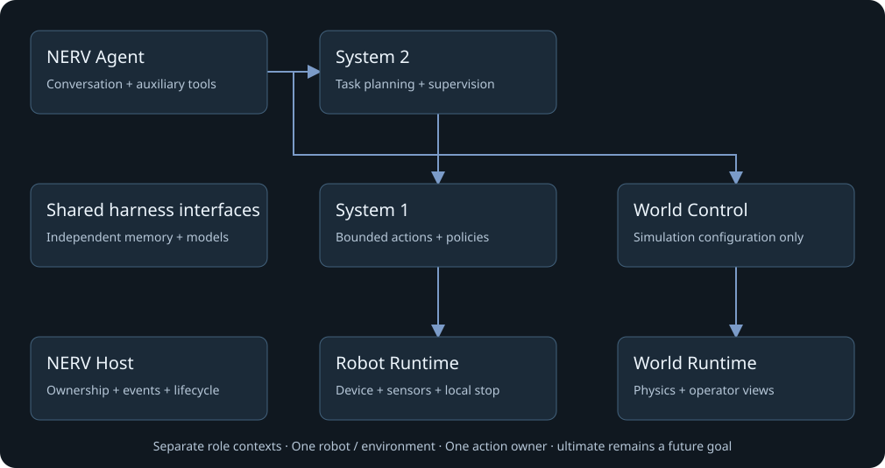

# NERV

[简体中文](i18n/zh/README.md) · [Architecture](#architecture) · [Runtime SDK](#runtime-plugins) · [VLM configuration](#visual-models)

NERV connects a visual language model to a robot, its sensors and its skills. The Agent handles conversation and delegates goals to System 2; a local runtime owns the device and controls action dispatch.

## Overview

One NERV instance binds one robot and one environment. One active conversation holds control. Simulation and real hardware are separate startup choices, with independent preparation, calibration and verification. Changing environment requires ending the instance; running environment transitions are not implemented.

NERV Agent handles conversation while an independent System 2 controller observes, plans and supervises robot execution. Ordinary messages leave the task running; explicit updates and cancellation go through the task controller. The operator prepares and enables the device and can apply an emergency stop. Releasing the stop returns to disarmed standby and invalidates the previous task.

## Architecture

NERV Agent manages conversation and delegates robot goals to System 2. System 1 executes bounded actions and policies; Robot Runtime owns devices and sensors. World Control owns simulation interventions. The host coordinates control ownership, lifecycle and event records. Robot drivers and policy inference run in a separate worker environment.

<div align="center"></div>

The following node topology remains the transport foundation:

<div align="center"></div>

Agent and System 2 use separate harness instances, context, summaries, provider continuation and usage records. Their events share an append-only journal with isolated task views. A runtime declares its sensors and skills; the frontend reads those capabilities. Simulation and real hardware have separate environment bindings. Operator scene controls and simulator ground truth stay outside the agent's observation. The [interface types](src/nerv/nerve/) define the module boundaries.

## Current status

The source version is **0.6.3**. The local `v0.5.0` tag preserves the audited baseline. Version 1.0.0 requires operator physical acceptance with frozen trials and fault checks.

| Connection | Current scope |
|---|---|
| SO-101 / real | LeRobot 0.6.1 adapter, top and wrist cameras, native ACT loading, managed execution and local watchdog. Physical acceptance pending. |
| G1 / simulation | Existing MuJoCo worlds and gait controller retained; rendered/control regression passed with CPU llvmpipe. |
| SO-101 / simulation | Three MuJoCo table presets, rigid and deformable object replacement, top/wrist cameras and bounded joint/gripper control. No task policy or simulated ACT deployment. |
| G1 / real | Disabled binding retained as legacy configuration. No current execution support. |
| Visual models | Curated VLMs from OpenAI, DeepSeek, Gemini, xAI and Anthropic, with provider keys and native effort choices. API and physical checks are separate. |

The ACT artifact is the original 100,000-step `snack_into_box` checkpoint. The repository contains its file hashes and input contract, not its weights. Whether the policy itself returns to Rest remains a physical test requirement.

## Quick start

For GitHub installation and the `nerv` / `npx` launcher, use the
[installation guide](guides/github-install.md). Normal launches store user data in
`~/.nerv`; an explicit `NERV_HOME` is only needed to choose another location. The
launcher manages host and device Python environments separately. Published archive
commands require a source commit that actually contains this launcher.

The following source-development workflow remains available:

Use Python 3.11 or later and Node.js with npm. From this checkout:

```bash
python3 -m venv .venv
.venv/bin/python -m pip install -e ./packages/nerv-runtime-sdk -e '.[platform,dev]'
npm --prefix frontend ci
npm --prefix frontend run build:static
.venv/bin/nerv serve --port 8000
```

Open `http://localhost:8000`. The static frontend uses the same origin as the backend. For frontend development, use `npm --prefix frontend run dev` on the allocated port 8100.

Open **Models and API keys**, select a provider, enter its key, then choose **Save key**. NERV checks local storage before sending one billable image request through an enabled model from that provider. It saves the key only after the answer matches the generated image and shows the save result; failed tests preserve the previous key. Choose the model and reasoning effort in the session. Session creation requires a registered key but makes no provider request. A conversation can also be created without a robot. A real binding never prepares the device automatically.

Configuration values can be placed in `~/.nerv/.env` using [.env.example](.env.example). Private model settings and keys live under `NERV_HOME` (default `~/.nerv`), outside the repository. Keys are stored in `credentials.json`; model selection, effort and validation records are in `vlm.json`. The directory uses mode 0700 and files use mode 0600. The VLM registry ignores API keys in the shell and project `.env`. Re-enter existing keys in the panel; the upgrade leaves old files untouched.

## Robot connections

For G1 simulation, initialize the existing worlds and policies submodules and install simulation dependencies:

```bash
git submodule update --init --recursive
.venv/bin/python -m pip install -e '.[sim]'
```

Select G1, Simulation and a compatible world. The existing world lifecycle, scene tools and operator views remain available. Operator scene state and third-person cameras do not enter the agent's observation.

For SO-101 simulation, use the same simulation dependencies and select `so101-pick-place`, `so101-sort-snacks` or `so101-hanoi-five`. The [workbench guide](worlds/scenes/so101_workbench/README.md) explains object replacement, native elastic packets and cloth, source configuration and scene qualification. Regenerate the standard scenes with:

```bash
.venv/bin/python worlds/tools/make_workbench.py --all
```

The simulator restores a named starting pose and all object states on reset. Scene qualification checks physics, cameras, motor dispatch and endpoint reach; autonomous grasping and collision-free planning require their own controller and evaluation.

For SO-101 real hardware, create a separate adapter environment. Install only the SDK and LeRobot adapter there:

```bash
python3 -m venv .venv-lerobot
.venv-lerobot/bin/python -m pip install -e ./packages/nerv-runtime-sdk -e ./packages/nerv-runtime-lerobot
.venv-lerobot/bin/nerv-runtime discover
.venv-lerobot/bin/nerv-runtime check --provider lerobot0.6.1
```

Set `NERV_LEROBOT_PYTHON` to that interpreter, `SO101_PORT`, the calibrated `SO101_ID`, `SO101_CAMERA_CONFIG` to the native camera JSON and `SO101_ACT_CHECKPOINT` to the frozen checkpoint directory. Match the checkpoint's cameras, calibration, scene and starting pose. The profile's real binding remains `verified: false`; `NERV_ALLOW_UNVERIFIED=1` permits a supervised acceptance session and does not certify the device.

A person then selects Real hardware, creates the session, presses **Prepare device**, reviews the worker tool manifest, loads the policy and enables control. Manifest review is an initial setup step; individual agent tool calls need no approval. Preparation connects the device and may enable motor torque. Model loading sends no motion. Skill completion retains the device session. The emergency stop is a software pose hold, not a power cut or a substitute for a hardware stop.

## Conversation and world control

The right column belongs to NERV Agent. Chat stays available during robot execution and manual control. **Stop reply** cancels only the current conversation decision. **Stop task** waits for local execution acknowledgement; **Emergency stop** locks motion until an operator releases it into disarmed standby.

The middle camera frame contains robot activity from System 2, execution feedback and host events. Bubbles show public decision summaries and timestamps; they never become camera pixels or policy input. The independent event stream reconnects and deduplicates records. Historical sessions do not show live cameras.

Capabilities have five application domains: `agent_tools` for computation and session history; `robot_actions` for robot actions and skills; `robot_tasks` for task management; `world_control` for simulation configuration and interventions; and `instance_control` for lifecycle. Provider function calling and MCP carry these capabilities without merging their permissions.

Choose SO-101, Simulation and a workbench world in **New session**. Select the supported object slots before creation. The world catalogue supplies types, nominal dimensions and mass. Flexible materials remain uncalibrated approximations. Each instance gets its own MJCF, configuration and source hashes.

**Toolbox → Simulation world** uses the same service as Agent world commands. Reset preserves the current objects and world process, invalidates the task, and disarms control. Changing object topology uses **End and rebuild instance**. Old sessions stay readable but cannot control the replacement. Weather, furniture and style changes appear only when a world declares and implements them; the tabletop worlds currently declare object replacement and reset. Real bindings reject world modification.

Viewing, creating and manually controlling a simulation requires no model request. Language-driven operations need a configured VLM and are billable. SO-101 ACT and Hanoi execution policies are not deployed to these simulations. The long-term autonomous target is named **ultimate**; this release remains an Agent-operated system.

## Demo and interface

The following recording and screenshots come from earlier G1 simulation versions. They show the existing navigation and operator views; the model controls and device preparation flow have changed in 0.6.

<div align="center"></div>

The instruction is “Walk to the living room.” The recording shows one unedited turn at 2.5× speed; an [original-speed MP4](assets/readme/media/walk-to-the-living-room.mp4) is also available. The agent uses head-camera observations and calls the gait skill. The chase camera is an operator view.

<div align="center"></div>

The session view places sensors beside the conversation. Robot observations and operator-only views are separate. Runtime sensor names determine which camera streams appear.

NERV Agent receives fresh robot camera snapshots on every decision, including ordinary chat. Camera visibility in the interface does not control model input. Simulation cameras can be read before preparing motion; real cameras require operator preparation. For the SO-101 workbench, top and wrist appear side by side, followed by the overview with an Operator view badge. The overview is excluded from Agent input; System 2 remains responsible for task supervision.

<details>
<summary>More interface and simulation views</summary>

The right-sidebar **Toolbox** contains device access, preparation, motion authorization, robot actions, world controls, camera and System 2 settings, and scene tests. **Stop task** and **Emergency stop** remain in the top toolbar when the toolbox is closed. The right sidebar switches between **Agent chat** and **Toolbox**. Switching preserves chat drafts and ongoing replies and does not stop robot tasks. The center contains camera views and genuine robot activity. The dashboard shows registry entries, node state and sessions.

**Allow access** approves the capabilities and guidance that the operator reviewed. Changed capabilities require a new review; offline nodes cannot be approved. This permission does not prepare devices, authorize motion or start tasks.

<div align="center"></div>

<div align="center"></div>

World Explore displays apartment and house assets. Scene testing is an operator function: its task state and results do not enter agent observations or certify an autonomous robot skill. The G1's released flat-ground gait does not provide furniture manipulation, grasping, autonomous sitting or stair traversal.

<div align="center"></div>

<div align="center"></div>

<div align="center"></div>

The [world-library tools](worlds/docs/explore/README.md) cover scene tests, G1 routes and browser views.

</details>

## Visual models

The panel groups keys by provider. It displays whether a key is saved without returning the saved value to the browser. The panel lists supported models without a model or effort selector. One saved key serves the provider’s registered models, subject to account access. Chat reads the same registry. Pure text models and Mock do not appear in the running catalogue or act as fallbacks.

OpenAI, DeepSeek and xAI use provider-specific Responses dialects. Gemini uses the stateless Interactions API; Claude uses native Messages streaming. Signed thought blocks and opaque reasoning items are replayed only within the matching provider identity. Effort options are model specific; an unspecified effort leaves the parameter out so the supplier applies its default. The last model and each model's effort are remembered. Changes are refused during an active turn or execution.

| Provider | Curated visual models | Native effort choices |
|---|---|---|
| OpenAI | GPT-6.1 Sol, GPT-6 Astra | low, medium, high, xhigh, max |
| DeepSeek | V4.1 Flash | none, low, high, max |
| Gemini | 3.8 Flash; 3.5 Flash-Lite | Flash: low, medium, high; Lite also supports minimal |
| xAI | Grok 4.7; Grok 4.3 | 4.7: low, medium, high, xhigh; 4.3: none, low, medium, high |
| Anthropic | Claude Opus 5.5, Claude Sonnet 5.5 | low, medium, high, xhigh, max |

Catalogue capabilities were checked against supplier documentation on 2026-10-20: [OpenAI](https://developers.openai.com/api/docs/models/gpt-6.1-sol), [DeepSeek](https://api-docs.deepseek.com/api/create-response/), [Gemini](https://ai.google.dev/gemini-api/docs/thinking), [xAI](https://docs.x.ai/developers/model-capabilities/text/reasoning), [Anthropic](https://platform.claude.com/docs/en/build-with-claude/effort). Key registration sends one image request only when the operator submits the form. Opening settings, changing selections and creating sessions do not call the provider.

The optional API diagnostics endpoint checks image input, tool calls and continuation. Their results do not gate session creation or model use; those require only a nonempty registered key. Existing keys do not need to be registered again. A subsequently expired key permits session creation and produces a clear conversation error when used. Failed replies preserve the input and offer retry and model settings; retries do not replay old robot actions.

Changing endpoint, model, effort or credentials invalidates matching diagnostic and physical records. One successful key registration does not certify other models, general visual performance or robot performance. Agent errors do not cancel independent robot tasks; System 2 failures retain local stopping and supervision rules.

## Agent harness

<div align="center"></div>

The diagram follows a managed skill such as ACT. Starting it returns an execution ID; System 2 continues observing and checking execution state while the worker runs its local policy. Direct read tools and existing G1 skills can return their result within the tool call. Local stop and supervision checks remain active while a model request is pending.

The default `AgentHarness` receives its host Link, model provider, context manager and compactor through replaceable boundaries. It never owns a robot object or loads ACT.

Each session has a durable append-only event journal, image assets, task and notes. Existing JSON sessions migrate once and retain a `.legacy` source snapshot. JSON snapshots can be rebuilt from the journal. History search and paginated reading are restricted to the current session.

The context budget covers instructions, notes, summary, complete tool groups, tools, current images, provider continuation and reserved output. Token and image budgets are estimates; actual usage is recorded when the supplier returns it. Compaction uses a separate request without tools, images or the main reasoning continuation. Failed compaction retains original events and pauses if the request cannot fit.

Restart marks unfinished runs as interrupted with unknown results. It restores history without replaying actions. A new chat message invalidates only the previous Agent reply. An explicit task update advances its version and stops the old execution before replanning. Task model configuration and effort are frozen at task start.

## Runtime plugins

`nerv-runtime-sdk` is an independently installable package with no NERV core, vendor SDK, PyTorch or MuJoCo dependency. A Python worker discovers `RuntimeProvider` entry points in its own environment. Non-Python services can implement the same HTTP/MCP protocol and register a URL.

`describe()` and imports must have no device or GPU side effects. Preparation, policy loading, enabling, execution, cancellation, emergency stop, release and disconnect are separate operations. Profiles, environment bindings and policy artifacts are separate contracts. The host does not inject its source tree or model credentials into workers.

The [runtime SDK guide](packages/nerv-runtime-sdk/README.md) and [inspection-only plugin example](examples/inspection-runtime/) describe protocol 2, which requires `actions()` and rejects incompatible workers before preparation. The SDK defines provider discovery, protocol endpoints and read-only conformance checks.

## Validation

The original ACT checkpoint and native processors also passed CPU and queued CUDA tensor forward checks. These check numerical contracts, not manipulation performance.

The software suite uses explicit fixtures for model responses, cameras and actuators; these tests are not physical demonstrations. To install the adapter source for CPU lifecycle tests without installing its native driver in the host environment:

```bash
.venv/bin/python -m pip install --no-deps -e ./packages/nerv-runtime-lerobot
.venv/bin/python -m ruff check src packages tests
.venv/bin/python -m pytest tests --ignore=tests/test_humanoid_family.py --ignore=tests/test_world_bus.py --ignore=tests/test_e2e_apt.py -q
npm --prefix frontend run typecheck
npm --prefix frontend run check:locales
npm --prefix frontend run build:static
```

Full simulation verification adds the three omitted modules on a working MuJoCo rendering setup. Local GPU work follows the machine's queue policy. Real-device tests and paid API checks are explicit operator actions.

## Versioning

Version history is preserved. `src/nerv/_version.py` supplies the core package, CLI and HTTP version. The independently installable SDK and adapter declare matching development versions in their package metadata.

The release sequence is 0.5.0 baseline, 0.6.x development, then 1.0.0 after the frozen 10-trial integration acceptance and fault tests. There is no automatic release based on unit tests or model registration. See [CHANGELOG.md](CHANGELOG.md).

## Development

[AGENTS.md](AGENTS.md) describes repository boundaries. The [interface types](src/nerv/nerve/) and [runtime SDK](packages/nerv-runtime-sdk/src/nerv_runtime_sdk/) define the service contracts. Scenes and policies remain separate submodules.

NERV is distributed under the [MIT license](LICENSE). Vendor SDKs, model weights, training data and external assets retain their own licenses.

## Standard SO-101 candidate

The 0.6.3 candidate adds standard-device setup, local ACT import, bounded direct joint/gripper control and operator-only sessions. The installed host wheel includes its web interface. Physical acceptance is still pending; Windows, WSL and macOS hardware support remains experimental. Follow the [student guide](guides/standard-so101.md) for the two-environment installation, existing calibration, policy checks and stop behavior. NERV does not train policies.
