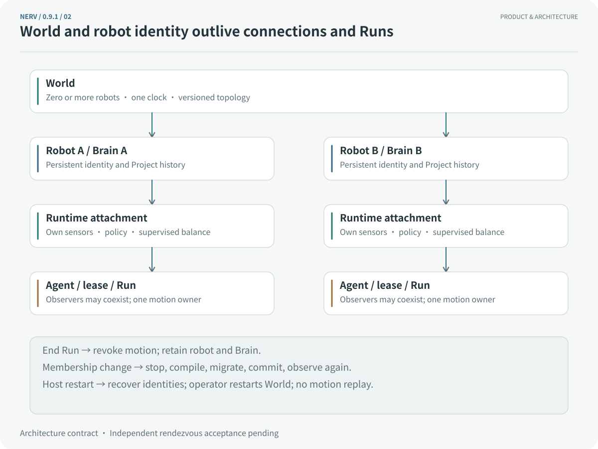
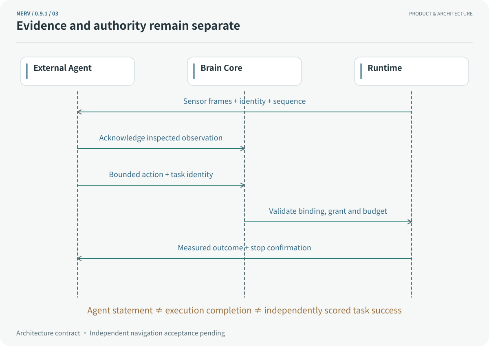
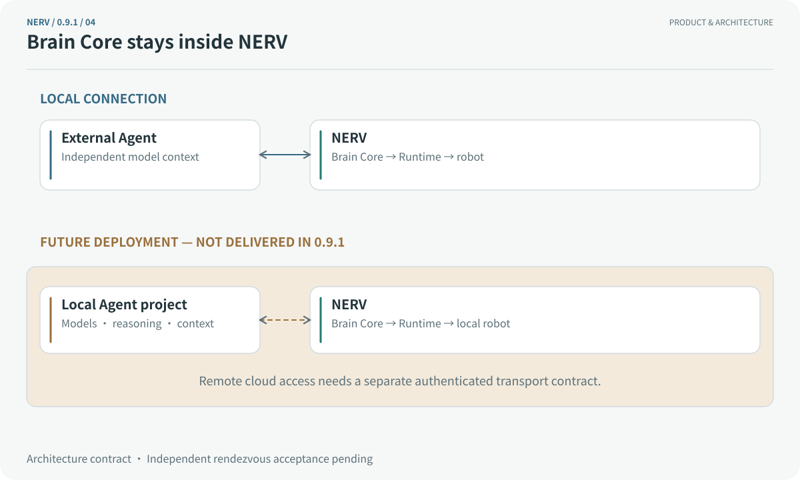

# NERV 0.9.1 architecture

[中文](../i18n/zh/architecture.md) · [NERV](../README.md)

Brain Core is NERV's stateful interaction module, installed with NERV. External Agents own understanding, visual interpretation, planning, model calls and context. Brain Core owns identity, sensor delivery, permissions, task dispatch and execution receipts. Runtime owns drivers, ACT/gait inference, control loops and stopping. MCP is the transport; it is not the control state machine.

| Object | Contract |
|---|---|
| Project | Reusable configuration and history for one robot |
| Run | One pinned Project revision and robot instance |
| Brain instance | One Run, one robot, one paired Agent identity |
| Robot instance | Separate joints, actuators, sensors, Runtime and control history; distinct from model/profile name |
| World instance | Frozen scene/roster/spawns, one physical clock and shared collisions; independent of any single Run |

An operator reserves a Run/Brain before an Agent starts it. Shared composition binds allocated Runs before starting physics. Namespaced model joints map back to canonical policy joints at each bound bus endpoint. Mutable controllers, queues and task state are separate. Peer robots remain physical obstacles. Composition is generated from source arenas; third-party robot files are not edited.

Ending one shared Run revokes its control and leaves its Runtime holding in the world. It does not tear down the shared process or peer Runtime. Shared-world stop is operator-only. Reconfiguration requires a new World. Host recovery interrupts Runs and restores no movement. An Agent can read its prior Brain history; a new binding and operator authorization are required before new motion.

Project/Run/Task journals remain the facts of record. Observation acknowledgement is a client assertion, action acceptance is not completion, and an Agent statement is not independent task scoring. Brain stores no external conversation, hidden reasoning or model keys.

The wheel excludes old `nerv.brain`, `nerv.harness`, `nerv.vlm` and internal decision modules. Historical source and journals remain available in the repository/user data. Old model/credential/chat endpoints are retired. Internal decision schemes require explicit reselection; fixed policies remain supported. This is a compatibility change, not an ordinary patch.

Future deployment: **independent local Agent project → NERV Brain Core → Runtime/robot**. Brain Core does not become a separately installed Agent product. Remote cloud access, multi-robot cooperation planning, new policy training and hardware qualification are outside 0.9.1. Shared-G1 independent acceptance remains a release gate; architecture diagrams are not evidence of that acceptance.
