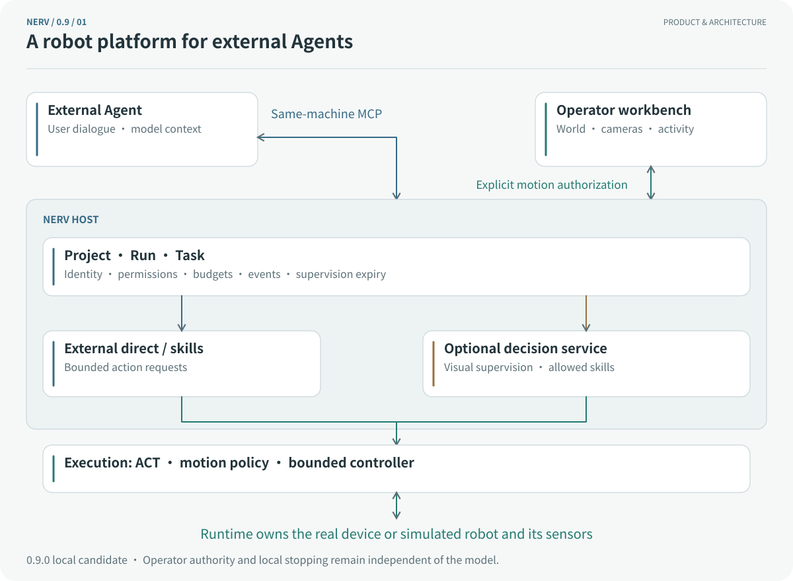
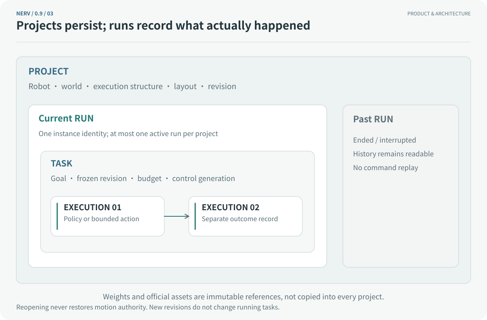
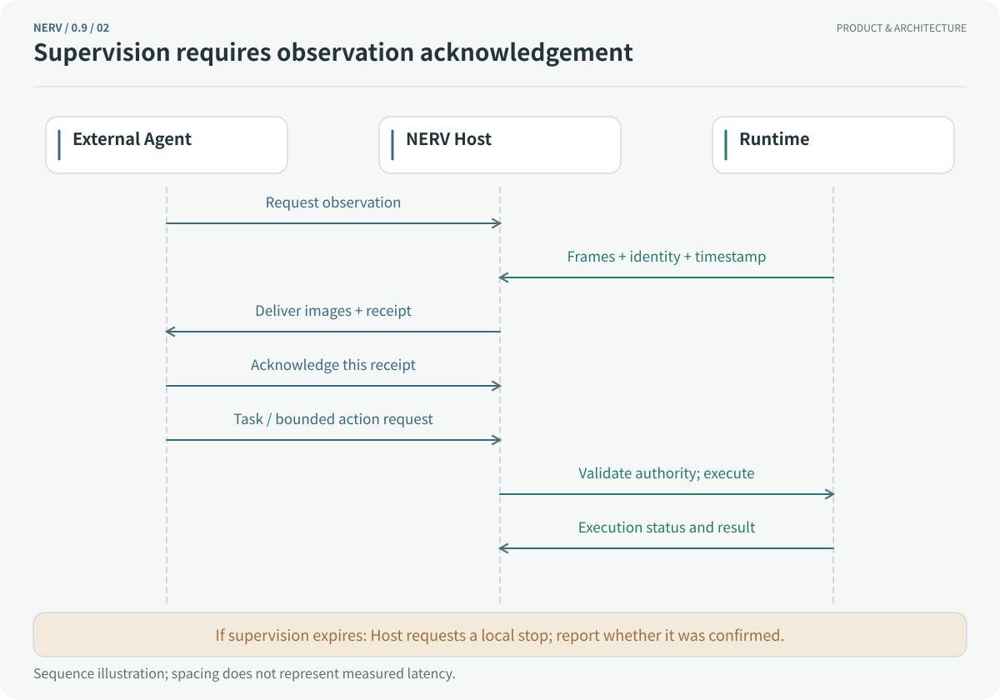
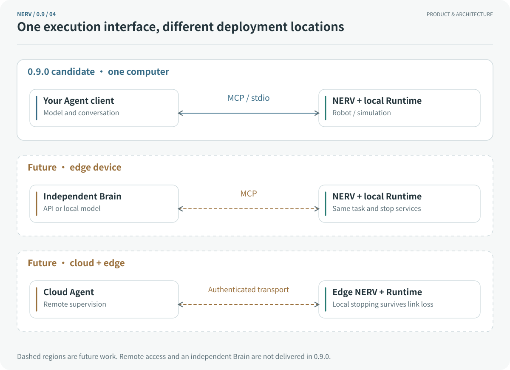

# Architecture and control

[中文](../i18n/zh/architecture.md) · [NERV](../README.md) · [MCP connection](mcp.md)

NERV 0.9.0 is a local acceptance candidate for an Agent-facing robot platform. The external Agent owns dialogue and model context. NERV manages projects, task authority, local execution and stopping. Optional robot decision services remain available, without restoring a second ordinary chat product.

## Responsibilities and process boundaries

The interaction, decision and execution layers describe responsibilities rather than three required models. The external Agent can choose bounded actions or skills, or supervise a task that uses a managed robot decision service. ACT and motion policies run locally through compatible executors. Host code does not import LeRobot or load policy tensors.

The public Host MCP service is separate from internal Runtime-node interfaces. Pairing identifies the client, channel and allowed projects. Browser, CLI and MCP operations use the same underlying Project and task services. Agent tools do not provide general shell execution, installation, credential access or motion authorization.

The independent Runtime SDK defines discovery, preparation, observation and execution lifecycle. A provider's imports and descriptions must have no device/GPU side effects. Preparing, loading a policy, enabling motion, stopping, emergency stop, disconnect and releasing torque are separate operations. SO-101 uses one native LeRobot instance and shared scheduler for ACT and bounded controls. See [Runtime SDK](../packages/nerv-runtime-sdk/README.md) and [control schemes](control-schemes.md).

## Durable identity and revisions

Project stores configuration and layout; Run identifies a world/device instance; Task freezes goal, scheme, capability set and control generation; Execution records a policy/action attempt. A project has at most one active Run and one controlled robot. Conflicting device/world owners are rejected rather than implicitly displaced.

Reopening configuration does not connect motors or restore motion permission. A valid live Run can be reattached; Host restart marks unfinished work interrupted. Project updates create revisions. Task updates advance versions and stop obsolete execution before replacement. Late actions from old runs, observations or control generations are refused.

Projects and historical records belong to the current channel under `NERV_HOME`. Official assets and model weights are immutable references. Local training exports and calibration files remain read-only external references. Stable and preview do not share mutable project state.

Migration converts robot sessions into Project/history records once, preserves original identifiers and stores recoverable snapshots. Plain chat is archived. Repeated migration does not create duplicate projects or replay motion. An older application must use its own recovery snapshot when rolling back.

## Observations, supervision and stopping

An observation includes sensor frames, capture metadata and instance identity. The gateway records delivery and receipt acknowledgement. Acknowledgement is a client assertion; it does not establish model understanding. Task polling and transport heartbeat are not supervision renewals. Declared observation age and supervision limits govern motion; missing contracts prevent unsupported control.

External visual control performs bounded actions and observes again; it is not a high-frequency servo. ACT inference continues in its local Runtime while the external Agent supervises. Local expiry handling is independent of model response time. The browser renews only operator-owned tasks, never external Agent tasks.

Takeover revokes external authority before cancelling execution. Only confirmed stopping permits manual control. An unconfirmed stop remains visibly unconfirmed. Agent observation may continue during manual control; handing motion back requires an operator action. Adapter-specific stopping rules are needed for different bodies: releasing torque is not a universal failure response.

## Workbench and control console

The application owns task status and supervision across navigation. The world view stays mounted beneath the console overlay. A narrow tool rail opens transient controls; camera monitors preserve aspect ratio and save their placement. Operator chase views and simulator truth remain separate from Agent sensor permissions.

Activity bubbles carry source labels and distinguish Agent statements from execution feedback. They are DOM overlays, never part of raw camera images. The history view retains events beyond the bounded floating display. No external full conversation is automatically synchronized.

## Capability and environment boundaries

Robot semantics belong in adapters/families and versioned registry entries. World-owned builders and schemas determine simulation changes. Host services organize declared capabilities without embedding joint orders or scene-specific behavior. Real bindings reject world edits. New world topology requires a replacement instance and invalidates prior action authority.

The capability catalog reserves future VLA, WAM, traditional planning and cross-environment project types without advertising runnable implementations. Go2 motion remains blocked by its incomplete deployment contract. A matching tensor dimension is not sufficient evidence of compatibility.

Managed Python environments separate incompatible dependencies under `.nerv`; all build output remains outside the source checkout. Resources and policy revisions update independently from environment versions. Active leases protect referenced installations. See [environment management](environments.md), [assets](assets.md) and [policy publication](policy-publishing.md).

## Future deployment

An independent Brain can own API credentials, context, scheduling and cost while acting as a normal MCP client. It must use the same task/authority path, inspect state on reconnect and avoid replaying actions. Remote supervision additionally needs authenticated encrypted transport, device registration and connection management. Neither is delivered in 0.9.0.

The [diagram sources](../assets/readme/diagrams/README.md) are editable and reproducible. Earlier [node topology](../assets/readme/images/structure.svg) and [skill sequence](../assets/readme/images/flow.svg) remain historical references, not the current public Agent contract.
