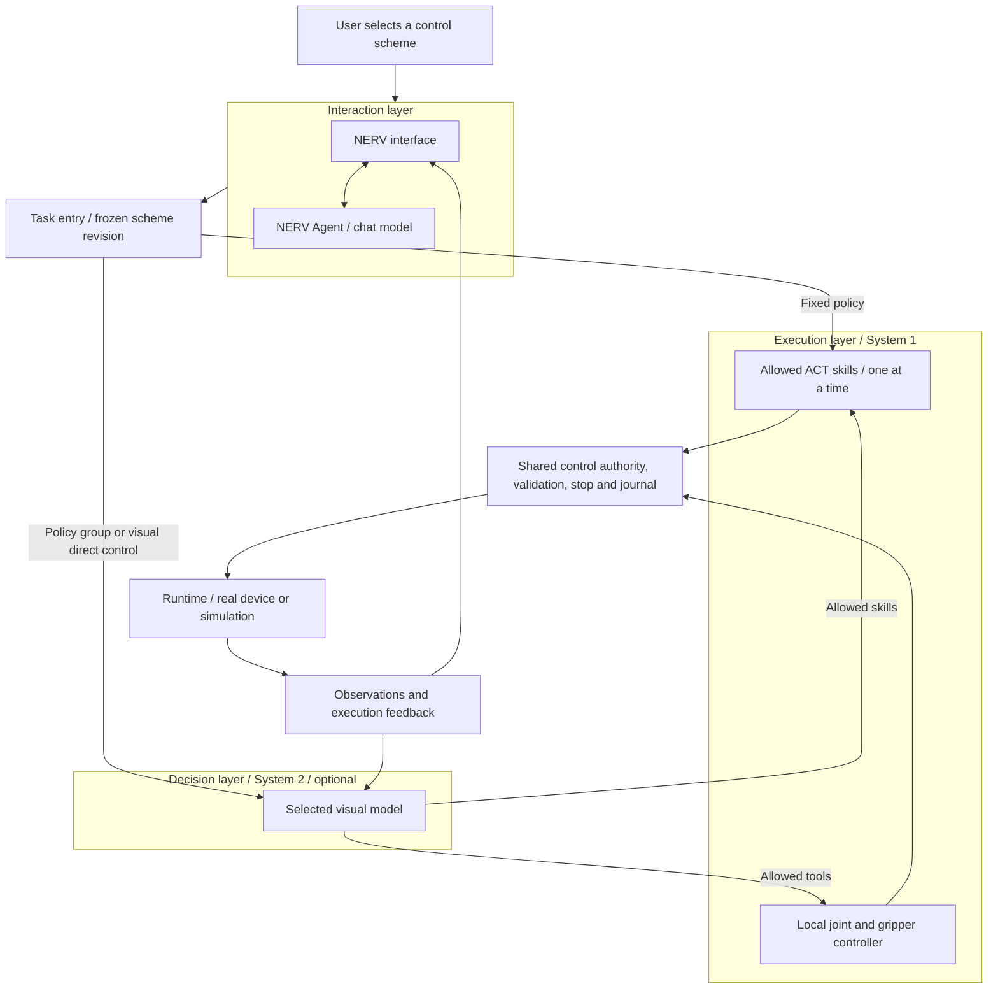
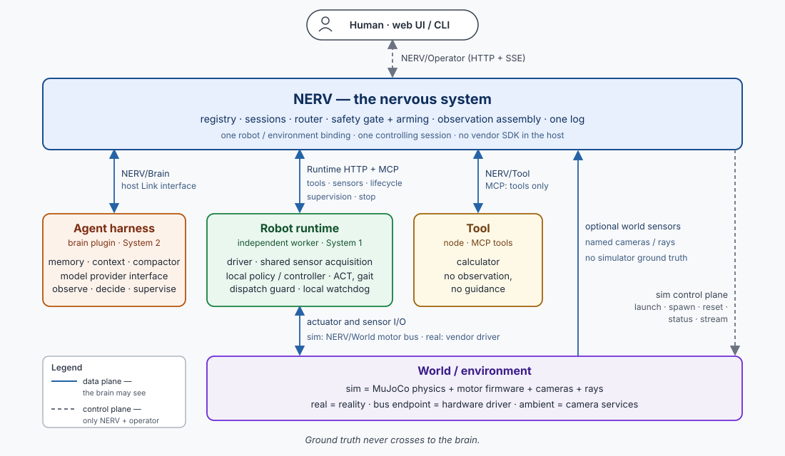
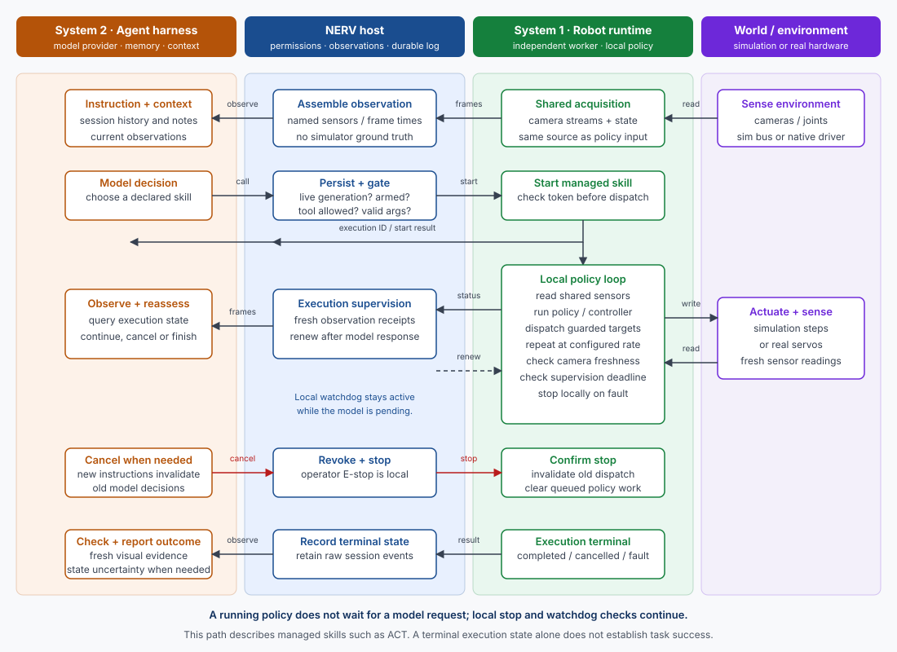

# Architecture and control

[中文](../i18n/zh/architecture.md) · [NERV](../README.md)

NERV 0.7.1 separates conversation, task supervision and local execution. System 1 is the execution layer inside a runtime; it is not an additional Python environment.

The standard SO-101 worker owns one LeRobot device instance. ACT inference and bounded direct joint control both produce candidate targets for its shared scheduler. The host does not import LeRobot or load policy tensors.

## Architecture
The interaction layer handles conversation and task submissions. The optional decision layer selects and supervises allowed actions. The execution layer runs ACT or bounded local controllers; Robot Runtime owns devices and sensors. Fixed-policy tasks bypass the decision model and need no API key. World Control owns simulation interventions. The host coordinates control ownership, lifecycle and event records. Robot drivers and policy inference run in a separate worker environment.

The following node topology remains the transport foundation:

Agent and System 2 use separate harness instances, context, summaries, provider continuation and usage records. Their events share an append-only journal with isolated task views. A runtime declares its sensors and skills; the frontend reads those capabilities. Simulation and real hardware have separate environment bindings. Operator scene controls and simulator ground truth stay outside the agent's observation. The [interface types](../src/nerv/nerve/) define the module boundaries.

## Conversation and world control
The right column belongs to NERV Agent. Chat stays available during robot execution and manual control. **Stop reply** cancels only the current conversation decision. **Stop task** waits for local execution acknowledgement; **Emergency stop** locks motion until an operator releases it into disarmed standby.

The middle camera frame contains robot activity from System 2, execution feedback and host events. Bubbles show public decision summaries and timestamps; they never become camera pixels or policy input. The independent event stream reconnects and deduplicates records. Historical sessions do not show live cameras.

Capabilities have five application domains: `agent_tools` for computation and session history; `robot_actions` for robot actions and skills; `robot_tasks` for task management; `world_control` for simulation configuration and interventions; and `instance_control` for lifecycle. Provider function calling and MCP carry these capabilities without merging their permissions.

Choose SO-101, Simulation and a workbench world in **New session**. Select the supported object slots before creation. The world catalogue supplies types, nominal dimensions and mass. Flexible materials remain uncalibrated approximations. Each instance gets its own MJCF, configuration and source hashes.

**Toolbox → Simulation world** uses the same service as Agent world commands. Reset preserves the current objects and world process, invalidates the task, and disarms control. Changing object topology uses **End and rebuild instance**. Old sessions stay readable but cannot control the replacement. Weather, furniture and style changes appear only when a world declares and implements them; the tabletop worlds currently declare object replacement and reset. Real bindings reject world modification.

Viewing, creating and manually controlling a simulation requires no model request. Language-driven operations need a configured VLM and are billable. SO-101 ACT and Hanoi execution policies are not deployed to these simulations. The long-term autonomous target is named **ultimate**; this release remains an Agent-operated system.

## Visual models
The panel groups keys by provider. It displays whether a key is saved without returning the saved value to the browser. The panel lists supported models without a model or effort selector. One saved key serves the provider’s registered models, subject to account access. Chat reads the same registry. Pure text models and Mock do not appear in the running catalogue or act as fallbacks.

OpenAI, DeepSeek and xAI use provider-specific Responses dialects. Gemini uses the stateless Interactions API; Claude uses native Messages streaming. Signed thought blocks and opaque reasoning items are replayed only within the matching provider identity. Effort options are model specific; an unspecified effort leaves the parameter out so the supplier applies its default. The last model and each model's effort are remembered. Chat changes are refused during an active reply. A running robot task keeps its frozen model configuration independently.

| Provider | Curated visual models | Native effort choices |
|---|---|---|
| OpenAI | GPT-6.1 Sol, GPT-6 Astra | low, medium, high, xhigh, max |
| DeepSeek | V4.1 Flash | none, low, high, max |
| Gemini | 3.8 Flash; 3.5 Flash-Lite | Flash: low, medium, high; Lite also supports minimal |
| xAI | Grok 4.7; Grok 4.3 | 4.7: low, medium, high, xhigh; 4.3: none, low, medium, high |
| Anthropic | Claude Opus 5.5, Claude Sonnet 5.5 | low, medium, high, xhigh, max |

Catalogue capabilities were checked against supplier documentation on 2026-10-20: [OpenAI](https://developers.openai.com/api/docs/models/gpt-6.1-sol), [DeepSeek](https://api-docs.deepseek.com/api/create-response/), [Gemini](https://ai.google.dev/gemini-api/docs/thinking), [xAI](https://docs.x.ai/developers/model-capabilities/text/reasoning), [Anthropic](https://platform.claude.com/docs/en/build-with-claude/effort). Key registration sends one image request only when the operator submits the form. Opening settings, changing selections and creating sessions do not call the provider.

The optional API diagnostics endpoint checks image input, tool calls and continuation. Their results do not gate VLM session creation or model use; those require only a nonempty registered key. Operator workspaces are created through a separate endpoint and excluded from chat history. They need no key; public chat creation rejects the operator identity before starting nodes or writing a session. Existing keys do not need to be registered again. A subsequently expired key permits session creation and produces a clear conversation error when used. Failed replies preserve the input and offer retry and model settings; retries do not replay old robot actions.

Changing endpoint, model, effort or credentials invalidates matching diagnostic and physical records. One successful key registration does not certify other models, general visual performance or robot performance. Agent errors do not cancel independent robot tasks; System 2 failures retain local stopping and supervision rules.

## Agent harness

The diagram follows a managed skill such as ACT. Starting it returns an execution ID; System 2 continues observing and checking execution state while the worker runs its local policy. Direct read tools and existing G1 skills can return their result within the tool call. Local stop and supervision checks remain active while a model request is pending.

The default `AgentHarness` receives its host Link, model provider, context manager and compactor through replaceable boundaries. It never owns a robot object or loads ACT.

Each session has a durable append-only event journal, image assets, task and notes. Existing JSON sessions migrate once and retain a `.legacy` source snapshot. JSON snapshots can be rebuilt from the journal. History search and paginated reading are restricted to the current session.

The context budget covers instructions, notes, summary, complete tool groups, tools, current images, provider continuation and reserved output. Token and image budgets are estimates; actual usage is recorded when the supplier returns it. Compaction uses a separate request without tools, images or the main reasoning continuation. Failed compaction retains original events and pauses if the request cannot fit.

Restart marks unfinished runs as interrupted with unknown results. It restores history without replaying actions. A new chat message invalidates only the previous Agent reply. An explicit task update advances its version and stops the old execution before replanning. Task model configuration and effort are frozen at task start.

## Runtime plugins
`nerv-runtime-sdk` is an independently installable package with no NERV core, vendor SDK, PyTorch or MuJoCo dependency. A Python worker discovers `RuntimeProvider` entry points in its own environment. Non-Python services can implement the same HTTP/MCP protocol and register a URL.

`describe()` and imports must have no device or GPU side effects. Preparation, policy loading, enabling, execution, cancellation, emergency stop, release and disconnect are separate operations. Profiles, environment bindings and policy artifacts are separate contracts. The host does not inject its source tree or model credentials into workers.

The [runtime SDK guide](../packages/nerv-runtime-sdk/README.md) and [inspection-only plugin example](../examples/inspection-runtime/) describe protocol 3, which requires `actions()` and rejects incompatible workers before preparation. The SDK defines provider discovery, protocol endpoints and read-only conformance checks.

## Selected control schemes

[Control schemes and module contracts](control-schemes.md) describe immutable revisions, fixed-policy tasks, independent decision contexts and protocol 3 grants. The right panel shows only the selected path. The old all-path illustration above documents transport relationships; it does not grant access to every action.

Interaction, decision and execution are the primary terms. System 2 and System 1 remain auxiliary labels in diagrams and existing journal role IDs. A fixed-policy task does not instantiate a model. A visual-direct task still uses a local controller; model output never writes motor registers.

## Application navigation and preferences

Home, My robot, Settings and conversation views use hash navigation in the static package. The application owns the active-task toolbar and visible-operator supervision; changing pages does not transfer control or cancel execution. Robot workspaces share the existing task service. Display names and portraits do not modify calibration identity.

Four allowlisted conversation settings are persisted with a file lock and atomic replacement. Each Agent turn reads a snapshot: environment configuration, then web preferences, then defaults. A task keeps its scheme revision and authority. Runtime protocol remains version 3.
