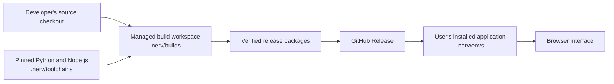

# Environments and local storage

NERV installs its own Python virtual environments, managed with uv. Installing a NERV
component does not install packages into your system Python, Conda environments or
LeRobot training environment. You do not need to activate a virtual environment to use
`nerv`.

## What NERV installs

The release installer obtains a managed CPython interpreter and uv. uv creates standard
Python virtual environments (venv), with system site-packages disabled. Each environment
has its own executable and package directory. The launcher selects the active host by its
saved absolute Python path; Runtime records select their own interpreters.

| Environment | Purpose |
|---|---|
| Host | Web interface, sessions, model connections and task management |
| SO-101 Runtime | LeRobot, Feetech and ACT inference, installed on request |
| Simulation | Simulation dependencies and scene resources, installed on request |

ACT checkpoints share the compatible SO-101 Runtime; each checkpoint does not require
another Python environment. Model training stays outside NERV. Future VLA support is
subject to its own adapter and dependency checks; no arbitrary VLA environment is installed.

## Where files live

The default root is `~/.nerv` (the `.nerv` directory in your user home on Windows as well).
An explicit `NERV_HOME` selects another root. Settings → System and installation and each
component's Installation location show the actual root or environment path for the running
instance.

| Relative location | Contents |
|---|---|
| `envs/host/` | Versioned host environments |
| `envs/<component>/` | Independent component environments |
| `python/`, `bin/`, `bootstrap/` | Managed Python, installer tools and entry points |
| `.cache/downloads/`, `.cache/releases/`, `.cache/uv/` | Download records, verified artifacts, release assets and uv cache |
| `active.json`, `previous.json`, `runtimes/` | Active host, rollback pointer and component receipts |
| `memory/`, `devices/`, `schemes/`, `artifacts/` | Session history, device settings, control schemes and policy references |
| `credentials.json`, `vlm.json` | Private credentials and model settings |
| `backups/` | Update recovery snapshots |
| `toolchains/`, `builds/` | Pinned developer tools and source snapshots used to build candidates |
| `assets/`, `workspaces/assets/` | Saved asset revisions and editable personal copies |

Imported model directories and external calibration files stay at their original locations.
NERV references them; deleting `.nerv` will not delete those external files, but it will
remove NERV's configuration and history. Back up user data before removing anything.

## Installation, updates and repair

NERV selects a compatible release plan for the host system and compute backend, downloads
and verifies its files, then creates a new environment. Package and Runtime checks must
pass before activation. The complete current download plan installs from verified local
wheels without online dependency resolution. Cached files can be reused after a failed
attempt; supported servers allow interrupted downloads to resume.

Use the component page to install or repair components. Use `nerv update` and
`nerv rollback` for release changes after exiting NERV. Old environments may be needed
for rollback; do not delete them simply because a newer directory exists. Do not move
venv directories manually: their interpreter links and entry points can contain absolute
paths. To change a root, rebuild environments at the destination and migrate user data
with a verified backup and updated Runtime references.

## What isolation covers

Python environments separate installed Python packages. They are not Docker containers,
virtual machines or a security sandbox. NERV runs with your account's file permissions.
USB devices, cameras, GPU memory, ports and system drivers are shared. Close other programs
using a device before connecting it in NERV. A Python environment cannot install or repair
operating-system permissions, GPU drivers or WSL USB forwarding automatically.

The installed host launcher uses Python isolated mode to avoid importing from the working
directory or an inherited `PYTHONPATH`. Runtime processes use explicitly selected Python
executables and filtered environments. User-selected external adapters still require their
own compatibility checks.

## Local candidates

The 0.8.5 development implementation uses `~/.nerv/profiles/preview` for preview data.
Credentials, sessions, device settings and editable assets belong to that channel. Verified
installation files and compatible environments use the shared storage root `~/.nerv`.
Copying model settings once does not synchronize later changes or copy conversation history.
An explicit `NERV_STORAGE_HOME` changes the shared storage root; it does not select the
active channel or copy credentials.

The new `nerv preview` command starts an installed preview on port 8100. An occupied port
is an error, not permission to stop another process. These commands require the new host;
the public 0.8.1 launcher does not provide the 0.8.5 preview workflow.

## Source, build tools and installed software

Developers edit a Git checkout in their project directory. Pushing it uploads source commits
to GitHub; it does not install or activate software on their computer. A release contains
built application packages, the prebuilt web interface and installation manifests. Users
install those packages without cloning the development repository.

Node.js builds the web interface. It is a program, not the folder where NERV is installed.
Build dependencies such as `node_modules` belong to the managed build workspace. Ordinary
users receive the compiled interface and do not run npm or activate a Python environment.
Editing the developer checkout does not change an installed release. Build and install a
new preview to test those edits; publish a verified release to make them available to users.

The managed build command is `nerv preview build --source <checkout>`. It copies indexed
source files into a build workspace, excluding credentials, runtime data and existing
dependency directories. It builds a candidate without activating it. Retiring legacy
development environments requires a separate inventory and recovery check.

## Review unused environments

`nerv env list` shows receipts and references. `nerv env doctor` runs bounded interpreter
and module checks without connecting devices. `nerv env prune` only previews unused,
receipted environments and reports the space they occupy. It excludes current and
rollback references, running processes, user data, assets, caches and build tools.

To apply a reviewed preview, exit both hosts and pass its fingerprint with
`nerv env prune --confirmation <fingerprint>`. Any changed reference invalidates that
confirmation. An incomplete installation record blocks cleanup. Legacy environments
without a managed identity need a separate migration review and are retained.

Interrupted removals appear in the maintenance section, even if their installation
receipt was already removed. Review the linked journal and restore or repair the affected
environment before another removal. Cleanup does not infer permission to remove other
folders or environments belonging to another project.
