# NERV

[](../../pyproject.toml) [](../../CHANGELOG.md) [](../../LICENSE)

[English](../../README.md) · [简体中文](README.md)

**NERV 是供不同 Agent 使用的机器人基础平台**，连接本地执行、真实设备与虚拟世界。 你可以继续使用熟悉的 Agent，由 NERV 提供项目、观测、有限动作、策略执行、人工控制和运行记录。

NERV 0.9.1 引入 **Brain Core**：它随 NERV 安装，管理实例身份、观测、授权、任务与执行回执，不包含 AI Agent、模型 Provider、提示词循环或模型密钥管理。外部 Agent 负责理解、推理和上下文；Runtime 负责驱动、ACT／步态策略、高频控制与本地停止。沿用 0.9.1 版本号，但这是架构与兼容性升级。

G1 传感器观测区分点射线与全身制动通行空间，并提供本机关节／IMU 有效性和采集时的相机标定。开发中的仿真配置新增机器人自身的向下相机，以及同帧采集的自身碰撞包络；它们提供原始视图与保守身体形状，不检测目的地或认证到达。不提供 World 位置、地图或目标坐标，见 [MCP 传感器契约](mcp.md)。

[接入 Agent](mcp.md) · [架构](architecture.md) · [SO-101 设置](so101-setup.md) · [资产](../../guides/assets.md) · [路线图](ROADMAP.md)

本仓库目前是 **0.9.1 开发工作区**，尚未公开发布。下方命令安装最新公开版本，不会取得尚未发布的修改。候选 08 的 Linux CPU 软件与安装检查通过，但共享世界双 G1 固定试验为 0/6 独立导航成功、3 次虚报到达、无跌倒。该候选未通过导航资格；SO-101 真机验收仍未完成，见[候选发现](brain-core-091.md#安装候选实际结果)；Go2 缺少完整、可核验的部署契约，暂不能开放运动。

持久 World／Robot／Brain、资源发现与实例申请、G1 动态成员事务已实现。候选 21 通过 912 项 CPU 检查、隔离安装／恢复，以及安装后的共享世界运动、停止、控制恢复和成员变更检查。其首轮全新双 Agent 会合通过；第二轮因一台机器人的身体仍有部分在目标区域外、却宣称成功而失败。两轮均未记录跌倒或机器人间碰撞。后续候选 23 通过 945 项 CPU 检查、隔离安装／恢复，以及三轮全新双 Agent 会合的独立评分与只读复核：6 次机器人任务成功，无虚报、跌倒或机器人间碰撞。

安装后的模拟设备补测又发现 Host→Runtime 控制传输缺陷：严格业务 Schema 拒绝混入其中的内部凭据。修复改用 MCP 请求元数据、避免凭据进入普通调用日志，并将 Host 恢复后的历史 World 健康与当前状态分开。包含修复的候选 25 已通过 975 项 CPU 检查、两项退役 Provider 跳过、隔离离线安装／升级／回滚及三轮全新双 Agent apt 会合。6 次机器人任务均通过固定评分和独立只读复核，正式导航中无虚报、跌倒或机器人间碰撞。该资格仅适用于冻结的 Linux CPU 配置，尚未公开发布，也不代表真机通过。候选 23 与历史失败分别保留于[开发发现](brain-core-091.md)，不拼接成绩。

<div align="center">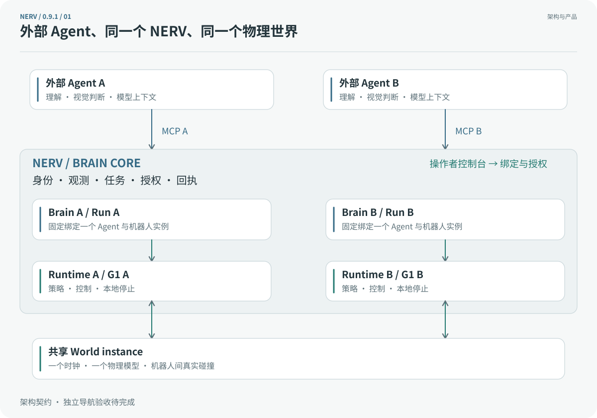</div>

## 安装与启动

GitHub 安装器管理 Python、uv 和预构建界面。普通用户无需安装 Node.js、克隆源码或另开 LeRobot 终端；机器人与仿真组件按需安装。

Linux／macOS：

```bash
curl -fsSL https://github.com/Yanshi-Robotics/nerv/releases/latest/download/install.sh | sh
```

Windows PowerShell（实验性支持）：

```powershell
irm https://github.com/Yanshi-Robotics/nerv/releases/latest/download/install.ps1 | iex
```

打开新终端，运行 `nerv`。正式渠道默认打开 [http://127.0.0.1:8170](http://127.0.0.1:8170)。启动不会连接电机、授权运动或恢复中断的任务。没有桌面的终端可使用 `nerv serve --no-browser`；Ctrl+C 请求正常退出。

显式安装的预览版通过 `nerv preview` 启动，使用独立渠道数据。候选安装与源码开发见[贡献说明](../../CONTRIBUTING.md)。预览版不是另一份源码仓库，推送代码也不会自动切换本地安装。

## 创建项目并连接 Agent

1. 打开控制台，安装仿真引擎和 World，或从“机器人”注册标准 SO-101。
2. 新建 Sim 或 Real Project，选择机器人、世界和执行结构。创建项目无需 NERV 聊天密钥；项目保存在 `.nerv` 当前渠道下。
3. 打开“设置 → Agent 连接”，填写客户端名称、选择允许访问的项目，并指定仅观测或允许任务／动作请求。
4. 在 MCP 客户端中设置桥接命令，填入配对后的客户端 ID。预览候选版使用：

   ```bash
   nerv mcp --channel preview --client CLIENT_ID
   ```

5. 仿真先创建并明确启动空 World，再向 Agent 授予兼容模板与实例配额。未绑定桥接器发现授权并申请机器人，之后附着 Brain、启动 Run。检查选定的控制方案，再单独授权动作，或使用操作者明确授予的仿真控制预授权。

桥接器连接已经运行的 Host，不另起一套机器人服务，也不自动准备硬件。[MCP 指南](mcp.md) 介绍配置、观测确认、请求 ID 和撤销方式。Codex、DeepSeek Harness、Claude Code 是计划接入的客户端；列出名称不代表所有客户端及版本均已通过验收。

没有 Agent 或模型密钥，操作者仍可安装资源、配置设备、查看观测，以及使用允许的固定策略和人工控制。NERV 不再运行内部视觉决策服务。

## 在世界中工作

控制台集中展示**项目、机器人、世界、策略、资产和设置**。机器人详情保留 SO-101 档案及本地三维预览。关联项目分别标注真实或仿真工作区；可用的机器人资产不会被当成已注册真机。

进入项目后，主相机或仿真场景占据主要展示区域。左侧窄工具条提供观测、执行、设备和人工控制。监视框可切换为主画面、调整大小、停靠或收起，布局随项目保存。界面的相机显示方式不改变交给 Agent 的原始图像。

活动气泡显示带来源的 Agent 说明、任务状态和执行反馈，不导入完整外部聊天，也不把 Agent 的文字当作已确认的设备结果。“活动”保留完整记录。控制台以覆盖层打开，进入设置不会结束当前 Run；停止任务和紧急停止仍是独立操作。

<div align="center">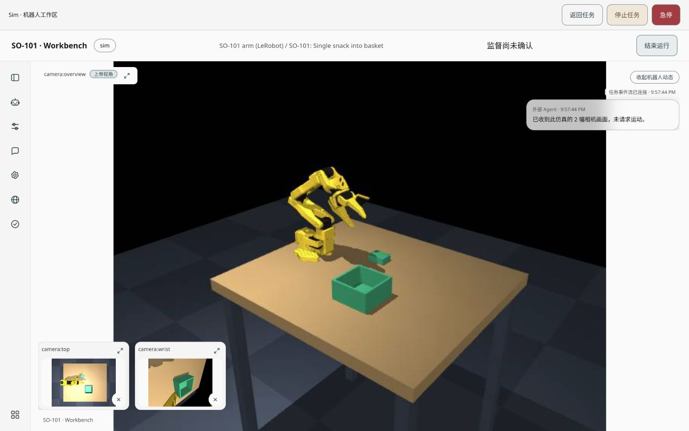</div>

已安装候选版中的 SO-101 仿真 Run，未授权运动。仅有观测权限的 MCP SDK 客户端收到两幅相机图像后，发布了画面中的说明。截图展示工作台和事件传递，不包含模型推理、机器人动作或真实硬件测试。

## 项目、运行与任务历史

Project 保存机器人、环境、执行结构、布局和修订。Run 记录针对已有 Robot、Brain、World 或设备连接的一段执行；这些资源拥有独立生命周期。Task 是锁定配置与授权的目标任务，Execution 是任务中的一次策略或有限动作执行。

<div align="center">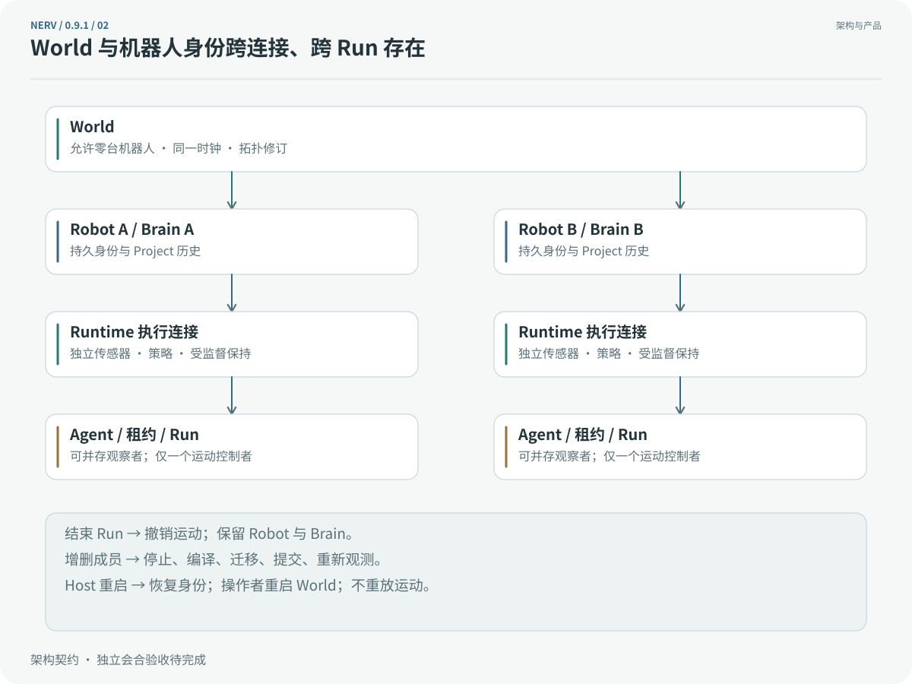</div>

再次打开项目会恢复配置和历史，并可重新附着到身份有效的活动实例。Host 重启后旧任务中断，运动授权清除，不重放动作。新项目修订用于后续运行与任务，当前任务继续使用锁定的引用。官方权重与资产通过引用复用，不为每个项目复制一份。

已登记设备需先由操作者连接，再启动 Run。结束 Run 保留设备连接，断开设备是独立操作。没有活动 Run 时仍可读取资源观测，查看图像不授予运动控制权。设备生命周期目前仅通过无硬件动作的模拟适配器检查，真机验证尚未进行。

仿真 Run 只附着已经启动的 World 和就绪的机器人 Runtime，不能创建、重启或重建物理仿真。结束或更换 Run 保留实体及其规范 Brain；移除机器人、停止共享 World 分别属于独立资源操作。旧独立仿真 Run 需要先明确分配资源，才能恢复执行。

0.9 迁移将机器人会话保存为项目与历史运行，纯聊天保留为只读归档，不伪造机器人项目。迁移快照和可重复执行的记录用于恢复；使用旧版程序回滚数据前，先按候选版的恢复说明操作。

## 监督与执行

外部 Agent 可以请求有限视觉动作或兼容的运动技能。ACT 与运动策略继续作为无内部模型决策的执行路线。驱动和推理留在 Runtime 环境，模型输出不能直接写电机寄存器。

<div align="center">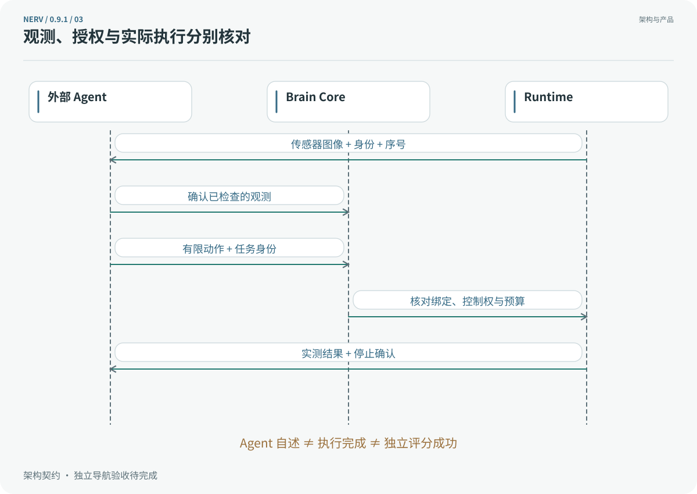</div>

观测交付、观测确认和任务成功是不同事实。图像附带实例与帧信息，客户端在请求运动前需要确认收到的观测，有限动作结束后重新观察。轮询任务状态或保持连接不会续期监督。监督过期时，本地机制请求停止，并报告停止是否已确认。

停止确认依据机器人当前测量。仿真采样间隔超过所需安静窗口时，确认会失效；仅有墙钟时效不能证明持续静止。有限动作结束后，机器人局部站立反馈继续运行。

人工接管先撤销外部运动控制，再等待停止确认。Agent 仍可观察；恢复 Agent 控制需要操作者再次确认。停止接收请求、停止任务、紧急停止、断开和卸力用途不同，详见[架构与控制](architecture.md)。

## 机器人与当前限制

| 路线 | 候选版范围 | 验收边界 |
|---|---|---|
| SO-101 Real | 分步引导、已有标定检查、双相机、ACT 与有限动作 | 真实连接和动作由操作者完成；未认证抓取可靠性 |
| SO-101 Sim | 三个工作台场景、相机观测与有限控制器 | 不假定真机 ACT 导出可以直接用于仿真 |
| G1 Sim | 受管理场景与运动策略路径 | 候选 25 经真实 MCP 完成三轮 apt 客厅会合，6 次机器人任务成功；位移精度仍有限，资格仅适用于冻结的 Linux CPU 配置 |
| Go2 Sim | 适配器与能力声明开发 | 完整部署契约缺失，运动被阻止；不宣称已具备公开运动能力 |
| Sim2Real／Real2Sim 等组合 | 预留能力类型 | 本版不开放运行 |
| Codex／DeepSeek Harness／Claude Code | 面向这些客户端提供本地 stdio MCP 桥接 | 具体客户端及版本的完整流程验收仍待完成 |

标准 SO-101 引导依次检查电脑、安装运行组件、识别 follower、核对已有电机与标定条件、确认相机并保存配置。电机配置和新标定继续在外部完成。缺少标定文件表示没有找到文件，不意味着设备从未标定。连接可能给电机上力，请按 [SO-101 指南](standard-so101.md) 操作。

Linux、Windows、WSL 与 macOS 使用各自的依赖方案。Windows／WSL 硬件透传和 macOS 相机支持仍属实验性；当前锁定的 macOS Intel Host 组合没有兼容安装包。[安装指南](github-install.md) 与[验收说明](../../guides/release-acceptance.md) 分别说明平台包、仿真、策略推理和真机证据。

## 资产、策略与托管环境

NERV 的 Python 环境、工具、缓存和已安装资源统一保存在 `NERV_HOME`，默认是 `~/.nerv`。Host、LeRobot、仿真和构建工具按依赖兼容性隔离，正式与预览渠道分别保存数据。安装和更新不会修改课程环境或系统 Python；USB 设备与 GPU 仍是共享硬件，需要明确占用关系。详见[环境管理](../../guides/environments.md)。

仿真引擎与场景包可以分别更新。资产库支持官方版本、纯数据 MJCF 导入、个人副本、检查、保存版本和导出；官方更新不会覆盖个人修改。公寓、住宅和机器人资产继续属于 NERV 的仿真方向，其源码由 [nerv-assets](https://github.com/Yanshi-Robotics/nerv-assets) 管理。操作见[资产流程](../../guides/assets.md)。

策略可来自本地导出或固定的 Hugging Face 修订。ACT 保留原生处理器与统计量，ONNX 运动策略需要明确的部署契约。某个模型在组织中公开，不代表它自动兼容或受推荐。来源不明的历史权重不纳入新的官方分发。详见[运动策略](../../guides/motion-policies.md)和[发布规则](../../guides/policy-publishing.md)。

下载使用文件校验、持久记录和有上限的重试／续传，环境经暂存安装和检查后才启用。[可恢复安装](recoverable-installation.md) 介绍进度与限制。使用 `nerv update --check` 检查公开更新；执行 `nerv update` 或 `nerv rollback` 前先停止任务并退出 NERV。预览渠道有独立的更新和回滚命令。

## 部署方向

0.9.1 面向同机外部 Agent 接入。未来可由独立本地 Agent 项目管理模型 API、上下文与规划，再连接 NERV Brain Core 和 Runtime；Brain Core 仍属于 NERV。未来云端 Agent 还需要带认证的远程传输和设备注册；本候选版不包含这两个产品。

<div align="center">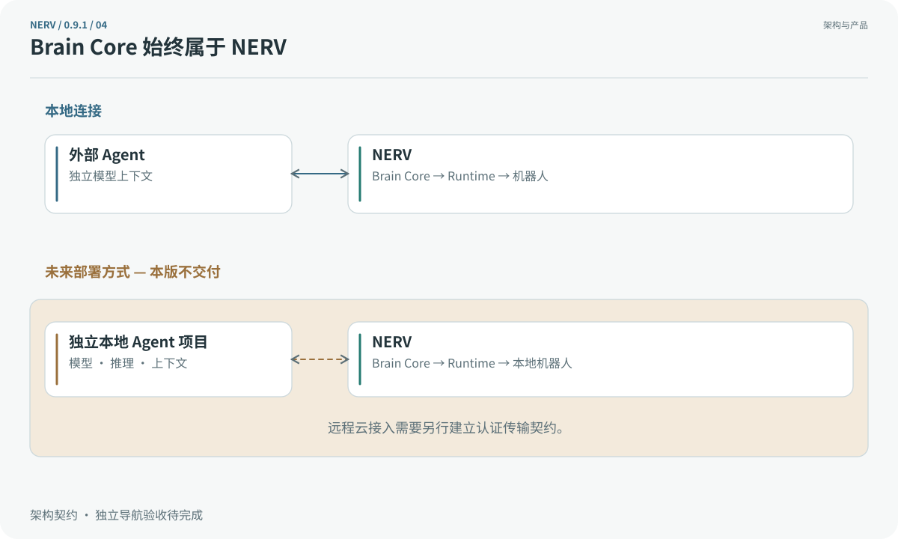</div>

[路线图](ROADMAP.md) 保留 Harness 扩展、插件管理、Yanshifu 集成和真实／仿真迁移研究，列出下一步与完成判据，不承诺日期。

## 世界与早期演示

下列录像和截图来自早期版本，展示仿真资产与历史界面，不代表 0.9.0 客户端验收完成。G1 录像使用头部相机和步态技能执行“走到客厅”，以 2.5 倍速播放；可查看[原速 MP4](../../assets/readme/media/walk-to-the-living-room.mp4)。

<div align="center">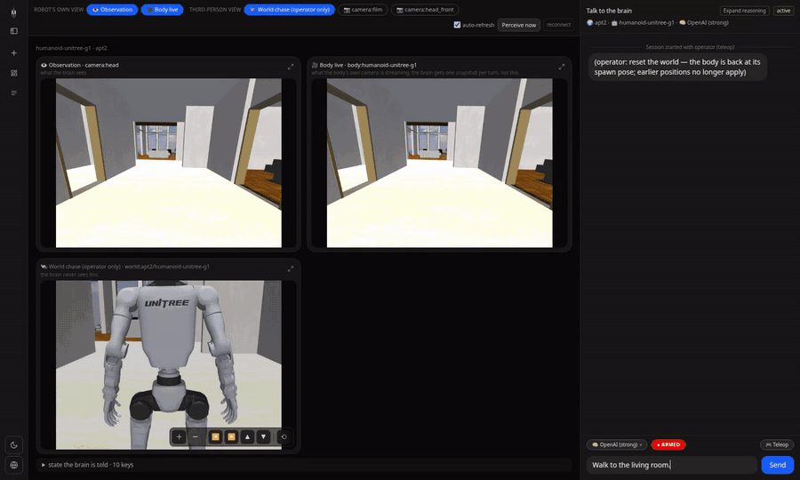</div>
<div align="center">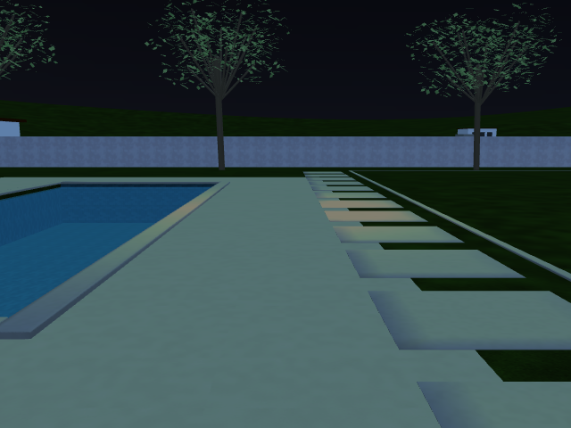</div>

<details>
<summary>早期界面与资产视图</summary>
<div align="center">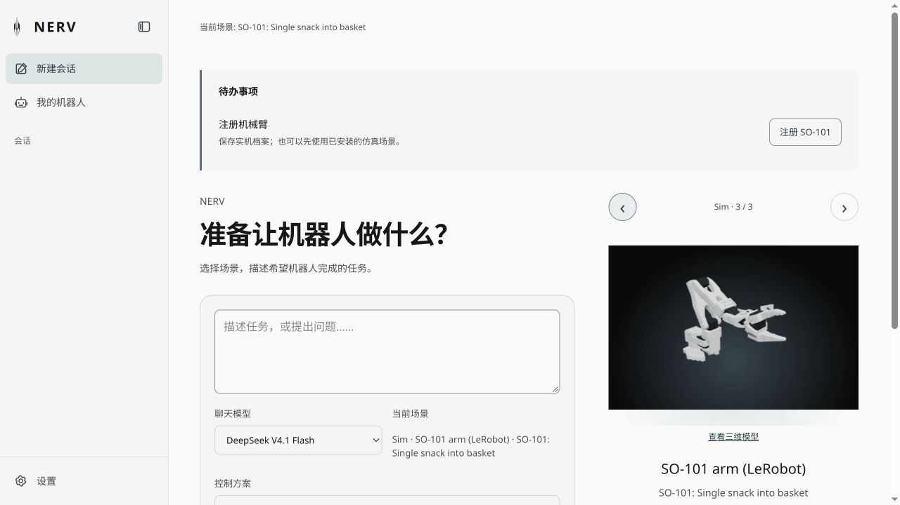</div>
<div align="center">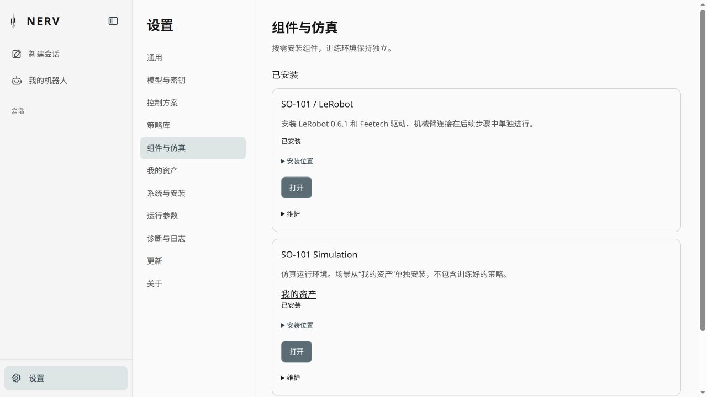</div>
<div align="center">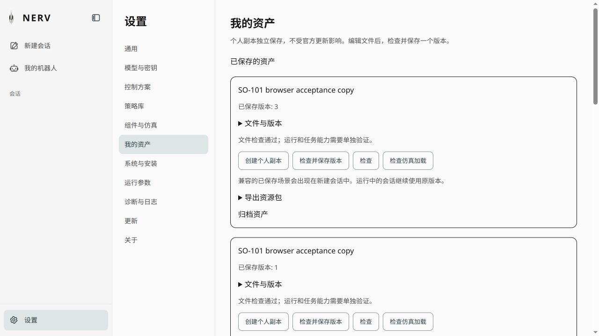</div>
<div align="center">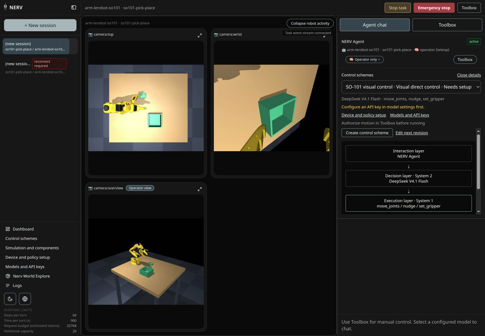</div>
<div align="center">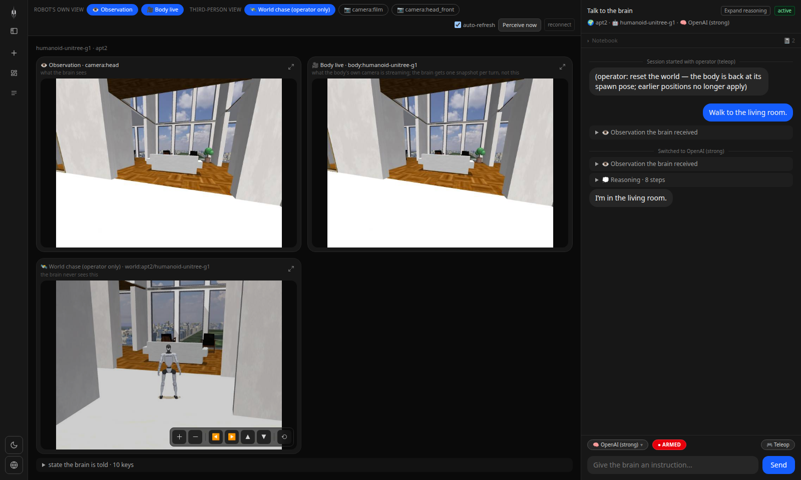</div>
<div align="center">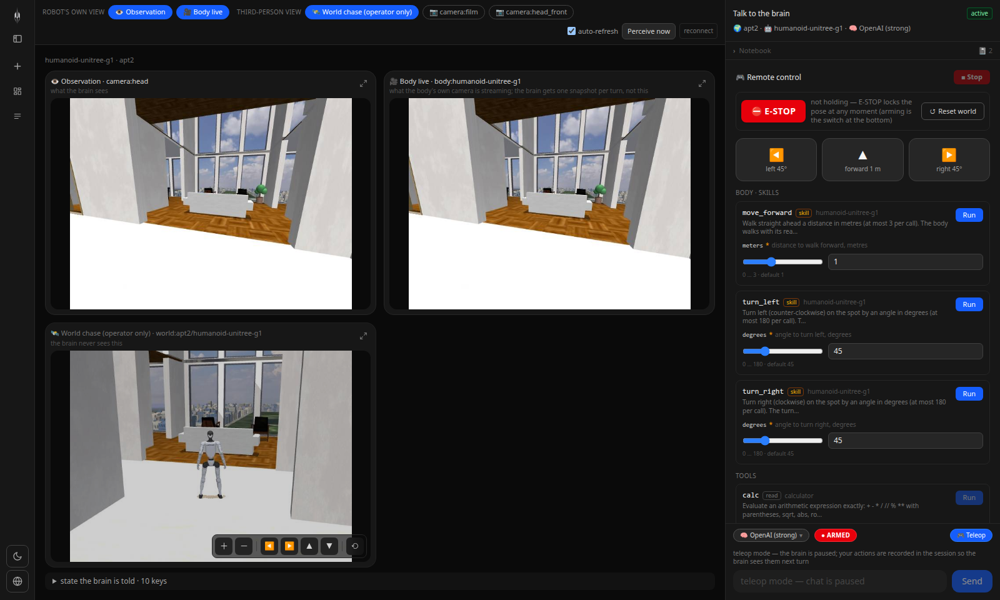</div>
<div align="center">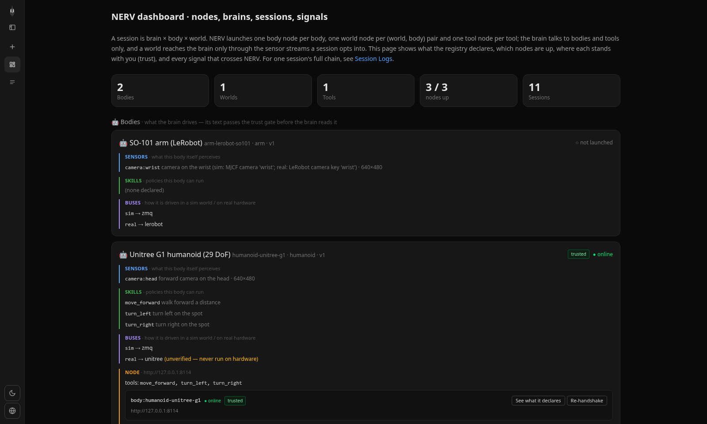</div>
<div align="center">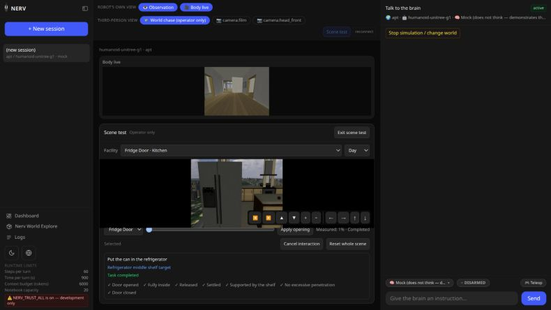</div>
<div align="center">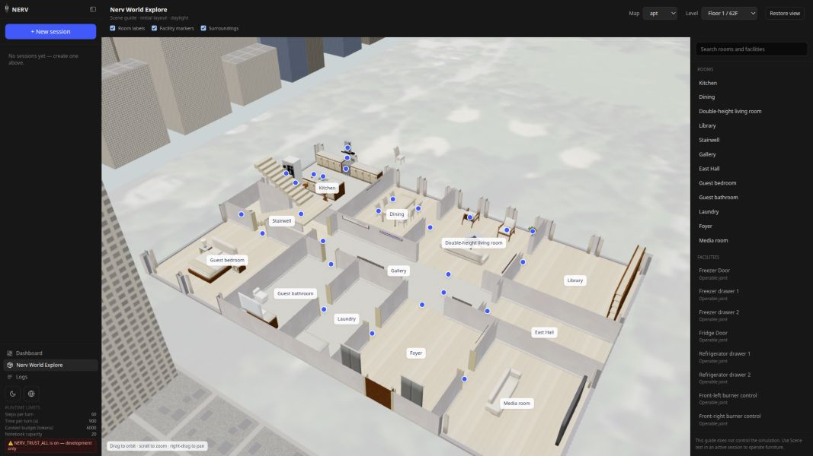</div>
</details>

[世界库工具](../../nerv-assets/docs/explore/README.md) 介绍场景查看方式。平地步态不包含抓取、自主坐下或上下楼能力。下图采集自本地 0.9.0 候选版，展示已保存但尚未启动 Run 的项目，不作为机器人运动证据。

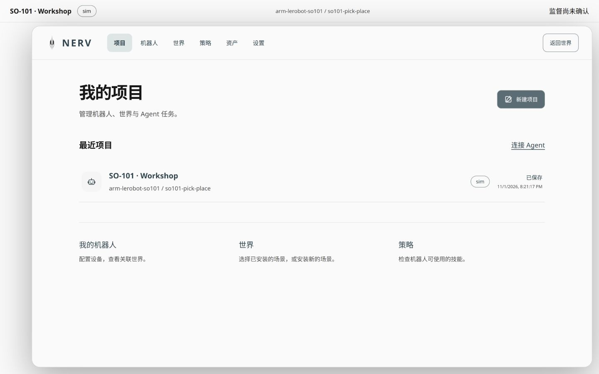

## 参与开发

NERV 由 Yanshi Robotics 维护，**DeepSeek Harness** 与 **Codex** 参与 AI 辅助开发，维护者负责审核、合并和发布。

开发入口包括[贡献说明](../../CONTRIBUTING.md)、[Runtime SDK](../../packages/nerv-runtime-sdk/README.md) 和[仓库规则](../../AGENTS.md)。欢迎通过 [GitHub Issues](https://github.com/Yanshi-Robotics/nerv/issues) 提交可复现问题和使用场景；报告中不要包含凭据、个人信息和私有录像。

应用代码使用 [MIT 许可证](../../LICENSE)，机器人资产、第三方包和策略权重保留各自许可。上述架构图附有[可编辑源文件](../../assets/readme/diagrams/README.md)。
