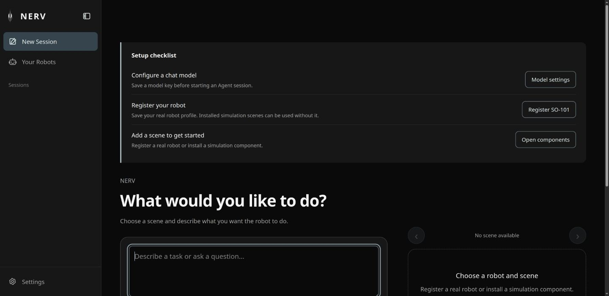
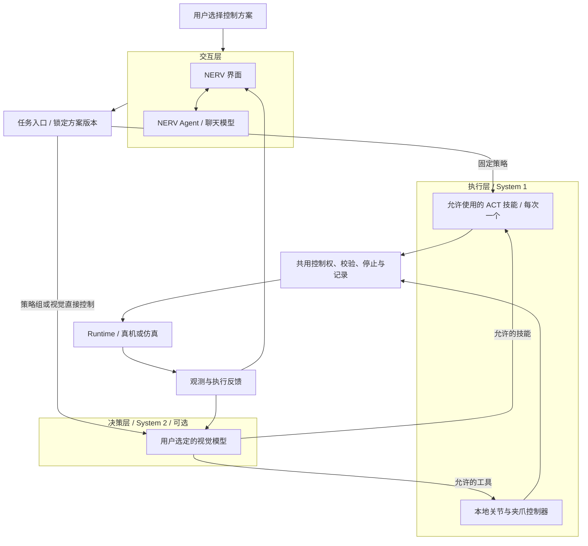
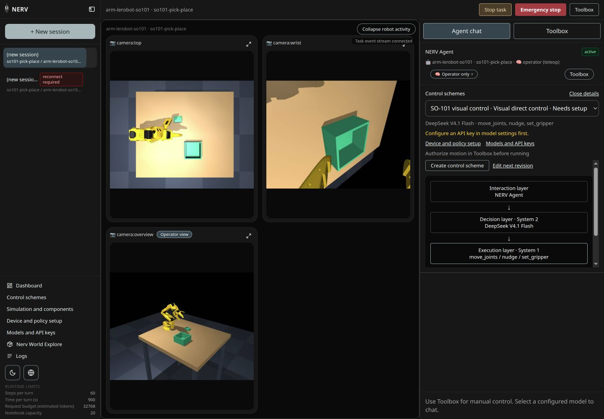
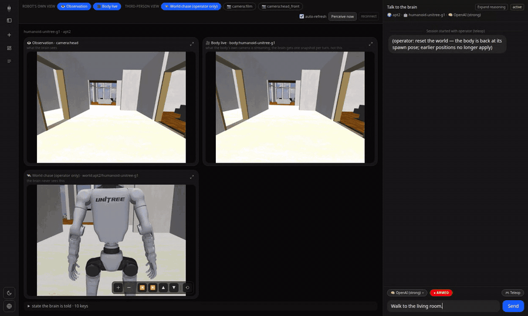
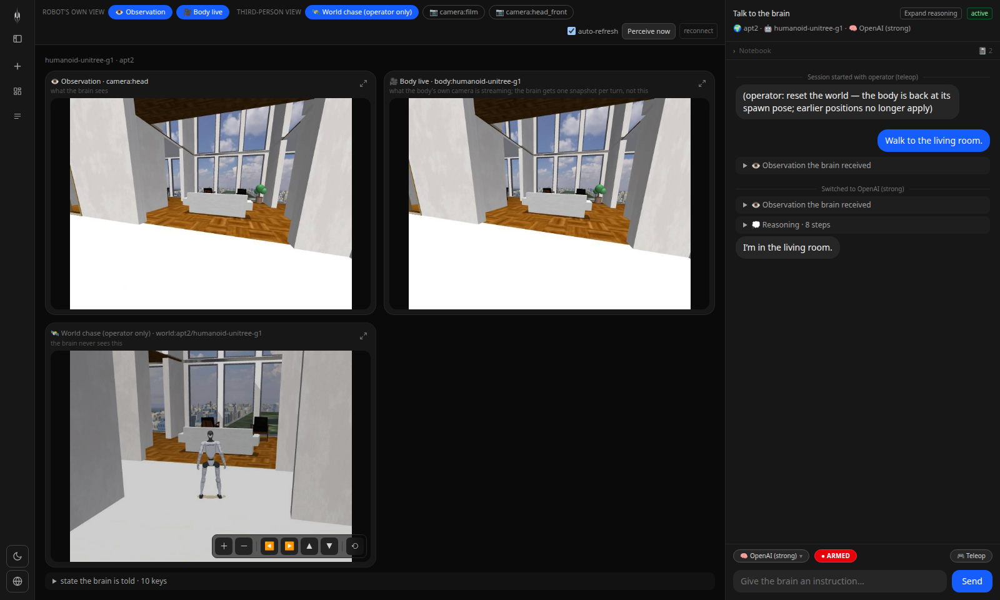
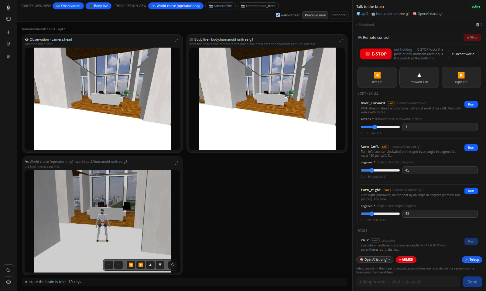
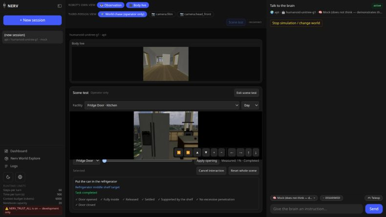

# NERV

[English](../../README.md) · [快速安装与启动](#快速安装与启动) · [SO-101 接入](standard-so101.md) · [架构](architecture.md) · [Runtime SDK](../../packages/nerv-runtime-sdk/README.md)

NERV 将交互、任务决策和本地动作执行连接起来。用户选择控制方案、提交目标，并查看机器人的实际执行反馈。你可以使用自己的 ACT 策略，让视觉模型选择和监督允许使用的技能，或通过视觉决策调用有限的关节与夹爪工具。

**0.8.2 是尚未发布的本地开发候选版**。下方安装命令使用公开发布版，不会安装本候选版；当前最新公开版本为 0.8.1。SO-101 实机验收和学生首次使用测试尚未完成。NERV 使用外部训练好的策略和已有标定，不承担训练或自动标定。

## 快速安装与启动

发布包安装器管理 uv、Python 3.12 和预构建网页。学生不需要安装 Node.js、Git 或编译前端。默认只安装主程序，SO-101 和仿真组件由用户在界面中按需安装。

Linux/macOS：

```bash
curl -fsSL https://github.com/Yanshi-Robotics/nerv/releases/latest/download/install.sh | sh
```

Windows PowerShell（实验性，尚未完成硬件验收）：

```powershell
irm https://github.com/Yanshi-Robotics/nerv/releases/latest/download/install.ps1 | iex
```

重新打开终端，然后启动：

```bash
nerv
```

服务就绪后自动打开浏览器，默认地址为 [http://127.0.0.1:8170](http://127.0.0.1:8170)。同一进程提供网页和 API。按一次 Ctrl+C，等待退出完成后再启动 NERV。端口被占用时，NERV 会报告错误，不结束其他进程，也不静默换端口。

```bash
nerv serve --no-browser
```

```bash
nerv serve --port 8171
```

```bash
nerv doctor
```

配置、会话、安装环境和缓存默认统一保存在 `~/.nerv`。`NERV_HOME` 仅用于需要隔离数据的测试等情况。启动主程序不会连接电机、启用动作或恢复旧任务。

更新前退出正在运行的服务，然后依次执行 `nerv update --check`、`nerv update` 和 `nerv`。[安装指南](github-install.md) 说明了回滚、解压安装包和旧 npm 启动器的迁移方法。

## 首次使用

每个新 Agent 会话都必须选择**已配置密钥的聊天模型和机器人场景**。通过新会话页右侧卡片的左右箭头或场景下拉框，选择已注册实机或已安装的仿真场景。卡片与任务输入共用同一份选择，点击开始时使用的就是当前展示的机器人和场景。网页、API 和 CLI 均不再提供纯对话创建入口；已有对话历史仍可查看。打开新会话页或设置不会调用模型；提交新密钥时需要明确进行一次图像测试，界面会提前说明请求内容。

“新建会话”是默认页面，点击 NERV 标志也会进入该页。侧栏依次提供新建会话、我的机器人、会话列表和设置，不再单列首页按钮。缺少模型或实机档案时，新会话页待办会直接引导到对应配置页；已有仿真场景无需注册实机即可使用。切换场景不会连接电机或授予动作权限。

“我的机器人”管理一台标准 SO-101 从臂。设置名称和图片后，依次安装运行组件、选择串口和已有标定、确认双相机，保存配置后再单独连接。修改显示名称不会改变 LeRobot 标定 ID。旧版已保存的设备会自动出现，无需重新注册。连接可能使电机带电，动作授权仍由操作者单独完成。

**不填密钥也能安装组件、注册设备、查看相机和运行固定 ACT**，入口是“我的机器人 → 设备与固定策略工作区”。策略在“设置 → 策略库”导入，不再阻塞设备注册。固定 ACT 始终在 NERV 内运行，使用同一套任务记录与停止机制。

仿真入口是“设置 → 组件与仿真”，依次显示已安装组件、安装进度和可安装组件。安装 SO-101 Simulation 后可打开场景浏览器，也可在创建聊天会话时选择仿真场景。现有抓取放置、零食分拣和汉诺塔三个场景包含本地控制器，不附带已训练的任务策略。

<div align="center"></div>

“关于”仅显示当前后端版本；“更新”保留主动检查、命令说明和许可链接。侧栏收起后，点击会话图标会展开历史列表，不会切换当前任务。

### 设置与保存

设置集中管理通用偏好、模型、控制方案、策略、组件、运行参数、诊断与更新。串口、标定和相机仍放在“我的机器人”。切换新会话页或设置不会取消机器人任务；存在活动设备工作区时，返回任务、停止任务和紧急停止入口持续显示。

四项运行参数对**新的 Agent 回合**生效。环境配置优先，被覆盖的字段会锁定并显示来源。已经开始的回合与机器人任务继续使用原有限制。机器人名称、处理后的图片和网页参数保存于 `~/.nerv/devices`，包含在更新快照中；回滚后新增资料保留在命令报告的恢复目录中。

SO-101 三维模型和解码器随安装包提供，按需加载。展示姿态用于识别设备，不代表实测姿态。用户图片经过大小检查、居中裁切和重新编码，不保留原始元数据。

## 三层架构

三层表示职责划分，不要求每次任务都调用三个模型。System 2 和 System 1 仅作为决策层与执行层的辅助名称。



主进程管理会话、任务和授权，独立 worker 持有设备和相机。SO-101 使用同一个 LeRobot 实例，全部运动经由 `robot.send_action()` 下发。ACT 推理和有限动作工具共用执行调度器，Agent 和决策模型都不能扩大用户选定的动作集合。

## 选择控制方案

| 方案 | 决策层 | 执行层 | 用户准备 |
|---|---|---|---|
| 固定策略执行 | 不启用 | 一个选定的 ACT | 已导入的兼容策略；点击运行无需 API key |
| 策略组执行 | 选定的视觉模型 | 一个或多个允许使用的 ACT，依次执行 | 视觉模型密钥与兼容策略 |
| 视觉直接控制 | 选定的视觉模型 | 有限关节移动、增量移动和夹爪工具 | 视觉模型密钥；无需 ACT |

固定 ACT 完全在 NERV 内运行，无需另开终端启动 LeRobot。只有一个技能的策略组就是视觉模型监督该技能。不同技能之间尚未验证的衔接会停止并要求操作者处理；将多个 ACT 加入列表，不等于它们能够可靠组合。

右侧对话框显示聊天模型、控制方案、实际决策模型、执行技能、“查看结构”和当前任务。固定方案提供“运行所选策略”。聊天回复和机器人任务独立取消。更换聊天模型不会替换正在执行的任务模型或方案。编辑方案生成新版本，运行中的任务继续使用原配置。

首次使用时，在方案区域查看并允许组件能力，随后即可选择其技能。动作授权仍需单独完成。缺少密钥的方案保持可见，并提供模型设置入口。

<div align="center"></div>

“停止回复”“停止任务”“紧急停止”分别处理不同对象。机器人停止按钮不依赖模型回复。更换方案或切换 Sim／Real 前，必须停止并确认执行结束。Runtime 协议 3 要求有期限的动作白名单和控制权代次，旧 worker 不会静默降级为不受约束的执行。

## 标准 SO-101 与策略导入

真机产品固定为标准 SO-101 follower 与 `lerobot[feetech]==0.6.1`。五个臂关节使用角度，夹爪使用 LeRobot 的 0–100 表示，两路相机为 `top`、`wrist`，预设为 640 × 480、30 FPS。推理不需要 leader。学生提供连接信息、已有标定和训练产物，不填写关节映射。

在“设备与策略接入”中选择 ACT 导出目录。NERV 检查权重、原生处理器和统计量、相机输入、六通道维度与文件指纹。训练产物不能证明单位或通道顺序时，固定标准声明会记录为“用户声明”。模型加载检查不操作硬件。连接后先执行“无动作策略检查”，再启用动作。原始导出目录保持只读；文件改变后需要重新导入和检查。

普通断开保留扭矩。显式卸力前需要支撑机械臂。软件停止会请求保持当前位置，通信中断时不能确认保持已经执行。请求目标、LeRobot 实际下发目标和实测位置分别记录。执行结束或模型判断完成，不等于已经证明任务成功。

[SO-101 指南](standard-so101.md) 说明设备发现、档案保存、标定、相机交接与恢复。未验收的真机适配通过可见的监督验收勾选进入；该操作不会将设备标为已验证。

## 组件、更新与支持范围

“模型与密钥”采用选择模型、输入密钥、测试并保存的流程。测试会发送一次内置图片请求，可能产生供应商费用，不会上传实时相机画面。密钥不进入会话日志或诊断报告。聊天模型和决策模型独立选择。

组件安装提供持久进度、取消、校验和重试。首版不开放任意仿真包导入；扩展边界见[控制方案与组件接口](../../guides/control-schemes.md)。真机与仿真绑定独立保存。真实 ACT 不会因为输入维度相同而自动获得仿真兼容性。

```bash
nerv update --check
```

```bash
nerv update
```

```bash
nerv rollback
```

更新或回滚前先停止任务、断开设备并退出 NERV。新主程序与所有已安装的官方组件先在独立环境中安装和检查，通过后统一切换。失败会恢复旧配置和环境指针。回滚恢复上一套环境与配置，另存较新的配置副本，密钥和事件历史保持当前状态。[安装指南](github-install.md) 说明这一边界与恢复方式。

| 系统或路线 | 当前状态 |
|---|---|
| Linux 主程序与 SO-101 仿真 | 软件候选版；本地安装和回归检查与实机验收分别记录 |
| Linux SO-101 真机 | 适配器和引导已实现，真实抓取验收待完成 |
| Windows 原生／WSL2 | 实验性；串口、相机后端和透传需要实机验证 |
| macOS Apple Silicon／Intel | 实验性；依赖、相机权限、CPU/MPS 分别验证 |
| G1 仿真 | 保留源码运行与回归，不列入学生一键安装组件 |
| GR00T／SmolVLA | 后续策略插件，尚未交付 |

[发布验收指南](../../guides/release-acceptance.md) 分别列出软件、仿真、固定 ACT、视觉监督、视觉直接控制与新用户测试要求。仿真结果和测试替身均不能代替真实抓取证据。

## 演示与界面

下方 G1 录像来自早期仿真版本，展示头部相机观测与步态技能，不作为 SO-101 真机证据。指令为“Walk to the living room.”。完整回合未剪辑，以 2.5 倍速播放，另有[原速 MP4](../../assets/readme/media/walk-to-the-living-room.mp4)。

<div align="center"></div>

<details>
<summary>早期界面与世界视图</summary>

0.6 版已经调整模型、任务和设备接入控件。保留的截图展示早期导航、观测与操作员视图；追拍相机和 World Explore 仅供操作员使用。

<div align="center"></div>
<div align="center"></div>
<div align="center"></div>
<div align="center"></div>
<div align="center"></div>
<div align="center"></div>

[世界库工具](../../worlds/docs/explore/README.md)介绍场景测试与浏览器视图。G1 的平地步态不提供抓取、家具操作、自主坐下或上下楼梯能力；场景检查不能证明自主任务成功。

</details>

## 扩展与贡献

[公开路线图](ROADMAP.md) 说明 Harness 扩展、插件管理与 Yanshifu 集成的后续方向。这些能力不属于 0.8.2 的实现范围。

[Runtime SDK](../../packages/nerv-runtime-sdk/README.md) 定义版本化发现、生命周期和受限调度。设备 SDK 留在 worker，策略插件产生候选目标，不持有硬件。开发说明见 [CONTRIBUTING.md](../../CONTRIBUTING.md)、[AGENTS.md](../../AGENTS.md) 和 [CHANGELOG.md](../../CHANGELOG.md)。

问题报告请提供版本与脱敏复现步骤，不附带密钥、未经检查的相机画面或私有配置归档。NERV 使用 [MIT 许可证](../../LICENSE)，SDK、模型与外部资产保留各自许可证。
