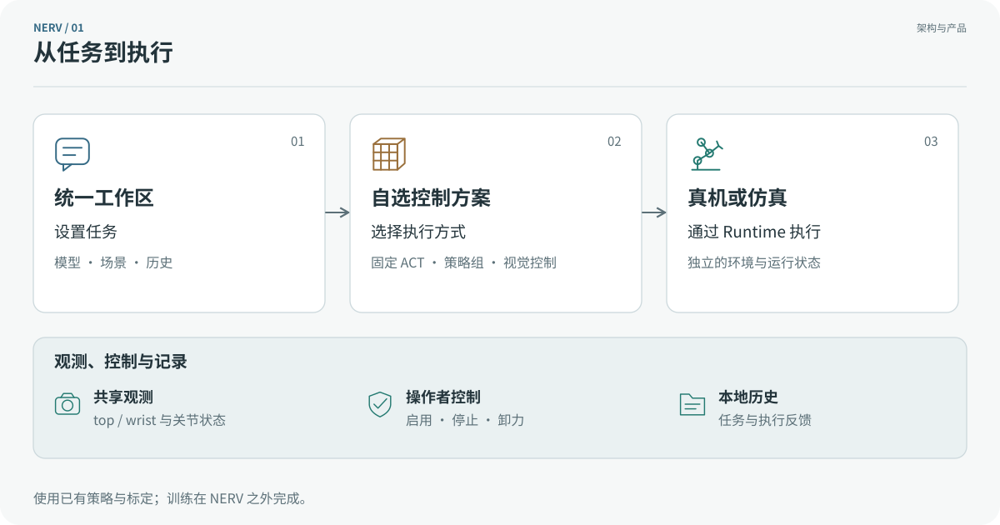
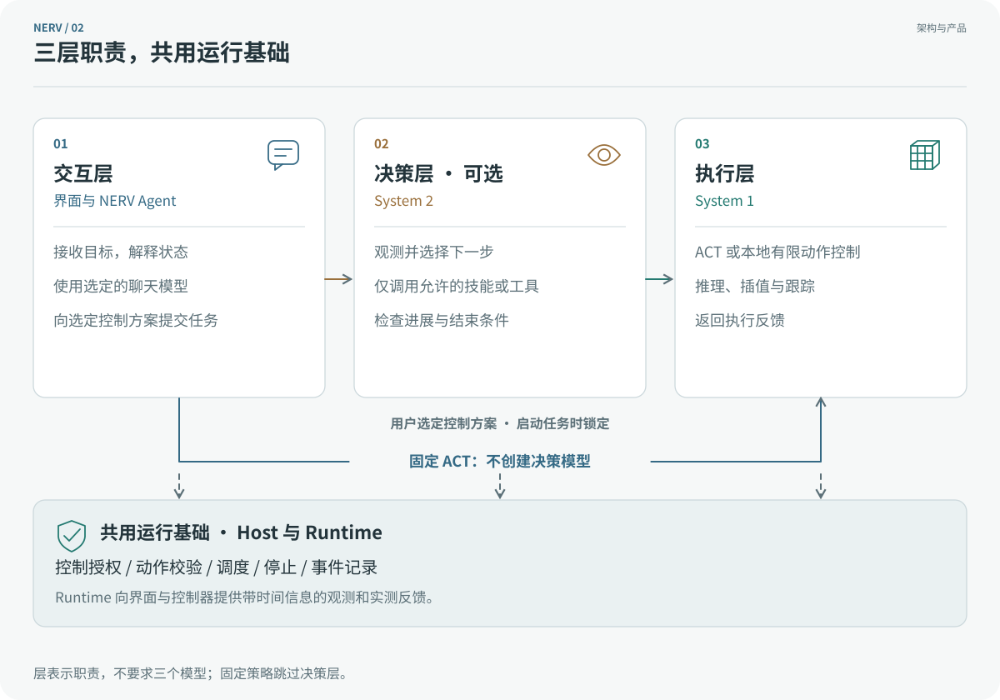
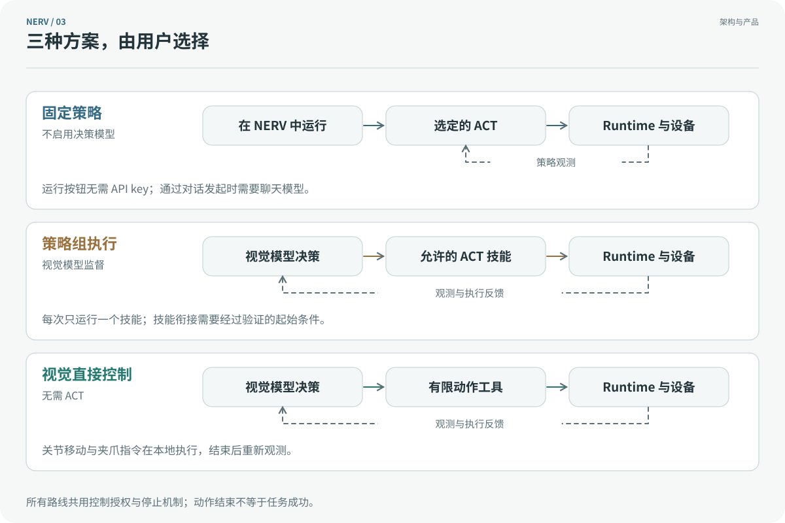

# NERV

[](../../pyproject.toml) [](../../guides/release-acceptance.md) [](../../LICENSE)

[](../../README.md) [](README.md)

NERV 是使用已训练策略和视觉 AI 执行机器人任务的本地工作区。连接机器人或仿真场景、选择控制方案后，你可以在同一界面查看观测和执行记录。训练与标定继续使用原有工具完成。

[SO-101 接入](standard-so101.md) · [架构](architecture.md) · [路线图](ROADMAP.md) · [变更记录](../../CHANGELOG.md)

0.8.5 是尚未发布的本地候选版。下方安装器使用公开发布版，当前为 0.8.1，不会安装此候选版。SO-101 实机验收和学生首次使用测试尚未完成。

<div align="center"></div>

## 快速安装与启动

GitHub 安装器管理 uv、Python 3.12 和预构建界面，无需 Node.js、Git 或自行编译前端。默认先安装主程序，机器人与仿真组件在设置中按需安装。

Linux／macOS：

```bash
curl -fsSL https://github.com/Yanshi-Robotics/nerv/releases/latest/download/install.sh | sh
```

打开新终端后启动：

```bash
nerv
```

Windows PowerShell（实验性支持）：

```powershell
irm https://github.com/Yanshi-Robotics/nerv/releases/latest/download/install.ps1 | iex
```

打开新的 PowerShell 窗口后启动：

```powershell
nerv
```

NERV 在 [http://127.0.0.1:8170](http://127.0.0.1:8170) 提供界面与 API，启动就绪后打开浏览器。配置、会话、安装环境和缓存保存在 `~/.nerv`。启动不会连接电机、启用运动或恢复旧任务。按 Ctrl+C 后，等待退出完成再重新启动。

远程终端可使用：

```bash
nerv serve --no-browser
```

通过 `--port` 可选择其他端口；端口被占用时，NERV 报错而不会关闭其他进程。[安装指南](github-install.md) 介绍诊断、解压安装包及旧版 npm 启动器的迁移方法。

## 可以用 NERV 做什么

- **连接设备与仿真**。 用分步引导保存标准 SO-101 的串口、已有标定和双相机配置；仿真作为可选组件安装。
- **使用自己的策略**。 导入外部训练的 ACT，检查兼容性，在 NERV 内加载和运行。
- **自己决定控制方式**。 选择固定策略、视觉模型监督策略组，或视觉模型调用有限动作工具。
- **分开对话与机器人任务**。 聊天模型负责交互，任务使用选定的方案；停止回复和停止任务是独立操作。
- **保留本地工作记录**。 会话、任务事件、配置与环境保存在本机；重启恢复历史，不自动恢复动作。

0.8.4 候选版将“我的机器人 → SO-101 设置”整理为六步：检查电脑、安装组件、识别机械臂、检查前置条件、确认相机、保存配置。电机配置和标定仍在外部完成；只有点击“检查设备”后，NERV 才读取电机设置。详见 [SO-101 接入](so101-setup.md)。

沿用 0.8.3 的安装功能：“设置 → 系统与安装”、CPU／NVIDIA 安装方案、完整依赖下载进度和持久暂停／继续。操作与平台限制见[可恢复安装](recoverable-installation.md)。

## 首次使用

“新建会话”是默认页面，点击 NERV 标志也会进入该页。“我的机器人”管理已保存的 SO-101 档案，“会话”保存对话历史，“设置”集中管理模型、策略、组件和偏好。

1. 选择场景：在“我的机器人”注册标准 SO-101，或从“设置 → 组件与仿真”安装 SO-101 Simulation。
2. 在“设置 → 模型与密钥”配置聊天模型。保存新密钥前需主动执行一次内置图片测试，服务商可能收费；测试不会发送相机画面。
3. 在新会话页选择机器人或场景、描述任务并开始。创建会话需要已配置模型和有效场景；缺失项会提供直接设置入口。
4. 运行机器人任务前，选择兼容控制方案，并单独授权动作。

没有 API key 仍可安装组件、配置机器人、查看相机，并从“我的机器人 → 设备与固定策略工作区”运行固定 ACT。策略通过“设置 → 策略库”单独导入。

<div align="center"></div>

机器人详情默认展示本地三维模型，展示姿态不代表实测位置。名称、图片和连接配置会保存，运动授权不会随重启恢复。“关于”显示运行版本，“更新”提供主动检查入口。切换页面保留当前工作区及停止控件；运行参数修改对新的 Agent 回合生效，不改变已开始的工作。

## 三层架构

三层表示职责划分，不要求每次任务都经过三个模型。System 2 是可选决策层的辅助标注，System 1 表示本地执行层。

<div align="center"></div>

主进程管理会话、任务和授权，独立 Runtime 持有机器人与相机。SO-101 使用同一个原生 LeRobot 实例，所有动作统一经过 `robot.send_action()`。ACT 与有限动作工具共用调度器，模型不能扩大方案允许的动作集合。生命周期和协议说明见[架构指南](architecture.md)。

## 选择控制方案

<div align="center"></div>

| 方案 | 决策层 | 执行层 | 所需条件 |
|---|---|---|---|
| 固定策略 | 不启用 | 一个选定的 ACT | 已导入兼容策略；运行按钮无需 API key |
| 策略组 | 选定的视觉模型 | 允许的 ACT 技能，每次一个 | 视觉模型凭据和兼容技能 |
| 视觉直接控制 | 选定的视觉模型 | 有限关节移动、增量和夹爪指令 | 视觉模型凭据；无需 ACT |

固定 ACT 完全在 NERV 中运行，无需另开 LeRobot 终端。只有一个技能的策略组为该技能增加视觉监督。技能组合需要验证衔接条件；未经验证的衔接会停止并交由操作者处理。

右侧对话框分别选择聊天模型和控制方案，显示方案的决策模型、技能、结构查看入口及当前任务。运行中的任务保留原方案版本和模型设置。“停止回复”“停止任务”和“紧急停止”用途不同；更换方案或切换 Sim／Real 前须停止任务。

## 标准 SO-101 与策略导入

真机约定为一台标准 SO-101 从臂，使用 `lerobot[feetech]==0.6.1`：五个臂关节采用角度，夹爪采用 LeRobot 的 0–100 范围；`top` 和 `wrist` 相机为 640 × 480、30 FPS。用户提供串口、机器人 ID、已有标定及相机身份。推理不需要 leader，也不需要自定义关节映射。

通过“设置 → 策略库”导入外部训练的 ACT 目录。NERV 检查权重、原生处理器、统计量、相机输入、六通道形状和指纹。缺少单位或顺序元数据时，需要确认固定标准声明，并记录其来源为用户声明。原始模型只读，文件变化后需要重新检查。启用动作前先做无动作策略检查。[ONNX 运动策略导入](motion-policies.md) 使用独立部署契约，并锁定用户选定的版本。[SO-101 指南](standard-so101.md) 介绍注册、相机确认与恢复流程。

连接可能使电机带电。普通断开保留扭矩，显式卸力前须支撑机械臂。软件停止会请求保持位置，通信中断后无法确认执行结果。请求目标、实际下发目标和实测位置分别记录；执行结束或模型声称完成都不等于任务成功。操作者接受未验证设备的限制，也不代表硬件集成已经通过验收。

## 组件、更新与支持范围

NERV 使用 uv 管理的 Python 虚拟环境，默认保存于 `~/.nerv`，与系统 Python 和训练环境分开。目录归属、测试版隔离、更新方式及硬件共享边界见[环境管理与隔离说明](environments.md)。

0.8.5 候选版将仿真引擎和场景资源分开安装：先在“组件与仿真”安装引擎，再到“我的资产”安装抓取放置、零食分拣、汉诺塔或 G1 住宅场景。场景包不附带已训练策略。设置中已安装组件置顶，安装支持持久进度、取消、完整性检查和重试。0.8.5 候选版增加了 [MJCF 数据资产导入、个人副本与版本保存](assets.md)，不执行第三方仿真代码。Real 与 Sim 分别绑定，张量维度相同不代表真机 ACT 可用于仿真。扩展边界见[组件与方案约定](../../guides/control-schemes.md)。

更新或回滚前，先停止任务、断开设备并退出 NERV。检查公开更新：

```bash
nerv update --check
```

安装更新，完成后重新启动 NERV：

```bash
nerv update
```

需要返回上一安装版本时：

```bash
nerv rollback
```

更新会先准备主程序与已安装官方组件，再激活整套环境。更新失败会恢复原环境指向和配置；回滚会保留较新的配置副本，凭据与会话历史保持当前内容。详见[更新与恢复说明](github-install.md)。

| 系统或路线 | 状态 |
|---|---|
| Linux 主程序与 SO-101 仿真 | 已做本地软件和安装检查；硬件单独验收 |
| SO-101 真机／Linux | 已实现适配器与引导；真实抓取验收待完成 |
| Windows 原生／WSL2 | 实验性支持；USB、相机后端及透传需实机测试 |
| macOS Apple Silicon | 实验性 CPU 安装；相机权限和硬件仍需验证 |
| macOS Intel | 0.8.5 暂无主程序安装包：锁定的 cryptography 依赖缺少兼容 wheel |
| G1 仿真 | 候选版支持受管理场景与本地 ONNX 导入；需要兼容且通过检查的运动策略 |
| GR00T／SmolVLA | 计划中的策略后端，尚未交付接入 |

[验收指南](../../guides/release-acceptance.md) 分别说明软件、仿真、真实任务和新用户测试。[路线图](ROADMAP.md) 介绍后续 Harness 扩展、插件管理和 Yanshifu 集成，均不属于 0.8.2 的实现范围。

## 演示与界面

下方 G1 录像来自早期仿真版本，展示头部相机观测与步态技能，不作为 SO-101 真机证据。指令为“Walk to the living room.”。完整回合未剪辑，以 2.5 倍速播放，另有[原速 MP4](../../assets/readme/media/walk-to-the-living-room.mp4)。

<div align="center"></div>

<details>
<summary>早期界面与世界视图</summary>

0.7 版本的控制方案工作区：

<div align="center"></div>

保留的截图展示早期导航、观测与操作员视图，模型、任务和设备接入控件此后已有调整。追拍相机和 World Explore 仅供操作员使用。

<div align="center"></div>
<div align="center"></div>
<div align="center"></div>
<div align="center"></div>
<div align="center"></div>
<div align="center"></div>

[世界库工具](../../worlds/docs/explore/README.md)介绍场景测试与浏览器视图。G1 的平地步态不提供抓取、家具操作、自主坐下或上下楼梯能力；场景检查不能证明自主任务成功。

</details>

## 贡献者与开发

NERV 由偃师造物维护。参与开发的 AI 贡献者包括：

- **DeepSeek Harness**：辅助项目开发。
- **Codex**：辅助项目开发。

修改由维护者审阅，合并和发布由维护者决定。

开发环境与评审要求见[贡献指南](../../CONTRIBUTING.md)，扩展接口见 [Runtime SDK](../../packages/nerv-runtime-sdk/README.md)，仓库约定见 [AGENTS.md](../../AGENTS.md)。可通过 [GitHub Issues](https://github.com/Yanshi-Robotics/nerv/issues) 提交版本和脱敏复现步骤，请勿附带凭据或私有录像。

NERV 使用 [MIT 许可证](../../LICENSE)。外部 SDK、机器人模型和媒体保留各自许可证。

官方策略的许可与对应源码要求单独记录，见[策略发布规范](guides/policy-publishing.md)。NERV 应用自身的许可证保持不变。
