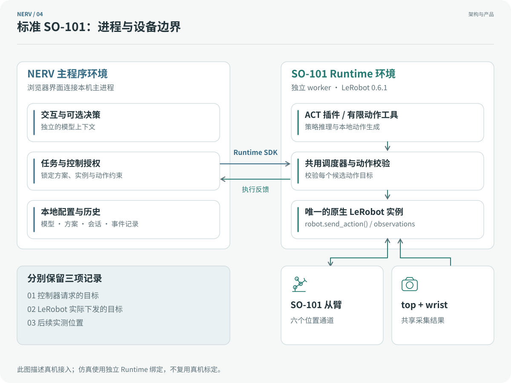

# 架构与控制

[English](../../guides/architecture.md) · [NERV](README.md)

NERV 0.8.2 将对话、任务监督与本地执行分开。System 1 表示 Runtime 内的执行层，不是额外一个 Python 环境。

标准 SO-101 worker 持有唯一的 LeRobot 设备实例。ACT 推理和有限关节控制都向同一个调度器提交候选目标；主进程不导入 LeRobot，也不加载策略张量。

## 三层职责

交互层处理对话与任务提交，决策层根据观测选择和监督允许的动作，执行层运行 ACT 或本地有限动作控制器。固定策略任务不创建决策模型，点击运行无需 API key。视觉直接控制仍经过本地执行器。System 2、System 1 仅作为图示和历史日志角色的辅助名称。

用户选定完整控制方案，任务启动后锁定其版本、模型配置、策略指纹和实例。聊天模型与任务模型独立，更换聊天模型不会改变正在执行的机器人任务。Agent 统一通过任务入口请求运动，不能越过方案直接操作关节。

## 架构

NERV Agent 通过任务入口提交目标。任务按用户选定的方案运行：固定 ACT 由 Host 直接管理，策略组与视觉直接控制创建独立的决策上下文。Runtime 持有设备与传感器，并在本地执行策略或受限动作；Host 协调控制权、实例生命周期与事件记录。World Control 负责仿真环境操作。

### 进程与设备边界

Agent 与 System 2 分别使用独立的 harness、上下文、摘要、供应商续接状态和用量记录。两者共用追加式事件日志，通过任务视图区分各自记录。运行后端声明传感器与技能，界面读取这些能力。仿真与现实各有独立的环境绑定。操作员的场景控制和仿真真值不进入 Agent 观测。模块边界由[接口类型](../../src/nerv/nerve/)定义。

## 对话与世界控制

右侧聊天区属于 NERV Agent，机器人执行和手动控制期间仍可交流。**停止回复**仅取消当前对话决定；**停止任务**等待本地执行确认；**急停**锁定动作，操作员解除后回到未授权待命。

中间相机外框内显示 System 2 的公开决策摘要、执行反馈和宿主事件。动态气泡带有来源和时间，不进入相机原始帧或策略输入。独立事件流支持重连与去重，历史会话不显示实时画面。

业务能力分为五类：`agent_tools` 提供计算和会话历史；`robot_actions` 提供机器人动作和技能；`robot_tasks` 管理任务；`world_control` 修改仿真配置与状态；`instance_control` 管理实例生命周期。供应商的函数调用和 MCP 只负责传输，不合并这些能力的权限。

在**新建会话**中选择 SO-101、仿真和一个桌面场景，再配置该场景支持的物品槽位。物品类型、标称尺寸和质量来自世界目录，柔性材料参数尚未经过实物标定。每个实例独立生成 MJCF、配置与来源哈希。

**工具箱 → 仿真世界**与 Agent 的世界命令使用同一服务。重置保留所选物品和世界进程，结束任务并撤销动作授权。改变物品拓扑时使用**结束并重建实例**；旧会话保留历史，不能控制新实例。天气、家具、风格等能力只有在世界声明并实现后才会出现；当前桌面场景提供物品替换与重置。现实环境拒绝修改世界属性。

创建聊天会话要求已登记模型密钥和有效场景。创建、查看和手动操作仿真不会发起模型请求；独立的操作者工作区无需密钥。语言控制需要配置 VLM，并产生调用费用。当前桌面仿真没有部署 ACT 或哈诺塔执行策略。长期自主目标命名为 **ultimate**；本版仍是由 Agent 协调操作的系统。

## 视觉模型

面板按供应商管理密钥，只显示是否已保存，不向浏览器返回保存的值。面板列出支持的模型，不提供模型或推理强度选择。同一供应商的已注册模型共用密钥，实际使用权限取决于供应商账户。聊天区读取同一注册表。纯文字模型和 Mock 不进入正式运行目录，也不作为自动回退。

OpenAI、DeepSeek 和 xAI 分别使用对应的 Responses 协议参数。Gemini 使用无服务端会话存储的 Interactions API，Claude 使用原生 Messages 流式接口。带签名的思考内容和推理续接项只会传回匹配的供应商接口。界面按型号展示合法推理强度；未指定时省略参数，使用供应商默认值。系统分别记住上次模型和每个型号的强度。当前回复未结束时不能切换聊天模型；机器人任务独立保留启动时锁定的模型配置。

| 供应商 | 预置视觉模型 | 原生推理强度 |
|---|---|---|
| OpenAI | GPT-6.1 Sol、GPT-6 Astra | low、medium、high、xhigh、max |
| DeepSeek | V4.1 Flash | none、low、high、max |
| Gemini | 3.8 Flash、3.5 Flash-Lite | Flash：low、medium、high；Lite 另支持 minimal |
| xAI | Grok 4.7、Grok 4.3 | 4.7：low、medium、high、xhigh；4.3：none、low、medium、high |
| Anthropic | Claude Opus 5.5、Claude Sonnet 5.5 | low、medium、high、xhigh、max |

模型能力依据于 2026-10-20 核对的供应商文档：[OpenAI](https://developers.openai.com/api/docs/models/gpt-6.1-sol)、[DeepSeek](https://api-docs.deepseek.com/api/create-response/)、[Gemini](https://ai.google.dev/gemini-api/docs/thinking)、[xAI](https://docs.x.ai/developers/model-capabilities/text/reasoning)、[Anthropic](https://platform.claude.com/docs/en/build-with-claude/effort)。只有操作员提交密钥登记表单时才发送一次识图请求。打开设置、切换选项和创建会话均不会请求供应商。

可选诊断 API 检查图像输入、工具调用和多轮续接。诊断结果不限制创建 VLM 会话或使用模型；这两项只要求已登记非空密钥。操作者工作区通过独立入口创建，不进入聊天会话列表，也不需要密钥。已有密钥无需重新登记。密钥后来失效时仍可创建会话，调用时显示明确错误。失败回执保留用户输入，并提供重试和模型设置入口；重试不会重放旧机器人动作。

地址、型号、强度或凭据变化后，原有诊断和实机记录不再适用。一次密钥登记通过，不代表其他型号、通用视觉能力或机器人能力已通过验收。Agent 回复失败不会取消独立任务；System 2 故障仍按本地停止与监督规则处理。

## Agent harness

策略组中的 ACT 技能启动后先返回执行编号。worker 运行本地策略期间，独立决策上下文继续观察并查询执行状态。固定策略任务由 Host 监督，不创建这一决策上下文。直接读取类工具和已有 G1 技能也可在工具调用中返回结果。等待模型响应时，本地停止和监督机制继续生效。

默认的 `AgentHarness` 通过可替换接口获得宿主 Link、模型供应商、上下文管理器和摘要器，不持有机器人对象，也不加载 ACT。

每个会话独立保存追加式事件日志、图片资产、任务和笔记。旧 JSON 会话执行一次性迁移，并保留 `.legacy` 源快照。JSON 快照可从日志重建；历史检索和分页阅读仅能访问当前会话。

上下文预算覆盖指令、笔记、摘要、完整工具调用组、工具定义、当前图片、供应商续接项和输出预留。Token 与图片预算属于估算；供应商返回实际用量时另行记录。摘要使用不带工具、图片及主对话推理续接的独立请求。摘要失败时保留原文；无法满足请求预算则暂停。

进程重启后，未结束的回合被记为中断、结果未知。系统恢复历史，不重放动作。新聊天消息仅使 Agent 的旧回复失效。明确更新任务时递增任务版本，停止旧执行后重新规划。任务启动时冻结 System 2 的模型配置和推理强度。

## 运行插件

`nerv-runtime-sdk` 可独立安装，不依赖 NERV 核心、厂商 SDK、PyTorch 或 MuJoCo。Python worker 在自己的环境内发现 `RuntimeProvider` 入口。非 Python 服务可实现相同 HTTP／MCP 协议，并登记服务 URL。

模块导入和 `describe()` 不得操作设备或 GPU。准备、加载策略、使能、执行、取消、急停、解除和断连分别处理。机器人描述、环境绑定和策略资产各有独立契约。宿主不会向 worker 注入整仓源码或模型密钥。

[Runtime SDK 指南](../../packages/nerv-runtime-sdk/README.md)与[只读插件示例](../../examples/inspection-runtime/)说明协议 3 的接入方式。插件须提供 `actions()`；不兼容的 worker 在准备前被拒绝。SDK 提供插件发现、协议接口和只读一致性检查。

方案与组件的协议详见[控制方案与组件接口](../../guides/control-schemes.md)。

## 选定的控制方案

[控制方案与组件约定](../../guides/control-schemes.md)介绍不可变方案版本、固定策略任务、独立决策上下文和协议 3 的控制授权。右侧面板只显示选定路线；图示用于比较可选模板，不为任务授予全部动作权限。

交互层、决策层和执行层是主要术语，System 2 与 System 1 仅用于图示辅助标注和已有日志角色。固定策略任务不创建模型；视觉直接控制仍由本地控制器执行，模型不直接写电机寄存器。

## 导航与偏好设置

新建会话、我的机器人、设置和会话视图通过静态包中的 hash 路由导航。应用外层持有任务工具栏与操作者监督逻辑；切换页面不转移控制权，也不取消执行。机器人工作区复用任务服务，显示名称和头像不改变标定身份。

四项允许修改的对话参数通过文件锁与原子写入保存。每个 Agent 回合读取参数快照，优先级为环境配置、网页偏好、默认值。机器人任务保持启动时的方案版本和授权，Runtime 协议仍为版本 3。

新会话页的场景选项来自已注册实机和兼容的已安装仿真场景。展示卡片与创建表单共享同一选择。HTTP 和 CLI 在凭据校验、节点启动或会话写入之前拒绝缺少机器人或仿真场景的请求；真机工作区需要机器人，不绑定仿真世界。历史读取仍支持旧的无机器人会话。

## 历史图示

此前的[节点拓扑图](../../assets/readme/images/structure.svg)与[技能执行时序图](../../assets/readme/images/flow.svg)保留供版本比较。它们使用旧角色名称，当前三层职责与执行路线以上方图示为准。
