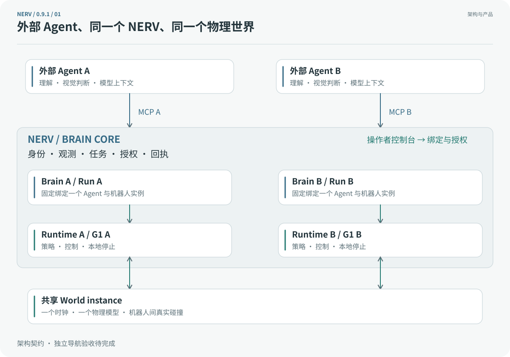
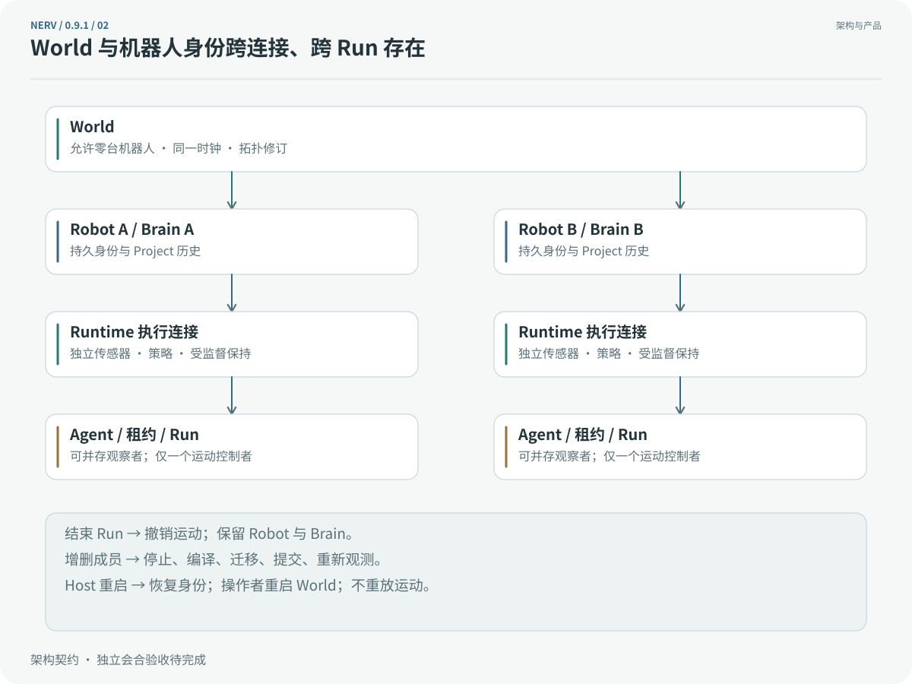
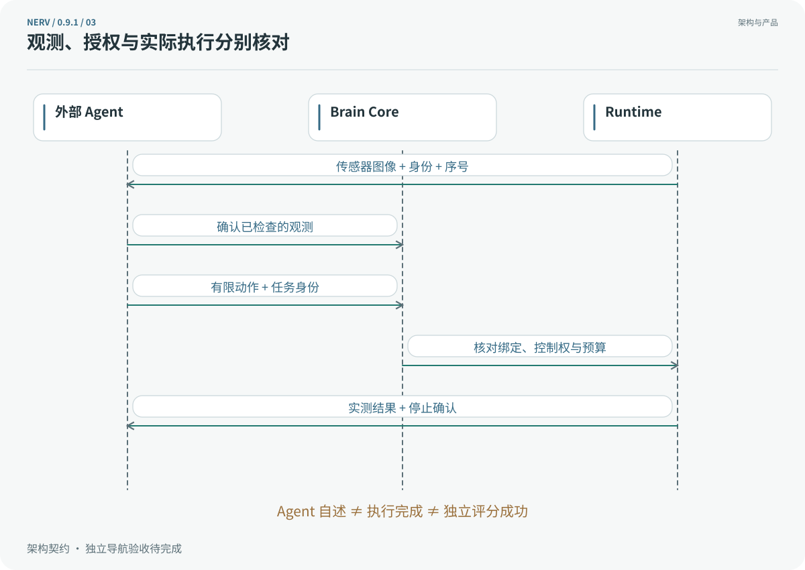
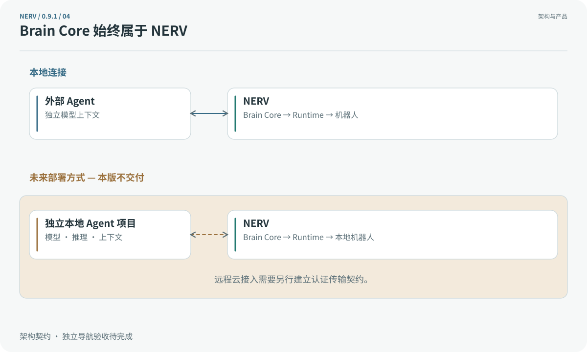

# NERV 0.9.1 架构

[English](../../guides/architecture.md) · [NERV](README.md)

Brain Core 是随 NERV 安装的有状态交互模块。外部 Agent 负责目标理解、视觉判断、规划、模型调用与上下文；Brain Core 负责身份绑定、观测、能力、授权、任务和回执；Runtime 负责驱动、ACT／步态策略、高频控制与停止。MCP 是通信协议，不承担控制状态机的职责。

| 对象 | 契约 |
|---|---|
| Project | 一台机器人的可复用配置与历史 |
| Run | 固定项目修订及机器人实例的一次运行 |
| Brain instance | 每台 Robot 对应一个规范 Brain，跨 Run 与 Agent 连接保留 |
| Robot instance | 独立关节、执行器、传感器、Runtime 与控制记录；不同于机器人型号 |
| World instance | 独立场景与时钟，允许零台机器人，通过事务修改成员并递增拓扑修订 |
| Agent attachment | 获授权的连接；观察者可以并存，连接本身不授予运动权 |
| Runtime attachment | 当前执行连接，在线状态独立管理 |
| Control lease | 一个运动控制者，可撤销代次，Runtime 独立监督动作期限 |

操作者先创建空 World，授权模板、配额和出生位置。未绑定的 MCP 连接发现获准资源，幂等申请 Robot 与 Brain，再启动引用这些资源的 Run。旧的 Run 预留流程仅为兼容入口，不作为新生命周期验收路径。模型关节带实例命名空间，总线端点映射回策略原始关节名。控制器、队列和任务分别保存；另一台机器人的几何仍参与碰撞与避障。组合器读取源场景生成实例，不手工修改 MJCF 或第三方机器人原件。

结束一个共享 Run 只撤销它的控制，使其 Runtime 在世界中保持，不关闭世界或另一台 Runtime。共享世界停止只属于操作者；成员变更通过独立候选模型迁移并递增拓扑修订。Host 恢复时保留身份、中断原 Run，不恢复运动。原 Agent 可以读取历史；预授权范围内的新控制仍需要新观测和新租约。

Project／Run／Task 日志继续作为事实来源。观测确认是客户端的声明；动作接受不等于执行完成；Agent 自述不等于独立任务评分。Brain 不保存外部完整对话、隐藏推理或模型密钥。

安装包排除旧 nerv.brain、nerv.harness、nerv.vlm 和内部决策模块。源码与历史保留。旧模型、密钥和聊天接口退役，旧内部决策方案必须显式重选；固定策略继续支持。这是兼容性变化，不是普通补丁。

未来部署关系是：**独立本地 Agent 项目 → NERV Brain Core → Runtime／机器人**。Brain Core 不成为独立安装的 Agent 产品。远程云接入、多机器人协作规划、新策略训练和真机验收不属于本版。共享 G1 独立验收仍是交付门槛，架构图不作为验收证据。

本轮源码仍在资格验证中。长时间稳定保持、完整设备附着契约、安装候选的实际界面检查和三轮独立双 Agent 会合仍是完成门槛。拓扑提交后 Runtime 准备失败会标记为需要恢复，不宣称无痕回滚。Host 重启保留资源身份，由操作者重启世界；已预授权 Agent 在新观测后重新申请控制。
