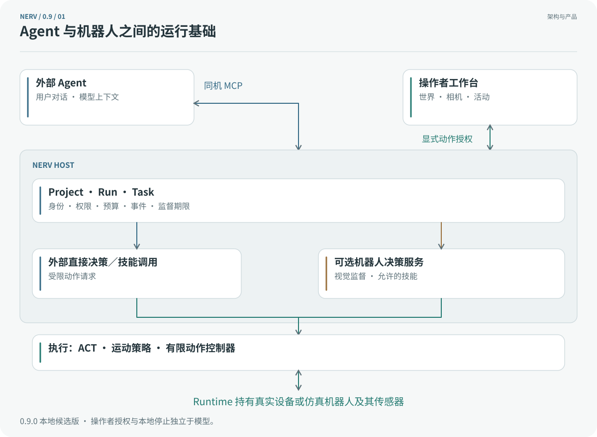
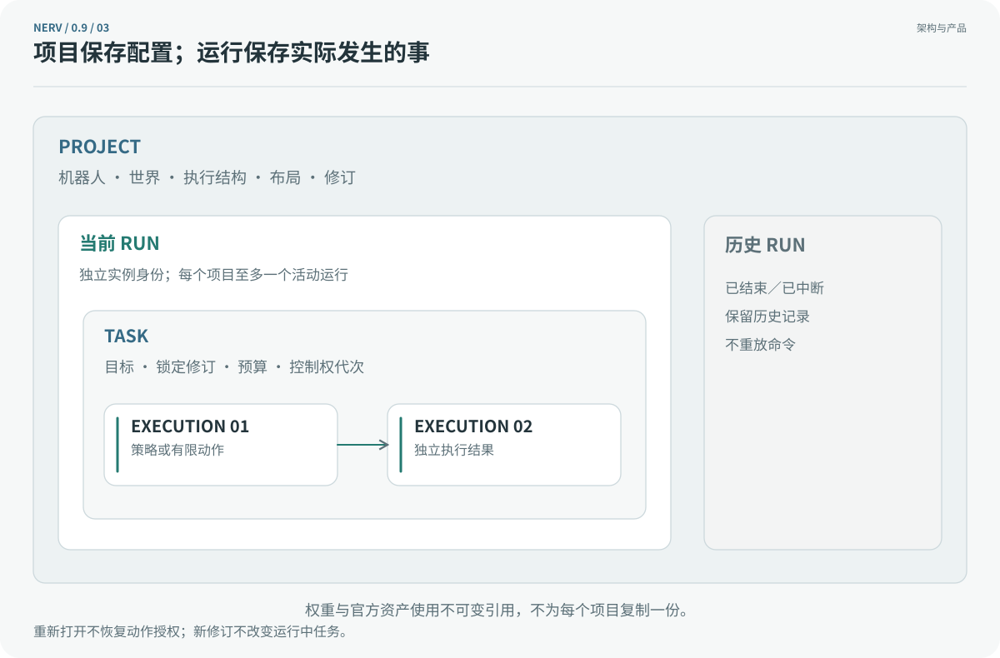
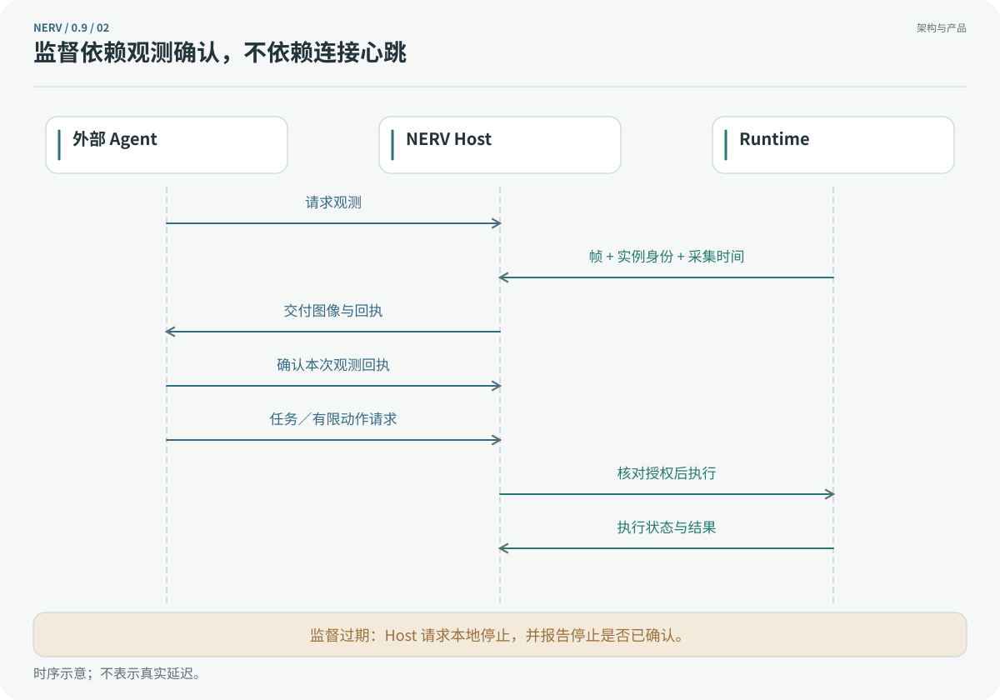
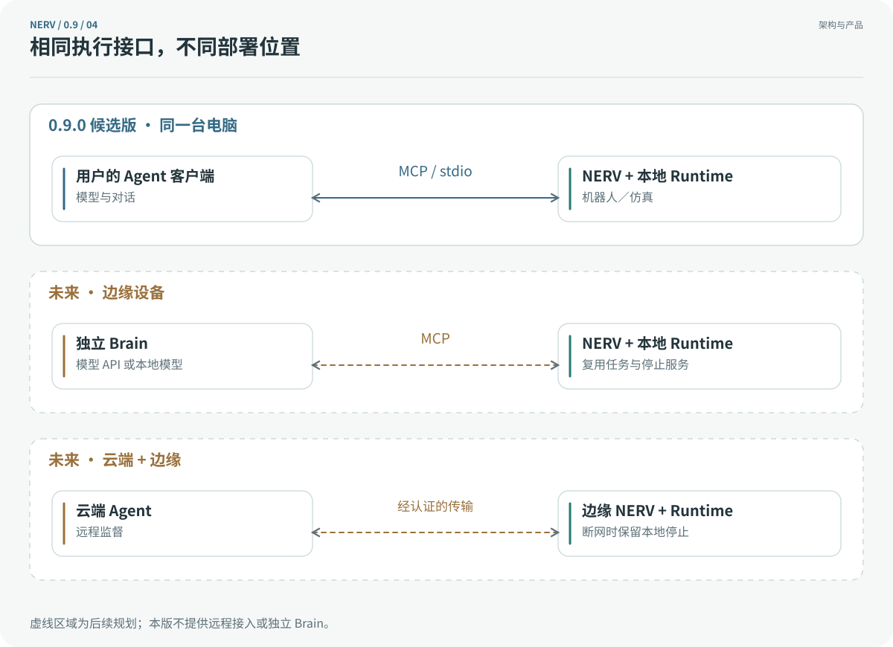

# 架构与控制

[English](../../guides/architecture.md) · [NERV](README.md) · [MCP 接入](mcp.md)

NERV 0.9.0 是面向 Agent 的机器人平台本地验收候选版。外部 Agent 管理对话和模型上下文，NERV 管理项目、任务授权、本地执行与停止。可选机器人决策服务继续保留，不恢复另一套普通聊天产品。

## 职责与进程边界

交互层、决策层和执行层表示职责，不要求三个模型同时存在。外部 Agent 可以选择有限动作或技能，也可以监督使用托管机器人决策服务的任务。ACT 与运动策略通过兼容执行器在本地运行；Host 不导入 LeRobot，也不加载策略张量。

公开的 Host MCP 服务与内部 Runtime 节点接口分开。配对记录客户端、渠道和允许访问的项目。网页、CLI 和 MCP 使用同一套 Project 与任务服务。Agent 工具不提供通用命令执行、安装、凭据读取或动作授权入口。

独立 Runtime SDK 定义发现、准备、观测和执行生命周期。Provider 的导入与描述不能产生设备或 GPU 副作用。准备、加载策略、启用动作、停止、紧急停止、断开和卸力是独立操作。SO-101 用一个原生 LeRobot 实例和共享调度器执行 ACT 与有限动作，详见 [Runtime SDK](../../packages/nerv-runtime-sdk/README.md) 和[控制方案](../../guides/control-schemes.md)。

## 持久身份与修订

Project 保存配置与布局，Run 标识世界或设备实例，Task 锁定目标、方案、能力集合和控制权代次，Execution 记录一次策略或动作尝试。每个项目至多一个活动 Run 和一个受控机器人。设备或世界已被占用时拒绝冲突启动，不隐式抢占。

重新打开配置不会连接电机或恢复运动授权。仍有效的活动 Run 可以重新附着；Host 重启后，未完成工作标记为中断。项目修改生成修订，任务更新推进版本，并在替换前停止旧执行。旧 Run、旧观测或旧控制权代次发来的迟到动作会被拒绝。

项目和历史记录存入 `NERV_HOME` 当前渠道。官方资产与权重使用不可变引用，本地训练导出与标定文件仍为外部只读引用。正式和预览渠道不共享可变项目状态。

迁移将机器人会话转换为 Project 与历史记录，保留原标识并保存恢复快照，纯聊天归档。重复迁移不会新增重复项目，也不重放动作。回滚旧程序时应使用其对应的数据快照。

## 观测、监督与停止

观测包含传感器帧、采集元数据和实例身份，网关记录交付与回执确认。确认是客户端声明，不代表模型理解。任务轮询和传输心跳不会续期监督。动作由声明的观测时效和监督期限约束；缺少契约时，不开放不受支持的控制。

外部视觉控制执行有限动作后重新观察，不承担高频伺服。ACT 在本地 Runtime 推理，外部 Agent 持续监督。监督过期处理独立于模型响应速度；浏览器仅为操作者任务续期，不替外部 Agent 续期。

接管先撤销外部权限，再取消执行。只有停止确认后才开放人工控制，无法确认时明确显示。人工控制期间 Agent 可以继续观察；交还运动控制权需要操作者确认。不同机器人的失联行为由适配器定义，不能统一采用卸力。

## 工作台与总控制台

应用外层维持任务状态和监督，打开控制台覆盖层时世界视图保持挂载。窄工具条打开临时控制面板，监视框保留画面宽高比并保存位置。操作者第三人称视图和仿真真值与 Agent 的传感器权限分开。

活动气泡标明来源，区分 Agent 说明与执行反馈。气泡是 DOM 展示层，不进入原始相机图像。浮动显示数量有限，历史视图保留更多事件，不自动同步外部完整聊天。

## 能力与环境边界

机器人语义属于适配器、family 和版本化注册项。世界自己的构建器与 schema 决定仿真修改。Host 按能力声明组织调用，不包含关节顺序或场景业务逻辑。Real 拒绝修改世界；改变世界拓扑需要新实例，并使旧动作授权失效。

能力目录为 VLA、WAM、传统规划与跨环境项目类型留出接口，不把它们展示成可运行功能。Go2 缺少完整部署契约，运动仍受阻。张量维度相同不足以证明兼容。

托管 Python 环境在 `.nerv` 下隔离不同依赖，构建产物保存在源码目录之外。资源和策略修订与环境版本分别更新，使用租约保护正在引用的安装。详见[环境管理](../../guides/environments.md)、[资产](../../guides/assets.md)和[策略发布](../../guides/policy-publishing.md)。

## 后续部署方式

独立 Brain 可以管理 API 凭据、上下文、调度与费用，作为普通 MCP 客户端使用 NERV。它需要经过相同的任务与授权路径，重连后读取实际状态，不重放动作。远程监督还需带认证的加密传输、设备注册和连接管理，本版均不交付。

[图示源文件](../../assets/readme/diagrams/README.md) 可编辑、可重新生成。早期[节点拓扑](../../assets/readme/images/structure.svg)和[技能时序](../../assets/readme/images/flow.svg)仅保留作历史参考，不代表当前公开 Agent 契约。
