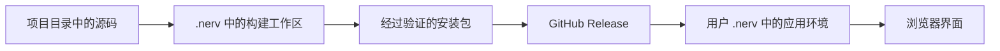

# 开发目录与安装环境

开发时在项目的 Git 仓库里修改源码。用户安装时下载构建好的软件包，安装到用户主目录下的
`.nerv`。源码仓库和安装目录各有用途，更新软件不需要移动开发仓库。

| 位置 | 保存的内容 | 谁使用 |
|---|---|---|
| 开发者的 NERV 项目目录 | 源码、测试、文档和 Git 历史 | 开发者 |
| `.nerv/toolchains` | 构建使用的 Python、Node.js 等工具 | NERV 构建命令 |
| `.nerv/builds` | 源码快照、前端构建依赖、构建结果 | NERV 构建命令 |
| `.nerv/envs` | 主程序、机器人 Runtime 和仿真的独立 Python 环境 | 安装后的 NERV |
| `.nerv` 下的用户数据目录 | 配置、密钥、会话和设备档案 | 当前用户 |

Node.js 是构建网页的程序，不是安装位置。前端构建完成后，普通用户直接打开网页使用，
不需要安装源码仓库、运行 npm 或手动激活虚拟环境。

提交和推送保存源码，构建生成安装包，安装命令选择本机要运行的版本。修改源码后，
已经安装的软件不会立即改变；需要构建并安装新的预览版，才能在预览界面里验收。

## Python 环境如何隔离

NERV 使用 uv 管理标准 Python 虚拟环境，关闭系统 site-packages。主程序、LeRobot
Runtime 和仿真依赖按兼容性分别安装。ACT 使用兼容的 Runtime 环境，不为每个权重重复
创建环境。模型训练和课程 LeRobot 环境保留原样。

启动器通过明确的 Python 路径运行应用；用户不需要执行 activate。NERV 不往系统 Python、
Conda 或其他项目的虚拟环境里安装包。已有训练模型和标定文件仍从原目录只读引用。

虚拟环境隔离 Python 依赖，并不隔离硬件和操作系统权限。串口、相机、显卡及端口仍由
本机程序共享；连接设备前需要确认没有其他程序占用。NERV 不自动改系统权限或显卡驱动。

## 正式版与预览版

0.8.5 开发实现使用 `.nerv/profiles/preview` 保存预览版的配置、密钥、会话和个人资产。
安装文件及兼容的依赖环境统一由 `.nerv` 管理，可复用已校验文件。两个渠道不自动同步
模型配置；显式复制一次之后，各自保存后续修改。

新的 `nerv preview` 命令启动已安装的预览版，默认端口为 8100。正式版使用 `nerv`，
默认端口为 8170。这套新命令需要新版主程序，公开的 0.8.1 尚不提供完整的 0.8.5 流程。

`NERV_HOME` 选择用户数据位置；`NERV_STORAGE_HOME` 可指定共用安装存储位置。
实际路径以“设置 → 系统与安装”及组件的“安装位置”为准。不要直接移动虚拟环境，
其中的解释器链接和启动脚本可能记录绝对路径。

## 构建与清理

开发命令 `nerv preview build --source <源码目录>` 将已纳入 Git 的文件复制到受管理
构建工作区，排除凭据、用户数据和旧依赖目录。它生成候选包，不会自动替换正在运行的版本。

旧环境清理前需要确认所有权、运行占用及回滚用途，并验证备份可以恢复。开发源码、
用户资料、外部模型、标定和其他项目环境不属于旧依赖清理范围。不要直接删除整个 `.nerv`。

完整的英文说明见 [Environments and local storage](../../../guides/environments.md)。
